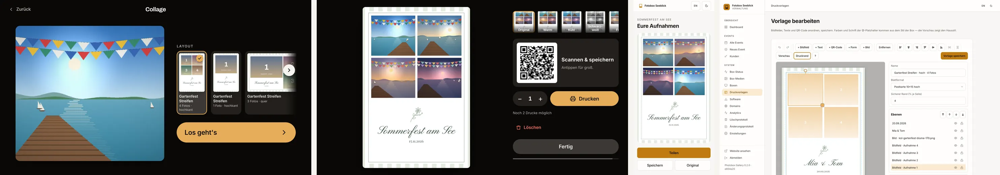

# Photobox Gallery

Photo booth software you own: the booth program for a Windows PC with a camera
and a photo printer, the online gallery where guests find their pictures, and
the sync between them. One repository, three parts, no vendor cloud, no
subscription, no AI processing of photos and no face recognition.

**Open source and MCP-native.** All code is AGPL-3.0 and complete in this
repository; money is made with operation (managed hosting, set-up, support),
not with a closed feature set. The gallery has a built-in [MCP](https://modelcontextprotocol.io/)
server with 81 tools, so an AI assistant of your choice (Claude, or any
client that speaks MCP with OAuth) can run an event from a chat: look at the
booths, read their errors and queues, set up a gallery, change booth
settings, send a test print — limited to the rights you tick, destructive
actions only in two steps, secrets written in but never read back out
([docs/MCP.md](docs/MCP.md)).



<sub>Screenshots of the real program. The photos in them are drawn demo
scenes, not guests; `tools/marketing_shots.mjs` takes them again.</sub>

> **Status: beta, version 0.9.2 — the first public beta.** Developed and
> tested on the author's own booth (Canon EOS M50, Canon SELPHY CP1300,
> Windows 11). The Windows setup is **not code-signed yet**.
> One version number for all three parts — see [`VERSION`](VERSION) and the
> [`CHANGELOG`](CHANGELOG.md). Product page and documentation:
> [photobox-gallery.com](https://photobox-gallery.com/) — docs in German at
> [/doku/](https://photobox-gallery.com/doku/), in English at
> [/en/docs/](https://photobox-gallery.com/en/docs/).

**Kurz auf Deutsch:** Photobox Gallery ist eine freie Fotobox-Software
(AGPL-3.0): das Box-Programm für einen Windows-Rechner mit Kamera und
Fotodrucker, die Online-Galerie für die Gäste und der Abgleich dazwischen.
Kein Abo, keine fremde Cloud, keine Gesichtserkennung. Über die eingebaute
MCP-Schnittstelle kann ein KI-Assistent die Galerie und die Boxen bedienen —
nur mit den Rechten, die du freigibst. Status: Beta, Setup noch nicht
signiert. Anleitung auf Deutsch: [photobox-gallery.com/doku](https://photobox-gallery.com/doku/).

## What this is

| Part | What it does | Runs on |
|---|---|---|
| **Gallery** (`app/`) | Event galleries with QR codes, guest upload, share links, moderation, expiry, branding, template library and editor, layouts per event, remote management of booths | a small VPS (Flask, SQLite) |
| **Booth** (`booth/`) | The booth itself: camera, countdown, photo/collage/GIF/boomerang/video, filters, greenscreen, printing with a queue on disk, e-mail, QR | the booth PC (Windows 10/11; from source also Linux and macOS) |
| **Sync** (`sync/`) | Offline-first upload queue to the gallery, a NAS, FTPS or a local folder | wherever the pictures are — also next to other booth software |

The booth runs standalone if you want it to. The gallery is optional, and so is
the internet: everything a guest experiences at the booth works offline, and
whatever could not be uploaded is caught up later.

## The model

All code is AGPL and complete in the repository, for everyone: no licence
keys, no feature held back for a paid version. Money is made with operation,
not with a closed feature set: the maintainer offers galleries and booths as a
managed service (hosting, updates, set-up, support). The Windows download is
free of charge in two editions (see [Download](#download-windows)). Details
under [Licence](#licence).

If the program is useful to you, you can support the project voluntarily:
[Support the project (PayPal)](https://www.paypal.com/ncp/payment/54FPXDFBMP5TJ).
It buys nothing extra — every feature is in the free download.

## Known limits

* **The booth is built for Windows.** The setup, its own window and the
  watchdog exist for Windows 10/11. On Linux and macOS it runs from source,
  for trying out; that is not tested for events.
* **The Canon EDSDK is never part of this repository, of a GitHub release or
  of a CI build.** For a Canon EOS camera over USB, take the edition with
  camera SDK from the project website (free of charge, works with Canon EOS
  cameras out of the box), or bring the SDK yourself from Canon's developer
  programme and point the free edition at it (`--install-edsdk`). Without the
  SDK: digiCamControl, a webcam, a tethering folder, or Canon over Wi-Fi
  (CCAPI, not tested by the author).
* **The setup is not code-signed yet**, so Windows SmartScreen warns about an
  unknown publisher. Compare the checksums first. Code signing, once active,
  covers the free edition only; the edition with camera SDK stays unsigned.
* **Updates are not signed yet.** A booth checks a new version against a
  SHA-256 the gallery sends and refuses older versions, not against a
  signature: whoever controls the gallery's admin can ship code to its booths
  ([`SECURITY.md`](SECURITY.md), open item S-4).
* **Beta.** Version 0.9.2; behaviour and settings can still change between
  versions (the [CHANGELOG](CHANGELOG.md) says when to update booths first).
* **Tested on real hardware** (15.11.2026, i5-6200U, Windows 11): Canon EOS M50
  over the EDSDK, Canon SELPHY CP1300 with Canon's driver, autostart; since
  then endurance runs on the same device. Other cameras and printers are
  supported by the code but not tested by the author. Not yet:
  touchscreen, flash, pairing with a gallery, FTP target. Everything else is
  tested with the mock camera only — see
  [docs/WINDOWS-INSTALLATION.md](docs/WINDOWS-INSTALLATION.md) (German).

## Screenshots

In `docs/screenshots/`, taken from the running program with
`node tools/marketing_shots.mjs` (how: [website/README.md](website/README.md)).
The camera in them is a stand-in that draws a lakeside scene; no guest is in
any picture.

- `strip.webp` — the four pictures at the top of this page
- `booth-start.webp` — the kiosk start screen
- `booth-layouts.webp` — choosing a collage layout, shown as the printed sheet
- `booth-countdown.webp` — the countdown over the live picture
- `booth-result.webp` — the result with filters, QR code and print button
- `gallery-phone.webp` — a run on a guest's phone, opened from the QR code
- `admin-layouts.webp` — "Layouts für dieses Event" in the gallery admin
- `admin-template-editor.webp` — the print template editor
- `print-sheet.webp` — a sheet the booth composed with a library template

## Why it exists

Many booth products are rented per machine or per year and keep the gallery on
the vendor's servers. This does the same job on hardware you own, with a
gallery you host yourself, under a licence that keeps it that way.

Deliberately **not** in the product: face recognition, "AI enhancement",
stickers, anything that needs an account or a paid API. The gallery knows which
run belongs to which guest because they pressed the button at the booth — not
because a model looked at their face. Filters are maths (LUTs, tone curves),
not models. What exists: an optional MCP access through which an AI assistant
of the operator's choosing can *administer* the gallery — off until the
operator creates an access, limited to the rights ticked for it
([`docs/MCP.md`](docs/MCP.md)). No photo is analysed by a model.
Print templates are plain JSON; one file explains the format well enough
for any assistant to write them: [`docs/VORLAGEN-FORMAT-FUER-KI.md`](docs/VORLAGEN-FORMAT-FUER-KI.md)
(English: [`docs/TEMPLATE-FORMAT-FOR-AI.md`](docs/TEMPLATE-FORMAT-FOR-AI.md)).

## Quick start (development)

```bash
git clone https://github.com/tillheidrich/photobox-gallery.git
cd photobox-gallery
python -m venv .venv && . .venv/bin/activate      # Windows: .venv\Scripts\activate
pip install -r requirements.txt -c constraints.txt                    # gallery
(cd booth && pip install -r requirements.txt -c ../constraints.txt)   # booth, with the sync package

python run.py                                      # gallery on http://127.0.0.1:5000
```

In a second terminal (same virtual environment):

```bash
cd booth && BOOTH_CAMERA=mock python -m boothcore  # booth on http://127.0.0.1:8765
```

`BOOTH_CAMERA=mock` gives you a fake camera, so the whole booth flow works on a
laptop without any hardware. The booth is installed from its own folder because
`booth/requirements.txt` says `-e ../sync`, and pip resolves that against the
working directory, not against the file.

`constraints.txt` pins every package to the version the test suites last
passed with; the `>=` floors in the requirements files stay as they are. Leave
`-c …constraints.txt` out if you deliberately want the newest versions.

On first start the gallery prints a one-time admin password in its log (look
for "Erste Anmeldung"). On macOS, port 5000 belongs to the AirPlay Receiver;
start the gallery with `flask --app run:app run --port 5050` instead.

Checked on 11.11.2026 in a fresh virtual environment on macOS (Python 3.14):
both installs, the gallery (`/healthz`, `/ueber`) and the booth with the mock
camera (`/api/about`, kiosk page) come up. Not checked here: Windows, Linux,
and anything with a real camera or printer.

### Tests

Three suites, three roots. All of them must pass before anything is merged:

```bash
python -m pytest tests -q          # gallery
(cd booth && python -m pytest tests -q)
(cd sync  && python -m pytest tests -q)
```

More checks and the CLA steps: [`CONTRIBUTING.md`](CONTRIBUTING.md).

### Windows: setup, booth and sync

`packaging/windows/` builds `PhotoboxBooth.exe` and `PhotoboxSync.exe` with
PyInstaller, and with `-Installer` the setup that contains both.
`PhotoboxBooth.exe --install` then sets up autostart, power settings, a
desktop shortcut and a local firewall rule by itself. See
[`packaging/windows/README.md`](packaging/windows/README.md).

### Originals on a NAS

The gallery can move originals off the server to a NAS (`app/storage.py`):
`ORIGINALS_BACKEND` (`local`, `sftp` or `webdav`) and the `ORIGINALS_SFTP_*` or
`ORIGINALS_WEBDAV_*` variables. In `docker-compose.yml` **both services need
the same values**: `pruner` moves the originals to the NAS, `web` streams them
back when a guest downloads one. With the variables only on `pruner`, a
download of an offloaded original answers 503. Put the values in `.env` next
to the compose file, never into the compose file itself.

## Run the gallery with Docker

`docker-compose.yml` builds the gallery from this source (there is no
prebuilt image) and starts two services: `web` and `pruner` (moves originals
to a NAS if you configure one). Data lives in `./data`.

```bash
cp .env.example .env     # set SECRET_KEY and BASE_URL (your public address); TRUST_PROXY=1 only behind a reverse proxy
docker compose up -d --build
docker compose logs web  # the one-time admin password ("Erste Anmeldung")
```

`web` listens on `127.0.0.1:5000` only (`PORT` changes it): put a reverse proxy
with TLS in front of it. For a NAS in the home network use
`docker-compose.nas.yml` instead; step by step (German):
[docs/INSTALL-NAS.md](docs/INSTALL-NAS.md).

## Download (Windows)

Two editions, both free of charge, the same program:

* **Edition with camera SDK** — only on the project website,
  [photobox-gallery.com](https://photobox-gallery.com/): the program plus the
  runtime libraries of the Canon EOS Digital SDK, so a Canon EOS camera works
  without an extra step. Offered only as a setup:
  `Photobox-Setup-<version>-mit-Kamera-SDK.exe`, checksum in
  `SHA256SUMS-mit-Kamera-SDK.txt`, notices in
  `THIRD-PARTY-NOTICES-mit-Kamera-SDK.txt`; there is no portable program with
  the camera SDK. A silent installation needs `/ACCEPTSDKTERMS=1`. Canon's
  files in it are proprietary, not under the AGPL, and come with end-user terms of their own (shown by the
  setup, and in `CAMERA-SDK-LICENCE.txt` next to the program). Not
  code-signed. Built by the maintainer outside this repository and outside
  CI.
* **Free edition** — built from this repository alone, attached to the
  GitHub releases, no file of Canon's SDK. For a Canon camera over USB, bring
  the SDK yourself (`--install-edsdk`) or use a webcam or Wi-Fi camera.

The free edition has three files per release, each with the version in its
name, plus `SHA256SUMS.txt` listing exactly these three:

| File | What it is |
|---|---|
| `Photobox-Setup-<version>.exe` | the setup: the booth **and** the sync program, Start menu, start at logon |
| `PhotoboxBooth-<version>.exe` | the booth alone, a single file |
| `PhotoboxSync-<version>.exe` | the sync alone, for a PC that runs other booth software |

For Windows 10/11 (64-bit). Compare the checksum before running a file
(`Get-FileHash .\Photobox-Setup-<version>.exe -Algorithm SHA256`). Until the
files are code-signed, Windows SmartScreen warns about an unknown publisher:
"More info → Run anyway". The setup installs the program, a start at logon and
the Start menu entries; photos and settings stay in
`%LOCALAPPDATA%\PhotoboxBooth` and survive updates and uninstalling. The
free edition contains no file of the Canon EDSDK — see "Known limits". Details
(German): [docs/INSTALLER.md](docs/INSTALLER.md), privacy for operators:
[docs/PRIVACY-BOOTH.md](docs/PRIVACY-BOOTH.md). Releases appear on the
repository's Releases page; you can always build the files yourself
(`packaging/windows/`).

Voluntary support, if you like the program:
[Support the project (PayPal)](https://www.paypal.com/ncp/payment/54FPXDFBMP5TJ).

## Code signing policy

Free code signing through the SignPath Foundation is being prepared and is
**not active yet: the current Windows files are unsigned.** Signed releases
will carry the line "Free code signing provided by
[SignPath.io](https://about.signpath.io), certificate by
[SignPath Foundation](https://signpath.org)". Only the free edition, built by
`.github/workflows/windows-release.yml` from this repository, is ever signed;
the edition with camera SDK never is. Roles (author, reviewer and approver: Till
Heidrich), privacy and uninstalling:
[`docs/CODE-SIGNING-POLICY.md`](docs/CODE-SIGNING-POLICY.md) and
[photobox-gallery.com/en/code-signing-policy](https://photobox-gallery.com/en/code-signing-policy/)
(German: [/code-signing-policy/](https://photobox-gallery.com/code-signing-policy/)).

## Contributing — humans and agents

Contributions are welcome, including from AI coding agents. Read
[`AGENTS.md`](AGENTS.md) first: it is the shortest path from "I have this repo"
to "my change is correct here". [`CONTRIBUTING.md`](CONTRIBUTING.md) covers the
process, [`SECURITY.md`](SECURITY.md) how to report a vulnerability.

Branches: `main` is the release branch (releases are cut from it);
`ecosystem` is the integration branch where changes and fixes land first.
Open pull requests against `ecosystem`.

Two rules that save everyone time:

1. **Never commit the Canon EDSDK.** It is Canon's proprietary SDK. The
   booth loads the libraries from a folder the operator provides, or from the
   edition with camera SDK, which is built outside this repository.
2. **No secrets in the repo.** Credentials live in environment variables and in
   the operator's own configuration.

## Who makes this

Photobox is written and maintained by Till Heidrich,
[Heidrich Digital](https://heidrich-digital.de). Project site and
documentation: [photobox-gallery.com](https://photobox-gallery.com).

## Licence

[AGPL-3.0-or-later](LICENSE), with one additional permission under section 7
of the AGPL for the Canon EDSDK: [`LICENSE-EXCEPTION`](LICENSE-EXCEPTION). You
may run, modify and distribute this. If you run a modified version as a network
service, your users get the right to its source — which is why the gallery
links its own source from the About page.

This repository is the whole program; no feature is held back:

* **The source is complete.** Everything the booth, the gallery and the sync
  do is in here and builds from here (`packaging/windows/`, `packaging/macos/`).
* **The Canon EDSDK is never part of this repository, of its public mirror,
  of a CI build or of a GitHub release.** It is Canon's proprietary SDK. The
  edition with camera SDK on the project website carries its runtime
  libraries unmodified, in object code only, solely for use with Canon
  cameras. **Those files are not under the AGPL**; they come with end-user
  terms of their own (`CAMERA-SDK-LICENCE.txt`). The permission in
  `LICENSE-EXCEPTION` makes the combination AGPL-clean; it grants no rights
  to Canon's files. With the free edition you bring the SDK yourself
  (`--install-edsdk`); other camera paths (gphoto2, digiCamControl, a hot
  folder, a webcam) need nothing from Canon.
* **Money is made with operation, not with a closed feature set.** All code is
  AGPL and complete here. The maintainer offers to run galleries and booths for
  others as a managed service: hosting, updates, set-up, support. That is a
  service around the software; anyone else may offer the same under the same
  licence. Both Windows editions are free of charge; support is voluntary
  ([PayPal](https://www.paypal.com/ncp/payment/54FPXDFBMP5TJ)).

Contributions come with [`CLA.md`](CLA.md): you keep your copyright, this
repository stays AGPL, and the maintainer holds the rights needed to keep the
licence situation clean: for example to grant the Canon SDK permission, or to
add a licence exception or change licence terms if a legal question ever
forces it. [`CLA.md`](CLA.md) says why, in plain words.
