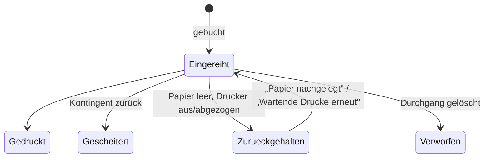

# Geschäftslogik 5 — Druckkontingente, Papier und die alte Lizenzschranke

> Read out of the code on 2026-11-11 · `ecosystem` @ `1fd8505` · kind: allowances and billing.
> Copy of the maintainer's wiki page of the same name (not public),
> German as written. Line numbers refer to `1fd8505`. Gaps C1 and D3 described
> here have been worked on since — see [`../../index.md`](../../index.md)
> before relying on sections 8 and 10.

Geld bewegt die Software nicht. Was sie begrenzt, sind **Abzüge** — und Abzüge sind das, was eine Vermietung kostet: Papier, Folie, Zeit in der Schlange. Deshalb steht diese Seite dort, wo bei anderen Programmen „Abrechnung" steht. Der zweite Teil beschreibt eine Schranke, die es nach dem eigenen Geschäftsmodell nicht geben dürfte.

## 1. Zweck

Die Box druckt so viel, wie der Betreiber erlaubt — je Druckvorgang, je Durchgang, je Event —, sagt dem Gast vorher, wie lange er wartet, und warnt, bevor das Papier ausgeht. Die Zähler leben an der Box, nicht in der Galerie: Gedruckt wird auch ohne Netz.

## 2. Beteiligte

* **Gast** — druckt am Ergebnisbildschirm oder aus der Kiosk-Galerie nach.
* **Betreiber** — setzt die Grenzen im Profil, wechselt Papier, setzt Zähler zurück (vor Ort oder per Auftrag).
* **Bedienperson** — druckt per Zifferntaste 1 bis 9 nach.
* **Drucker** — einer oder mehrere, mit Lastverteilung oder Ausweichen.

## 3. Voraussetzungen

* Drucken ist im Profil erlaubt und ein Druckweg ist eingerichtet.
* Zum Durchgang gibt es eine Druckdatei (nicht bei Video und Boomerang).
* Der Drucker meldet weder „nicht erreichbar" noch „Fehler".

## 4. Ablauf

1. **Erlaubnis berechnen.** Rest je Event = Grenze minus alle Abzüge des Events. Rest je Durchgang = Grenze minus Abzüge dieses Durchgangs. Erlaubt ist das Kleinste aus „Kopien je Druck", Rest je Event und Rest je Durchgang.
2. **Wartezeit nennen.** Aufträge in der Schlange mal Sekunden je Blatt (Voreinstellung 47 für den SELPHY CP1300).
3. **Einreihen.** Das Blatt wird für das Papierformat aufbereitet und auf Wunsch nachgeschärft.
4. **Buchen.** Der Zähler steigt beim Einreihen, nicht beim fertigen Druck.
5. **Scheitert der Druck:** Kontingent zurück. Im datensparsamen Betrieb wird der Durchgang dann sofort gelöscht.
6. **Druck fertig:** Meldung an Erweiterungen und Webhooks; im datensparsamen Betrieb wird gelöscht.

## 5. Regeln

| Wenn | Dann |
|------|------|
| Drucken abgeschaltet oder kein Druckweg | „Drucken nicht möglich" (403) |
| Nachdruck aus der Kiosk-Galerie abgeschaltet | Abgelehnt (403) — die Box sagt nein, der Knopf ist nicht nur ausgegraut |
| Drucker nicht erreichbar oder im Fehler | Abgelehnt (503) |
| Gewünschte Kopien über dem Erlaubten | Abgelehnt (409) |
| Grenze 0 | Unbegrenzt |
| Durchgang gelöscht | Seine Abzüge zählen für das Event weiter — löschen und neu aufnehmen umgeht die Grenze nicht |
| Papier nachgelegt (Knopf oder Auftrag `paper_changed`) | Blattzähler dieses Druckers beginnt von vorn |
| Drucker meldet seinen Vorrat selbst | Diese Zahl gilt; sonst die gezählte; sonst „unbekannt" — nie eine erfundene |

Voreinstellungen: höchstens 2 Kopien je Druck, höchstens 2 Abzüge je Durchgang, je Event unbegrenzt, automatischer Druck aus, Nachdruck aus der Kiosk-Galerie an.

## 6. Zustände eines Druckauftrags

Die Zustände „zurückgehalten" und „verworfen" entnehme ich den Auftragsnamen (`release_prints`) und dem Löschweg (`drop_session`); die Druckwarteschlange selbst (`printing/service.py`, `spool.py`) habe ich nicht gelesen.

## 7. Wann gebucht und wann erstattet wird

| Ereignis | Wirkung auf das Kontingent |
|----------|----------------------------|
| Druck eingereiht | belastet sofort |
| Druck gescheitert | zurück |
| Druck fertig | bleibt belastet |
| Automatischer Druck nach dem Fertigstellen | belastet wie jeder andere; läuft bei „Nochmal" nicht erneut |
| Durchgang gelöscht, Druck noch in der Schlange | Auftrag verworfen; ob das Kontingent zurückkommt, habe ich nicht gelesen |
| Zähler zurückgesetzt (Auftrag) | Druckzähler auf null |

## 8. Ausnahmen und Randfälle

* **Prüfen und Buchen sind zwei Schritte ohne Sperre dazwischen.** Zwei gleichzeitige Aufträge — Doppeltipp, oder Ergebnisbildschirm und Kiosk-Galerie — können beide die Prüfung bestehen und zusammen die Grenze überschreiten (Lücke D3, gelesen, nicht ausgelöst).
* **Zwei Zählweisen für das Papier:** je Drucker (genauer, wenn das Modell eingetragen ist) und ein Wert für die ganze Box. Die ältere Rechnung (`media_left`) nimmt den Rest einer Division; nach genau einer vollen Kassette zeigt sie „voll" statt „leer". Ob sie noch angezeigt wird, habe ich nicht verfolgt.

## 9. Was gelesen und geschrieben wird

**Geschrieben:** Druckzähler je Durchgang in der Bibliothek der Box, Blattzähler je Drucker, Druckwarteschlange, Meldungen („Papier rechnerisch alle"). **Gelesen:** Profil (`print`), Zustand der Drucker, Bibliothek.

## 10. Die alte Lizenzschranke

`app/license.py` stammt aus der Fassung vor dem Ökosystem. Es prüft einen signierten Schlüssel mit vier Merkmalen: unbegrenzte Geräte, Vorlagen, Auswertung, White-Label. Ohne Schlüssel gilt „Starter": ein Gerät, keine Auswertung.

**Was davon heute wirkt:** genau eine Stelle. Die Übersichtsseite „Analytics" zeigt ohne Schlüssel „Analytics im Pro-Plan — jetzt upgraden". Die Auswertung je Event und je Box daneben ist offen. Das Gerätelimit wird nirgends geprüft, die Merkmale „Vorlagen" und „White-Label" ebenfalls nicht.

**Warum das nicht bleiben kann:** Der Beschluss vom 18.09. lautet „Nichts in der Kaufversion fehlt im Repo", die Lizenz ist AGPL, und die Produktseite sagt „keine Lizenz je Rechner". Eine Bezahlschranke im offenen Quelltext ist außerdem wirkungslos: Fehlt der eigene Signaturschlüssel in der Umgebung, signiert das Modul mit dem Sitzungsschlüssel der Installation — wer die Installation betreibt, kann sich den Schlüssel selbst ausstellen.

**Nachtrag 11.11.2026:** Eine Kaufversion gibt es nicht mehr. Der Quelltext ist AGPL und vollständig, das Canon-SDK liefert niemand mit (Zusatzerlaubnis in `LICENSE-EXCEPTION`), Geld kommt nur aus dem Betrieb als Managed Service. Der Grund oben gilt damit umso mehr.

## 11. Fundstellen

| Was | Wo |
|-----|----|
| Erlaubnis berechnen, Wartezeit | `booth/boothcore/app.py:983–1000` |
| Blattvorrat, beide Zählweisen | `booth/boothcore/app.py:479–508`, `1002–1015` |
| Drucken: prüfen, einreihen, buchen | `booth/boothcore/app.py:1413–1432` |
| Gescheitert und gedruckt | `booth/boothcore/app.py:1434–1452` |
| Zähler in der Bibliothek | `booth/boothcore/library.py` (`add_prints`, `event_prints`) |
| Voreinstellungen | `app/ecosystem.py:276–292` |
| Druckwarteschlange (nicht gelesen) | `booth/boothcore/printing/service.py`, `spool.py` |
| Lizenzmodul | `app/license.py` |
| Die eine wirksame Schranke | `app/blueprints/admin.py:1667–1694`, `app/templates/admin/analytics.html:9–17` |
