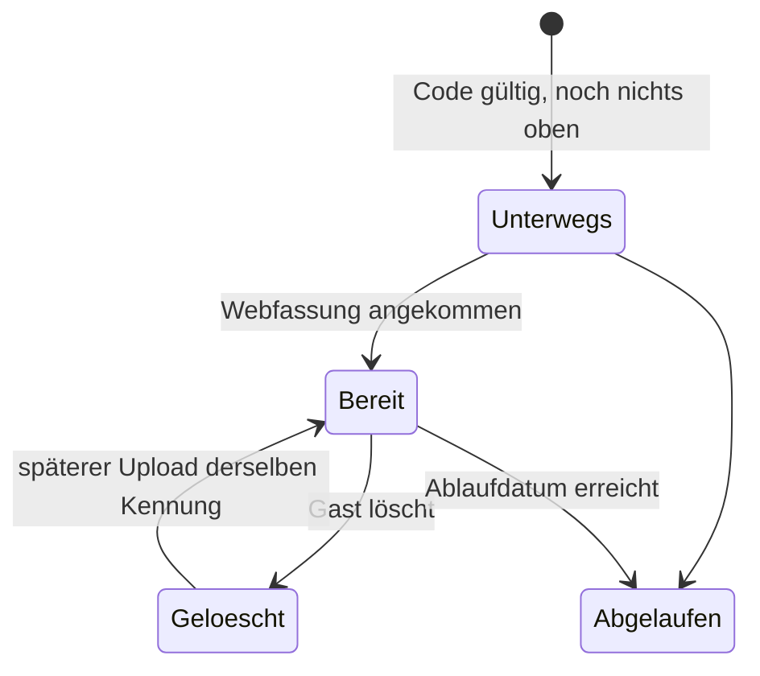

# Geschäftslogik 3 — Die QR-Seite des Durchgangs

> Read out of the code on 2026-11-11 · `ecosystem` @ `1fd8505` · kind: entry point.
> Copy of the maintainer's wiki page of the same name (not public),
> German as written. Line numbers refer to `1fd8505`. Gaps A1, A4 and B4
> described here have been worked on since — see [`../../index.md`](../../index.md)
> before relying on sections 6 and 8.

## 1. Zweck

Der QR-Code auf Bildschirm und Abzug führt den Gast zu genau seinem Durchgang — ohne Konto, ohne App, ohne Gesichtserkennung. Der Code ist der Nachweis: Wer ihn hat, war an der Box. Die Seite antwortet schon, bevor das Bild hochgeladen ist; das ist das Versprechen, auf dem die ganze Bauweise ruht.

## 2. Beteiligte

* **Gast** mit dem QR-Code.
* **Betreiber** — legt je Event fest, wohin der Code führt und ob Gäste selbst löschen dürfen.
* **Box** — hat den Code erzeugt, ohne die Galerie zu fragen.

## 3. Voraussetzungen

* Der Code besteht aus Kennung und Signatur (`kennung-signatur`), die Kennung hat 6 bis 24 Zeichen.
* Die Signatur passt zum Schlüssel eines Events. Gesucht wird zuerst über vorhandene Aufnahmen dieser Kennung, sonst unter den 500 jüngsten Events mit Schlüssel.

## 4. Ablauf

1. **Code prüfen.** Passt die Signatur zu keinem Event: 404.
2. **Stiller Betrieb?** Dann gibt es die Seite für Gäste nicht — auch alte Codes führen ins Leere.
3. **Wohin führt der Code?** Je Event eine von drei Antworten: zur eigenen Galerie (Standard), auf eine fremde Adresse (Weiterleitung, mit Kampagnen-Parametern), oder auf eine Statusseite mit einem Text des Betreibers.
4. **Abgelaufen?** Dann Statusseite „abgelaufen" (410).
5. **Merken.** Der Browser des Gastes darf ab jetzt die Dateien dieses Durchgangs sehen (bis zu 20 Durchgänge je Browser) — das trägt „Meine Aufnahmen".
6. **Zeigen.** Sind sichtbare Aufnahmen da: Bilder und Videos mit Teilen, Speichern, Original. Sind keine da: „Gleich da — dein Foto ist unterwegs", und die Seite fragt alle 3 bis 15 Sekunden nach.
7. **Weiter zur Galerie** — nur, wenn das Event veröffentlicht ist. Gibt das Event sein Passwort im Link mit, reist der Schlüssel mit: Wer an der Box stand, tippt nichts.

**Selbst löschen:** Der Gast löscht seinen Durchgang mit einem Tipp. Dateien, Einträge und ausgelagerte Kopien werden entfernt, das Löschprotokoll vermerkt Anzahl und Größe.

## 5. Regeln

| Wenn | Dann |
|------|------|
| Signatur falsch, Kennung zu kurz oder zu lang | 404 |
| Stiller Betrieb und kein angemeldeter Betreiber | 404 |
| QR-Ziel „fremde Adresse" und Adresse hinterlegt | Weiterleitung |
| QR-Ziel „Statusseite" | Text des Betreibers, keine Bilder |
| Galerie abgelaufen und kein Betreiber | „Abgelaufen", 410 |
| Keine sichtbare Aufnahme | „Unterwegs", Seite fragt nach |
| Event unveröffentlicht | Eigene Aufnahmen ja, Knopf zur Galerie nein |
| Selbst löschen abgeschaltet | 403 |

## 6. Zustände

Der letzte Übergang ist **Lücke A1** und nachgewiesen. Was im Bild fehlt, sind **zwei Zustände, die es geben müsste:** „wartet auf Freigabe" und „abgelehnt". Beide sehen für den Gast heute aus wie „unterwegs" (Lücke A4).

## 7. Geld und Kontingente

Keine.

## 8. Ausnahmen und Randfälle

* **Freigabe eingeschaltet:** Die Aufnahme ist oben, aber versteckt. Der Gast sieht „unterwegs" und wartet auf etwas, das vielleicht nie kommt.
* **Löschen und Statusabfrage** prüfen weder stillen Betrieb noch Ablauf — die Seite selbst prüft beides (Lücke B4).
* **Nach dem Löschen** zeigt ein erneuter Aufruf wieder „unterwegs": Die Seite unterscheidet nicht zwischen „noch nicht da" und „nicht mehr da".
* **Mehr als 500 Events mit Schlüssel:** Für einen Durchgang ohne Aufnahme in einem älteren Event wird der Code nicht mehr gefunden. Für die Praxis belanglos, als Grenze aber nirgends vermerkt.

## 9. Was gelesen und geschrieben wird

**Geschrieben:** Sitzung des Browsers (gemerkte Durchgänge), ein Zähler „Galerie angesehen" mit Quelle `qr-session` oder `qr-pending`, beim Löschen das Löschprotokoll. **Gelesen:** Event, Aufnahmen des Durchgangs, Galerie-Einstellungen, eigene Texte des Events.

## 10. Offene Fragen

* Was soll der Gast lesen, wenn seine Aufnahme auf Freigabe wartet? Wenn sie abgelehnt wurde?
* Was soll er lesen, nachdem er gelöscht hat?
* L4: Die Signatur hat 40 Bit, die Seite hat keine Versuchsbremse. Soll es eine geben?

## 11. Fundstellen

| Was | Wo |
|-----|----|
| QR-Seite | `app/blueprints/booth_v2.py:598–651` |
| Selbst löschen | `app/blueprints/booth_v2.py:654–700` |
| Statusabfrage | `app/blueprints/booth_v2.py:703–708` |
| Signatur, Code zerlegen, Event finden | `app/ecosystem.py:643–683` |
| Sichtbare Aufnahmen eines Durchgangs | `app/ecosystem.py:800–804` |
| Weg in die Galerie mit Schlüssel | `app/blueprints/booth_v2.py:583–595` |
| Nachfragen der Seite | `app/templates/public/session.html:38–46` |
| Stiller Betrieb | `app/silence.py` |
