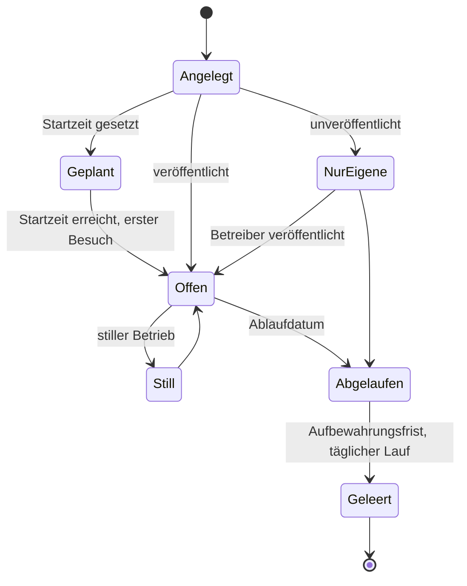

# Geschäftslogik 4 — Sichtbarkeit und Zugang einer Galerie

> Read out of the code on 2026-11-11 · `ecosystem` @ `1fd8505` · kind: life cycle of an event.
> Copy of the maintainer's wiki page of the same name (not public),
> German as written. Line numbers refer to `1fd8505`. Gaps B1, B2 and B4
> described here have been worked on since — see [`../../index.md`](../../index.md)
> before relying on section 8.

## 1. Zweck

Der Betreiber bestimmt je Event, wer die Bilder wann sehen darf: niemand, nur jeder Gast seine eigenen, alle mit der Adresse, alle mit dem Passwort — und bis wann. Sieben Schranken stehen hintereinander; jede kann für sich schließen.

## 2. Beteiligte

* **Gast** — mit Adresse, QR-Code, Passwort oder Freigabe-Link.
* **Betreiber** — angemeldet in der Verwaltung; für ihn gelten die Schranken der Gäste nicht.
* **Kunde des Betreibers** — bekommt einen Freigabe-Link oder stellt eine Zugriffsanfrage.
* **Die Uhr** — schaltet zum geplanten Zeitpunkt frei und lässt ablaufen.

## 3. Voraussetzungen

Das Event existiert. Alles Weitere sind Einstellungen mit sicheren Voreinstellungen: unveröffentlicht, wenn die Box das Event selbst anlegt; kein ZIP für Gäste; Freigabe aus; Selbstlöschen an.

## 4. Ablauf: die Schranken in ihrer Reihenfolge

1. **Alte Adresse?** Wurde die Galerie umbenannt, leitet die alte Adresse dauerhaft weiter. Gedruckte Codes bleiben gültig.
2. **Zeitplan.** Liegt der geplante Start in der Zukunft, sehen Gäste eine Vorfreude-Seite mit Countdown. Ist er erreicht, schaltet der erste Besucher die Galerie frei — ein eigener Dienst dafür ist nicht nötig.
3. **Veröffentlicht?** Wenn nicht: 404. Die QR-Seite des einzelnen Durchgangs funktioniert trotzdem.
4. **Stiller Betrieb?** Global oder je Event; der strengere gewinnt. Dann 404, auch mit Passwort.
5. **Schlüssel im Link?** Stimmt er, ist der Browser für dieses Event freigeschaltet. Diese Prüfung steht bewusst vor dem Passwort.
6. **Passwort.** Ohne Freischaltung erscheint das Passwortfeld — auf Wunsch mit dem Knopf „Zugriff anfragen".
7. **Abgelaufen?** Dann Statusseite (410).

Danach erst: Darstellung, Abstimmungsmodus, Downloads, ZIP — jeweils mit eigenem Schalter.

## 5. Regeln

| Wenn | Dann |
|------|------|
| Betreiber angemeldet | Zeitplan, Veröffentlichung, Stille, Passwort, Ablauf gelten für ihn nicht |
| Event von der Box angelegt, Wahl „Nur die eigenen" | Unveröffentlicht; jeder Gast sieht seinen Durchgang, eine gemeinsame Galerie gibt es nicht |
| Stiller Betrieb global an | Lässt sich je Event nicht wieder öffnen — das ist der Notaus |
| Passwort gesetzt und „Passwort reist im Link mit" | QR-Code, Sharepic und Druckseite tragen einen Schlüssel — aber nur für den, der schon drin ist. Wer anonym das QR-Bild abruft, bekommt die nackte Adresse |
| Zugriffsanfrage | Höchstens fünf je Stunde und Adresse; der Betreiber gewährt oder lehnt ab; Anfragen werden nach 90 Tagen gelöscht |
| Freigabe-Link mit Kennwort | Zehn Fehlversuche in 15 Minuten, dann Pause |
| Modus-PIN (Abstimmung) | Dieselbe Bremse |
| Gäste-ZIP | Nur wenn je Event erlaubt oder global für Gäste freigegeben |
| Aufnahme wartet auf Freigabe | Nicht in Listen, nicht einzeln abrufbar — auch nicht über die Nummer |
| Ablauf in den letzten sieben Tagen | Gäste sehen „noch n Tage verfügbar" |

## 6. Zustände

„Abgelaufen" (Gäste sehen nichts mehr) und „Geleert" (Dateien sind weg) sind zwei Fristen mit zwei Mechanismen. Die erste wirkt beim Aufruf, die zweite nur, wenn der tägliche Wartungslauf eingerichtet ist.

## 7. Geld und Kontingente

Keine. Eigene Domains je Event (`event_domains`) sind technisch vorhanden und werden erst wirksam, wenn die Prüfung bestätigt, dass die Domain wirklich hierher zeigt.

## 8. Ausnahmen und Randfälle

* **Anmeldung der Verwaltung:** Passwort, wahlweise zweiter Faktor, Wiederherstellungscode. Ein benutzter Code des zweiten Faktors gilt kein zweites Mal. **Eine Bremse für Fehlversuche gibt es nicht** (Lücke B1).
* **Galerie-Passwort: ebenfalls ohne Bremse** (Lücke B2) — obwohl dieselbe Datei die Bremse für die Modus-PIN und die Zugriffsanfrage benutzt.
* **Schlüssel im Link:** steht in der Adresszeile und damit in Verlauf, Weiterleitungen und Besucherstatistik (Lücke L2, zu prüfen).
* **Stiller Betrieb auf Nebenwegen:** Die QR-Seite prüft ihn, ihr Löschen und ihre Statusabfrage nicht (Lücke B4).

## 9. Was gelesen und geschrieben wird

**Geschrieben:** Freischaltung in der Sitzung des Browsers, `published` und `status` beim zeitgesteuerten Freischalten, Zugriffsanfragen, Fehlversuche (für die Stellen, die eine Bremse haben), Aufrufzähler. **Gelesen:** Event, Galerie-Einstellungen (`gallery_json`, 42 Schalter mit festen Voreinstellungen; Unbekanntes wird verworfen), globale Einstellungen, Domains.

## 10. Offene Fragen

* Wie viele Fehlversuche sind bei Anmeldung und Galerie-Passwort erlaubt, in welchem Zeitraum, und was geschieht danach?
* Soll der Schlüssel aus der Adresse verschwinden, sobald er eingelöst ist (Weiterleitung auf die Adresse ohne Parameter)?
* Freigabe-Links, Wasserzeichen und der Abstimmungsmodus sind hier nur gestreift; sie gehören auf eine eigene Seite (Stufe 2).

## 11. Fundstellen

| Was | Wo |
|-----|----|
| Reihenfolge der Schranken | `app/blueprints/public.py:420–458` |
| Zeitplan | `app/blueprints/public.py:238–255`, `app/schedule.py` |
| Stiller Betrieb | `app/silence.py`, `app/blueprints/public.py:326–350` |
| Schlüssel im Link, Regel „nur wer drin ist" | `app/blueprints/public.py:353–387` |
| Passwortprüfung ohne Bremse | `app/blueprints/public.py:444–452` |
| Anmeldung ohne Bremse | `app/blueprints/admin.py:161–219` |
| Die vorhandene Bremse | `app/sharelinks.py:208–219` |
| Galerie-Einstellungen | `app/gallery_settings.py` |
| Event von der Box, unveröffentlicht als Voreinstellung | `app/blueprints/booth_v2.py:259–268` |
| Aufbewahrung und täglicher Lauf | `app/retention.py:190–268`, `app/maintenance.py` |
| Zugriffsanfragen | `app/access.py`, `app/blueprints/public.py:579–601` |

## 12. Kundenzugang (ergänzt 12.11.2026, `work/gallery-clients`)

Ein Kunde des Betreibers (Brautpaar, Firma, Schule) bekommt **einen** Code für **alle** Galerien, die der Betreiber ihm zuordnet. Adresse: `/kunde` (englisch `/client`).

| Wenn | Dann |
|------|------|
| Code richtig, Kunde aktiv | Übersicht der zugeordneten Galerien: Titelbild, Datum, Anzahl, „n neu“ seit dem letzten Besuch dieser Galerie |
| Galerie zugeordnet und passwortgeschützt | Öffnet ohne Passwort — der Code ersetzt das Passwort (Schranke 6), sonst nichts |
| Galerie unveröffentlicht oder still | Steht nicht in der Übersicht und öffnet nicht (Schranken 3 und 4 gelten) |
| Galerie abgelaufen | Steht ausgegraut in der Übersicht, öffnet mit 410 (Schranke 7 gilt) |
| Moderation, Wasserzeichen, Download- und ZIP-Schalter | Gelten unverändert |
| Falscher Code | Zehn Fehlversuche je Adresse in 15 Minuten, dann Pause; ein richtiger Code zählt nicht mit |
| Code erzeugt | Wird genau einmal angezeigt (nicht über die Sitzung, nicht über MCP); gespeichert ist nur ein HMAC mit einem eigenen Schlüssel der Installation |
| Neuer Code, Kunde gesperrt, 120 Minuten ohne Aktivität (`client_idle_minutes`), Abmelden | Die Sitzung des Kunden endet; die Sitzung des Betreibers bleibt unberührt und umgekehrt |

Festgehalten durch `tests/test_client_access.py`.

## 13. Ordner (Untergalerien, ergänzt 12.11.2026, `work/gallery-clients`)

Eine Galerie kann Ordner haben (`events.parent_id`), **eine** Ebene tief. Ein Ordner ist ein gewöhnliches Event; Upload, Dateiablage und Adressen bleiben, wie sie sind.

| Wenn | Dann |
|------|------|
| Ordner anlegen | Adresse `<galerie>-<ordnername>`, veröffentlicht, ohne eigene Einstellungen und ohne Passwort |
| Ordner in einen Ordner, Galerie mit Ordnern unter eine andere, Galerie unter sich selbst | Abgelehnt — damit gibt es keine Zyklen |
| Einstellung im Ordner nicht gesetzt | Gilt die der Obergalerie; berechnet an einer Stelle (`gallery_settings.for_event`). Gespeichert wird im Ordner nur, was von der Obergalerie abweicht |
| Stiller Betrieb, Ablauf, Freigabe (Moderation) | Nie lockerer als oben: still, wenn einer still ist; der frühere Ablauf gilt; moderiert, wenn einer moderiert (ein zweiter Trigger hält Uploads in Ordnern moderierter Galerien zurück) |
| Obergalerie unveröffentlicht | Ordner gilt für Gäste als unveröffentlicht (404) |
| Obergalerie passwortgeschützt, Besucher noch nicht drin | Ordner leitet auf die Obergalerie (dort steht das Passwortfeld); Dateien des Ordners 403 |
| Wer die Obergalerie öffnen darf (Passwort, Schlüssel im Link, Kundenzugang) | Darf ihre Ordner öffnen |
| Ordner mit eigenem Passwort | Braucht zusätzlich dieses Passwort oder einen Kundenzugang, dem der Ordner selbst zugeordnet ist; zeigt vorher kein Titelbild |
| ZIP der Obergalerie mit `?folders=1` | Enthält jeden Ordner als Verzeichnis — nur die, deren eigenes ZIP der Besucher laden dürfte (gleiche Schranken, gleiche Schalter) |
| Startseite | Zeigt nur oberste Galerien |

Freigabe-Links (Nachtrag K2b): Ein Link auf die ganze Obergalerie zeigt auch ihre offenen Ordner (je Ordner eine Überschrift; im ZIP je Ordner ein Verzeichnis). Ordner mit eigenem Passwort, unveröffentlicht, still oder abgelaufen bleiben draußen; ein Link auf ausgewählte Bilder bleibt genau diese Bilder. Festgehalten durch `tests/test_subgalleries.py` und `tests/test_share_link_folders.py`.

## 14. Alte Adressen nach einem Umzug (ergänzt 12.11.2026, `work/gallery-clients`)

| Wenn | Dann |
|------|------|
| `/<konto>/<kennung>` mit dem eingestellten Kontonamen (`legacy_account`) und einer bekannten Kennung (`events.foreign_id`) | 302 auf `/gallery/<slug>`; danach gelten alle Schranken der Galerie wie sonst |
| zusätzlich `?file=<kennung>` und ein Bild dieser Galerie trägt sie (`media.foreign_id`) | 302 auf `/gallery/<slug>#photo-<id>` (die Galerie öffnet das Bild) |
| anderer Kontoname, kein Kontoname eingestellt, unbekannte Kennung | 404 — die Route greift gar nicht erst (Konverter), bestehende Routen antworten wie vorher |
| Kontoname wäre der erste Teil einer Galerie-Adresse (`admin`, `api`, `gallery`, `kunde` …) | Wird nicht gespeichert |
| Kennung schon an einer anderen Galerie | Abgelehnt; eindeutig auch in der Datenbank (Index) |
| Import `python -m app.import_ids datei.csv` (`kennung`, `slug` oder `titel`, optional `datei`, `datei_kennung`) | Bericht: gesetzt / nicht gefunden (auch: Titel mehrdeutig) / doppelt; kein Abruf beim alten Dienst |

Festgehalten durch `tests/test_legacy_links.py`.

## 15. Auswahl, die bleibt (ergänzt 12.11.2026, `work/gallery-clients`)

| Wenn | Dann |
|------|------|
| Ohne Kundenzugang | Alles wie bisher: Likes je Browser, „Meine Auswahl“ als ZIP über Kennungen in der Adresse |
| Kunde angemeldet, Galerie (oder ihre Obergalerie) ihm zugeordnet, `selection` an | Leiste „Meine Auswahl“ über dem Raster; Knopf an jeder Kachel und in der Großansicht; benannte Auswahlen je Galerie (höchstens 20), gespeichert am Kunden, nicht am Browser |
| Bild hinzufügen | Nur Bilder dieser Galerie, die der Kunde sieht (nicht versteckt, nicht wartend); dieselben Schranken wie die Galerie (veröffentlicht, still, Passwort/Code, Ablauf, Zeitplan) |
| `selection_max` gesetzt (Galerie-Einstellungen, leer = ohne Grenze) | Ein weiteres Bild über die Grenze: 409, die Auswahl bleibt, wie sie war |
| Schreibende Aufrufe | Nur als JSON (erzwingt bei fremden Seiten einen Preflight — derselbe CSRF-Schutz wie bei der Farbmarkierung) |
| Fotograf im Admin (Event-Seite, „Auswahlen der Kunden“) | Export je Auswahl: Dateinamen ohne Endung mit Komma, mit „ OR “ (Lightroom-Textfilter), CSV, Textdatei eine Zeile je Datei. Name = ursprünglicher Dateiname (`dateinamen.stamm`), bei Box-Aufnahmen der des Originals |

| Kunde angemeldet und Auswahlen aktiv (Nachtrag K4b) | **Eine** Leiste: die alte ZIP-Leiste „Auswählen“ entfällt, „Auswahl als ZIP“ ist eine Aktion der gespeicherten Auswahl (dieselbe Route `selection.zip`, nur wenn „Meine Auswahl“ erlaubt ist und kein Wasserzeichen gilt). An jeder Kachel ein immer sichtbarer Auswahl-Punkt (sichtbar 22 px wie das Herz-Zeichen, Tippfläche 36 px), ausgewählt = gefüllt mit Haken; er öffnet die Großansicht nicht |

Festgehalten durch `tests/test_client_picks.py`.

## 16. Fotobox-Event oder Kundengalerie (ergänzt 12.11.2026, `work/gallery-clients`)

| Wenn | Dann |
|------|------|
| Event von der Box, über die Schnittstelle oder schon vorhanden | Art `booth`: Aufbewahrungsfrist wie bisher |
| Im Admin beim Anlegen „Kundengalerie“ gewählt, über `setup_event` (MCP) angelegt, über `import_ids` mit alter Kennung versehen | Art `client` |
| Ordner | Hat die Art seiner Obergalerie |
| Art `client` | Keine automatische Löschung; einschaltbar je Galerie („Nach der Aufbewahrungsfrist automatisch löschen“) |
| Galerie ist `client`, einem Kunden zugeordnet oder trägt eine alte Kennung (auch über die Obergalerie) | **Harte Schranke im täglichen Lauf:** `retention.due()` liefert sie nicht, und `sweep()` fragt vor jedem Löschen `purge_allowed()` mit frisch gelesener Zeile erneut. Gelöscht wird nur, wenn an genau dieser Galerie das Löschen ausdrücklich eingeschaltet ist (`auto_delete = 1`) |
| Datenschutzseite einer Galerie ohne automatische Löschung | „bleiben gespeichert, bis der Fotograf sie löscht oder du die Löschung verlangst“ — kein Datum |
| Admin | Eventliste: „Löschung TT.MM.JJJJ“ oder „bleibt“; Event-Seite: Art, Schalter, Datum oder „bleibt“ |

Festgehalten durch `tests/test_client_gallery_retention.py`.

## 17. Kommentare (ergänzt 12.11.2026, `work/gallery-clients`)

| Wenn | Dann |
|------|------|
| Galerie-Einstellung `comments` | Vorgabe aus; an = Kunden mit Kundenzugang dürfen kommentieren (Bild und Galerie). Gäste ohne Code nie |
| Kommentar schreiben | Name aus dem Kunden, keine E-Mail, kein frei getippter Name; reiner Text, 1–1000 Zeichen, höchstens 30 je Kunde und Stunde (429); nur zu sichtbaren Bildern dieser Galerie; dieselben Schranken wie die Galerie |
| Lesen | Der Kunde sieht seine eigenen Kommentare und die Antworten des Fotografen darauf, nicht die anderer Kunden. Ausgabe immer als Text (Jinja autoescape, `textContent`) |
| Fotograf (Event-Seite „Kommentare“) | Antwortet je Kommentar, löscht (mit Antworten) |
| Raster | Kleines Sprechblasen-Zeichen an Bildern mit Kommentar: für den Kunden an seinen, für den Betreiber an allen |
| Benachrichtigung | Über den vorhandenen Notifier, falls eingerichtet: Galerie und Kunde, nie der Text |

Festgehalten durch `tests/test_comments.py`.

## 18. Titelbild und Auftakt (ergänzt 12.11.2026, `work/gallery-clients`)

| Wenn | Dann |
|------|------|
| Admin wählt „Als Titelbild verwenden“ an einem Bild | `cover_path` = Web-Fassung dieses Bildes; Bilder anderer Galerien werden abgelehnt (404). Das Titelbild erscheint in der Kundenübersicht, auf der Startseite und als Ordner-Kachel |
| Galerie-Einstellung `opener` (Vorgabe aus) und ein Titelbild vorhanden | Auftakt über der Galerie: Titelbild über die ganze Breite, Titel (oder `opener_title`), optional `opener_subtitle`, Datum TT.MM.JJJJ; im Ordner der Name der Obergalerie darüber |
| `title_font` | Wie die Seite, Archivo (mitgeliefert) oder ein Geräte-Schriftstapel; nie eine fremde Schrift |
| Thema hell/dunkel, Tönung, Ecken | Der Auftakt liegt mit eigener Abdunklung über dem Bild (lesbar in beiden Themen); „Ecken rund“ rundet seine Unterkante |

Festgehalten durch `tests/test_cover_opener.py`.

## 19. Großansicht: Farbmarkierung und EXIF-Zeile (ergänzt 12.11.2026, `work/gallery-clients`)

| Wenn | Dann |
|------|------|
| Wer an der Kachel markieren darf (Abstimmungsmodus mit `color_tags`, Betreiber immer) | Markiert auch in der Großansicht (Knopf schaltet reihum: ohne, rot, orange, grün, final); dieselbe Schnittstelle `/api/photo/<id>/tag`, die Kachel zieht mit |
| Galerie-Einstellung `exif` (Vorgabe aus) | Zeile unter dem Bild: Kamera, Brennweite, Belichtungszeit, Blende, ISO — aus dem Original gelesen, alles andere (insbesondere GPS) wird verworfen. Abruf `/gallery/<slug>/photo/<id>/exif.json` mit denselben Schranken wie die Galerie; aus = 404 |

Festgehalten durch `tests/test_lightbox_tags_exif.py`.

## 20. Import einer Ordnerstruktur für den Umzug (ergänzt 12.11.2026, `work/gallery-clients`)

`python -m app.import_folder WURZEL [--client NAME] [--ids zuordnung.csv] [--dry-run]`

| Wenn | Dann |
|------|------|
| Verzeichnis direkt unter WURZEL | Eine Galerie, Art `client` (keine Löschung nach Datum), veröffentlicht |
| Eine Ebene darunter | Ein Ordner dieser Galerie |
| Tiefer | Ebenfalls ein Ordner der Galerie, Name mit Pfad („Trauung / Kirche“); im Bericht unter „flachgezogen“ |
| Datei | Über `media.save_upload` wie ein Admin-Upload (Typprüfung am Inhalt, Web-Fassung, Vorschau); der ursprüngliche Dateiname bleibt der angezeigte. Kein Bild/Video oder Typprüfung negativ: „abgelehnt“ mit Grund |
| Datum | Ältestes EXIF-Aufnahmedatum, sonst Datum des Verzeichnisses; ein späterer Lauf ohne neue Bilder lässt es stehen |
| Zweiter Lauf | Legt nichts doppelt an: Galerien/Ordner über ihren Pfad, Dateien über Pfad + Größe + SHA-256 (`import_sources`); gilt als „übersprungen“ |
| `--client` | Kunde anlegen oder finden, alle importierten Galerien zuordnen |
| `--ids` (CSV: `ordnerpfad`, `kennung`, optional `titel`) | Setzt die alten Kennungen (Abschnitt 14) und auf Wunsch den Titel |
| `--dry-run` | Prüft alles (auch die Typprüfung), schreibt nichts |
| Netz | Kein Abruf bei Picdrop, keine Zugangsdaten |

Festgehalten durch `tests/test_import_folder.py`.
