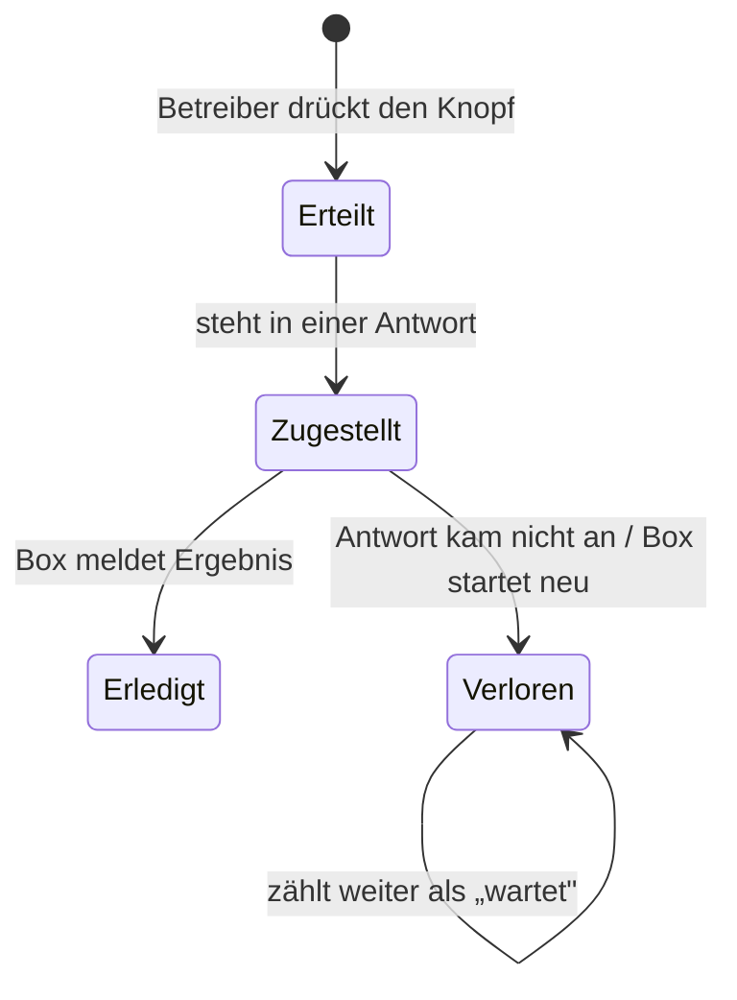

# Geschäftslogik 2 — Abgleich zwischen Box und Galerie

> Read out of the code on 2026-11-11 · `ecosystem` @ `1fd8505` · kind: workflow.
> Copy of the maintainer's wiki page of the same name (not public),
> German as written. Line numbers refer to `1fd8505`. Gaps A1, A2, A3 and C2
> described here have been worked on since — see [`../../index.md`](../../index.md)
> before relying on sections 6 and 8.

## 1. Zweck

Die Box meldet der Galerie ihren Zustand, lädt Aufnahmen hoch und holt sich Einstellungen, Medien und Aufträge ab. Die Verbindung geht immer von der Box aus — deshalb funktioniert sie hinter jedem Router und in jedem Gäste-WLAN, und deshalb kann niemand von außen in die Box hinein.

## 2. Beteiligte

* **Box** (oder das eigenständige Sync-Programm neben dslrBooth) mit ihrem Geräteschlüssel.
* **Galerie.**
* **Betreiber** — ändert das Profil und erteilt Aufträge in der Verwaltung.
* **Zeitgeber der Box** — alle 30 Sekunden; 5 Sekunden, solange ein Auftrag offen ist; 15 Sekunden nach einem Fehlschlag.

## 3. Voraussetzungen

* Das Gerät ist in der Galerie angelegt, aktiv und kennt seinen Schlüssel (von Hand eingetragen oder über einen Kopplungscode, der 15 Minuten gilt und einmal einlösbar ist).
* Für Uploads: Das Event gehört zu diesem Gerät — jetzt oder früher. Eine Box darf nachliefern, was vom Abend übrig ist, aber nichts in fremde Events legen.

## 4. Ablauf

**Der Abgleich**

1. Die Box schickt: Zustand (Kamera, Drucker, Platte, Warteschlange, Zähler), Profilversion, Ergebnisse erledigter Aufträge, Löschzettel, Meldungen, bei Bedarf ein ohne Netz angelegtes Event und an der Box gebaute Vorlagen.
2. Die Galerie bewertet den Zustand (grün, gelb, rot) und benachrichtigt den Betreiber beim Wechsel auf rot — nur beim Wechsel, nicht bei jedem Anruf.
3. Ein von der Box angelegtes Event wird übernommen. Maßgeblich ist der Signaturschlüssel, nicht der Name: Ist die Adresse schon vergeben, bekommt das Event eine andere, und die gedruckten QR-Codes gelten weiter.
4. Erledigte Aufträge werden abgehakt, Meldungen abgelegt.
5. Löschzettel werden ausgeführt und im Löschprotokoll belegt.
6. Die Antwort enthält: Bewertung, offene Aufträge (höchstens zehn), die Liste der Medien mit Prüfsummen, das Profil — aber nur, wenn die Box eine andere Version meldet —, und ein Angebot, wenn es eine neuere Fassung der Software gibt.
7. Die Box übernimmt das Profil, lädt fehlende Medien, führt die Aufträge aus und meldet die Ergebnisse beim nächsten Anruf, der dann nach einer Sekunde folgt.

**Der Upload**

1. Die Box arbeitet je Ziel eine eigene Warteschlange ab — Webfassungen zuerst, Originale zuletzt.
2. Die Galerie prüft Schlüssel, Art, Fassung, Dateityp und ob das Event zum Gerät gehört.
3. Dieselbe Kennung mit derselben Fassung und demselben Inhalt gilt als bereits angekommen. Mit anderem Inhalt ersetzt sie die alte Datei.
4. Aus Bildern entstehen Webfassung und Vorschaubild. Originale einer Webfassung werden abgelegt, aber nicht als eigenes Bild gezeigt.
5. Hat das Event die Freigabe eingeschaltet, hält ein Trigger der Datenbank die Aufnahme zurück — auf jedem Weg, auch für Gast- und Admin-Uploads.

## 5. Regeln

| Wenn | Dann |
|------|------|
| Schlüssel fehlt, falsch oder Gerät inaktiv | 401 |
| Kein Event zugeordnet | 422 — die Box behält die Datei |
| Event gehörte nie zu diesem Gerät | 403 |
| Kennung gehört zu anderem Event oder anderem Gerät | 409 |
| Gleicher Inhalt schon da | „Duplikat", nichts geschieht |
| Ziel vorübergehend nicht erreichbar | Nur die Warteschlange dieses Ziels wartet; ein gezogener Stick hält den Upload zur Galerie nicht auf |
| Dauerhafter Fehler | Eintrag „fehlgeschlagen"; erneut nur über den Auftrag „Fehlgeschlagene erneut" |
| Auftrag steht nicht auf der festen Liste der Box | Abgelehnt mit „nicht unterstützt" |
| Löschzettel für eine Aufnahme, die diese Box nicht hochgeladen hat | Wird nicht ausgeführt, aber quittiert |
| Neuere Software vorhanden | Angeboten, nie erzwungen — mitten im Abend startet sich nichts selbst neu |
| Vorlage von der Box besteht die Prüfung nicht | Nicht übernommen; die Box behält ihren Zettel |

## 6. Zustände eines Auftrags

**„Verloren" ist kein Zustand im Code — es ist der Zustand, der fehlt** (Lücke A3). Nachgewiesen: Die zweite Abholung liefert nichts, der Zähler der wartenden Aufträge bleibt auf 1, und damit bleibt der Takt der Box dauerhaft bei 5 Sekunden.

## 7. Geld und Kontingente

Keine.

## 8. Ausnahmen und Randfälle

* **Verbindung reißt beim Abgleich ab:** Die Box hebt Auftragsergebnisse und Meldungen auf und schickt sie beim nächsten Kontakt — solange sie nicht neu startet. Beides liegt nur im Arbeitsspeicher.
* **`restart_app`:** Der Auftrag startet die Box neu. Ob sein eigenes Ergebnis vorher gemeldet wird, habe ich nicht gelesen.
* **Löschung in der Galerie, Upload danach:** Die Aufnahme entsteht neu (Lücke A1, nachgewiesen). Es gibt keine Liste gelöschter Kennungen.
* **Löschung in der Galerie:** erreicht die Box nicht (Lücke A2).
* **Zwei Listen erlaubter Aufträge:** Die Box kennt `send_logs` und `reload_profile`, die Galerie kann beide nicht erteilen (Lücke C2, nachgewiesen).
* **Ampel:** bewertet Kennzahlen, nicht die Meldungen der Box (Lücke C3).

## 9. Was gelesen und geschrieben wird

**Geschrieben:** Heartbeat und Tageszahlen, Auftragsergebnisse, Bericht des Sync-Programms, Gerätemeldungen (30 Tage, höchstens 2.000 je Gerät), Aufnahmen und ihre Ableitungen, Zeitpunkt des letzten Uploads am Event, Löschprotokoll. **Gelesen:** Gerät, Event und Gerätehistorie, Profil, Medienliste, Softwareangebot.

## 10. Offene Fragen

* Soll ein zugestellter, unbeantworteter Auftrag nach einer Frist erneut zugestellt werden — oder verfallen? Für `test_print` ist doppelt harmlos, für `install_update` nicht. Die Regel muss je Auftrag feststehen.
* Wie lange gilt eine Kennung nach der Löschung als gesperrt?
* Welche der beiden Auftragslisten ist die richtige?
* L3: Der tägliche Wartungslauf (`python -m app.maintenance`) ist auf Staging eingerichtet, in der Produktion nicht.

## 11. Fundstellen

| Was | Wo |
|-----|----|
| Abgleich, Galerie-Seite | `app/blueprints/booth_v2.py:48–146` |
| Event von der Box übernehmen | `app/blueprints/booth_v2.py:234–274` |
| Upload | `app/blueprints/booth_v2.py:448–545` |
| Trigger der Freigabe | `app/ecosystem.py:533–557` |
| Aufträge: erteilen, abholen, abhaken | `app/ecosystem.py:1214–1257` |
| Erlaubte Aufträge der Galerie | `app/ecosystem.py:27–48` |
| Erlaubte Aufträge der Box | `sync/photobox_sync/agent.py:31–37` |
| Abgleich, Box-Seite | `sync/photobox_sync/agent.py:140–216` |
| Löschen nur eigener Aufnahmen | `app/ecosystem.py:832–843` |
| Kopplungscode | `app/ecosystem.py:1260–1310` |
| Bewertung des Zustands | `app/booth.py` |
