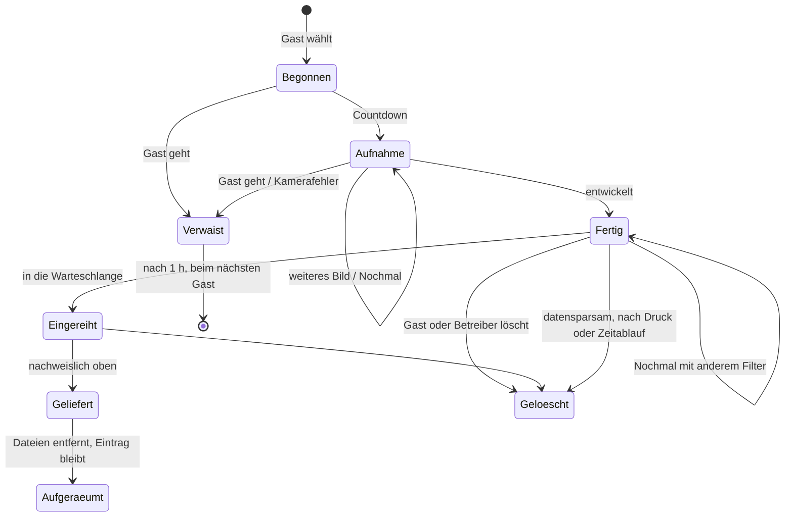

# Geschäftslogik 1 — Der Durchgang des Gastes an der Box

> Read out of the code on 2026-11-11 · `ecosystem` @ `1fd8505` · kind: workflow.
> Copy of the maintainer's wiki page of the same name (not public),
> German as written. Line numbers refer to `1fd8505`. What changed afterwards is
> listed in [`../../index.md`](../../index.md).

## 1. Zweck

Ein Gast macht an der Box in unter einer Minute eine Aufnahme (Foto, Collage, GIF, Boomerang oder Video), bekommt ein fertiges Ergebnis, einen QR-Code und auf Wunsch einen Abzug. Alles davon funktioniert ohne Netz.

## 2. Beteiligte

* **Gast** — tippt, lächelt, druckt.
* **Betreiber** — hat vorher über das Profil festgelegt, was der Gast wählen darf.
* **Box** — führt Kamera, Bildverarbeitung, Drucker und Warteschlange.
* **Zeitgeber der Box** — löscht im datensparsamen Betrieb.
* **Fremder Auslöser** — Buzzer oder HTTP-Aufruf mit Token.

## 3. Voraussetzungen

* Die Box ist nicht gesperrt (von Hand, per Auftrag oder nach Zeitplan).
* Die Kamera meldet „bereit".
* Die gewählte Betriebsart ist im Profil eingeschaltet. Im datensparsamen Betrieb zählen nur druckbare Arten (Foto, Collage, GIF).

## 4. Ablauf

1. **Wohin mit dem Foto?** (nur wenn `consent.enabled` an ist und es mindestens zwei Möglichkeiten gibt) Vor allem anderen wählt der Gast „In die Galerie“ oder „Nur drucken“. Die Knöpfe sind gleich groß und gleich gewichtet, keiner ist vorausgewählt; darunter steht der Hinweistext aus dem Profil. Nur ein Tipp auf einen Knopf wählt — Buzzer und Starttasten zeigen auf diesem Bildschirm nur „Bitte wählt auf dem Bildschirm“.
1. **Wählen.** Der Gast wählt Betriebsart und Format. Jeder Auswahlschritt, den der Betreiber abgeschaltet hat, entfällt als Bildschirm; die Box nimmt dann die Voreinstellung.
2. **Durchgang anlegen.** Die Box vergibt eine zufällige Kennung und signiert sie mit dem Schlüssel des Events. Damit steht der QR-Link fest, bevor das erste Bild existiert. Im datensparsamen Betrieb gibt es keinen Link.
3. **Gruß erfragen** (wenn eingeschaltet) — vor der Aufnahme, damit niemand zweimal wartet.
4. **Aufnehmen.** Countdown, Auslösung, bei Serien Durchsehen mit „Nochmal" für einzelne Bilder.
5. **Entwickeln.** Filter anwenden, Greenscreen ersetzen, Rahmen auflegen, Vorlage füllen. Für Foto und GIF entsteht zusätzlich eine Druckkarte; bei der Collage ist das Blatt selbst der Druck. Aus einer Collage entstehen auf Wunsch Einzelbilder und ein kleines GIF.
6. **Ablegen.** Das Ergebnis kommt in die Bibliothek der Box (Kiosk-Galerie, Druckzähler).
7. **Einreihen.** Je Ziel wandern die Dateien in die Warteschlange — Webfassung zuerst, Originale zuletzt. Im datensparsamen Betrieb: nichts.
8. **Automatisch drucken**, wenn eingeschaltet — nur beim ersten Fertigwerden, nicht nach „Nochmal".
9. **Zeigen.** Ergebnis, QR-Code, Druckknopf mit Wartezeit, E-Mail-Feld.
10. **Aufräumen im datensparsamen Betrieb.** Nach dem Druck wird alles gelöscht; scheitert der Druck, sofort; als Sicherheitsnetz nach 120 Sekunden.

## 5. Regeln

| Wenn | Dann |
|------|------|
| Box gesperrt | Kein Durchgang (423) |
| Betriebsart nicht eingeschaltet | Abgelehnt |
| Kamera nicht bereit | Abgelehnt mit dem Grund der Kamera |
| Format unbekannt | Voreinstellung des Profils |
| Greenscreen-Hintergrund nicht vorhanden | Ohne Hintergrundtausch |
| Filter unbekannt | „Original" |
| Aufnahmen fehlen beim Fertigstellen | Abgelehnt (409) |
| Collage, Einstellung „nur Einzelbilder" | Das Blatt wird nicht hochgeladen, nur die Einzelbilder |
| „Originale hochladen" an | Rohaufnahmen gehen zusätzlich hoch, mit niedrigster Dringlichkeit |
| „Nochmal" nach dem Fertigstellen | Neu entwickeln; Zähler und automatischer Druck laufen nicht erneut, der Löschzeitgeber beginnt von vorn |
| Datensparsamer Betrieb | Kein Link, kein Upload, kein Ordner, kein Stick — an der Stelle, an der Daten die Box verließen, nicht nur in der Oberfläche |
| Wahl je Durchgang eingeschaltet, Drucken an | Zwei Knöpfe: „In die Galerie“ (wie bisher) und „Nur drucken“. Ohne Wahl startet kein Durchgang (400 `consent.missing`), eine nicht angebotene Wahl wird abgelehnt (400 `consent.option`) |
| Weniger als zwei Möglichkeiten (Drucken aus, „Nur drucken“ abgewählt, Box ohnehin datensparsam) | Der Bildschirm entfällt, der Durchgang läuft wie ohne Wahl |
| Gast wählt „Nur drucken“ | Dieser eine Durchgang folgt dem datensparsamen Betrieb: kein Link, kein QR-Code, kein Upload, kein Ordner, kein Stick, keine E-Mail, nicht in der Kiosk-Galerie; nach dem Druck (bzw. `privacy.delete_after`) gelöscht, Sicherheitsnetz und Leerlauf-Zeitgeber wie dort. Der nächste Durchgang fragt neu |
| Jede Wahl | Die Box legt am Durchgang ab: gewählte Möglichkeit, Sprache, Profil-Version und SHA-256 (16 Zeichen) des angezeigten Hinweistextes, Zeitpunkt. Nichts über die Person. Der Eintrag bleibt, wenn die Dateien gelöscht werden (Spalten `consent_option`, `consent` der Bibliothek, nur ergänzend) |
| Ein Drucker fällt aus, ein anderer übernimmt (Ausfall beim Druck oder schon beim Einreihen, Verteilung `failover`) | Der Gast liest einmal ruhig „Euer Druck kommt am zweiten Drucker“; die Statuszeile zeigt dem Betreiber „Drucker 2 übernimmt“ in Gelb statt eines grünen Druckerpunkts |
| Kein Drucker kann drucken (alle melden einen Fehler, der Druck wird sofort abgelehnt, oder er scheitert an jedem Drucker) | Galerie-Durchgang: „Drucken klappt gerade nicht – euer Foto ist trotzdem gespeichert“. „Nur drucken“: Der Gast erfährt, dass nichts gedruckt und nichts gespeichert ist, und wählt „Doch in die Galerie“ (ab dann ein gewöhnlicher Durchgang, das Protokoll vermerkt `changed_from: print`) oder „Verwerfen“; ohne Antwort löscht das Sicherheitsnetz. Der Ergebnis-Zeitgeber steht, solange die Frage offen ist |
| Durchgang älter als eine Stunde und nie fertig | Aus der Liste; im datensparsamen Betrieb samt Dateien — aber nur, wenn ein neuer Durchgang beginnt |

## 6. Zustände

„Aufgeräumt" und „Gelöscht" sind verschiedene Dinge: Aufräumen behält den Eintrag mit Druckzähler, Löschen reist als Löschzettel zur Galerie.

## 7. Geld und Kontingente

Kein Zahlungsvorgang. Was begrenzt ist, sind Abzüge — siehe `../billing/druckkontingente-und-lizenz.md`.

## 8. Ausnahmen und Randfälle

* **Blitz lädt nach:** Zwischen zwei Auslösungen wartet die Box die eingestellte Ladezeit, sonst wird das zweite Bild einer Collage dunkel.
* **Hochformat in querformatigem Bildfeld:** Je nach Einstellung beschneiden (Ausschnitt nach oben verschoben) oder ganz einpassen. Verzerrt wird nie.
* **GIF drucken:** Gedruckt wird eine Karte mit dem ersten Bild.
* **Video und Boomerang:** kein Druck.
* **Verwaister Durchgang:** siehe Lücke A5.

## 9. Was gelesen und geschrieben wird

**Geschrieben:** Ordner des Durchgangs (Aufnahmen, Ergebnis, Webfassung, Vorschaubild, Druckkarte), Eintrag in der Bibliothek, Einträge in der Warteschlange je Ziel, Meldungen an Erweiterungen und Webhooks (`session_started`, `media_ready`, `printed`). **Gelesen:** Profil, Vorlagen, Filter, Medien, Zustand von Kamera und Drucker.

## 10. Offene Fragen

* **L1:** In der Galerie erscheint bei Einzelfotos das Foto, in der Kiosk-Galerie und beim Druck die Karte mit QR-Code. Im Testlauf erschienen Karten mit QR-Code auch in der Galerie. Welche Fassung ist „das Bild" für den Gast?
* **A5:** Wer räumt den letzten abgebrochenen Durchgang des Abends auf?
* Was passiert mit einem laufenden Durchgang, wenn währenddessen ein neues Profil eintrifft? Nicht gelesen.
* Wie verhält sich „Nochmal", wenn der erste Druck schon läuft? Nur teilweise gelesen (der Löschzeitgeber wird neu gesetzt).

## 11. Fundstellen

| Was | Wo |
|-----|----|
| Durchgang anlegen, Sperre, Betriebsarten | `booth/boothcore/app.py:1017–1043` |
| Verwaiste Durchgänge | `booth/boothcore/app.py:1045–1063` |
| Fertigstellen, „frisch" und „neu" | `booth/boothcore/app.py:1178–1267` |
| Einreihen und Dringlichkeiten | `booth/boothcore/app.py:1349–1396` |
| Löschen an der Box | `booth/boothcore/app.py:1398–1411` |
| Datensparsamer Betrieb | `booth/boothcore/app.py:882–933` |
| HTTP-Wege des Durchgangs | `booth/boothcore/app.py:1655–1785` |
| Bibliothek | `booth/boothcore/library.py` |
| Voreinstellungen des Profils (wortgleich an zwei Stellen) | `booth/boothcore/config.py`, `app/ecosystem.py:73 ff.` |
