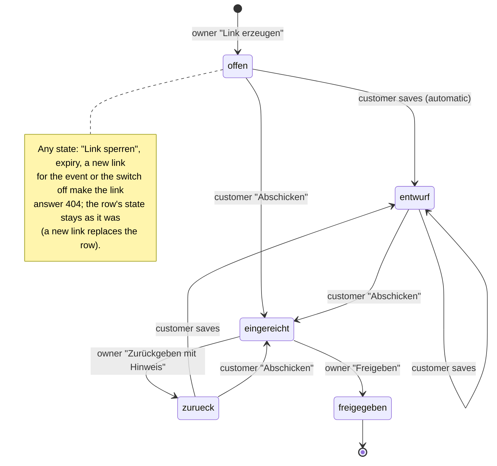

# Business logic — what the software does, not how it is built

"The route calls `take_jobs`" is construction. "A job counts as delivered as
soon as it is written into an answer" is a rule, and whether a remote test
print ever arrives depends on it. This folder holds the rules.

Read the page for the area you are about to change **before** you change it,
and update the register below in the same commit when your change closes or
opens a gap.

## Pages

Extracted from `ecosystem` @ `1fd8505` on 2026-11-11. The five pages are copies
of the maintainer's own notes and are in German, as they were written;
translating one is welcome, as its own commit. File names follow the titles of
those notes.

| # | Page | Kind |
|---|------|------|
| 1 | [The guest's run at the booth](current/workflows/gast-durchgang-an-der-box.md) | workflow |
| 2 | [Sync between booth and gallery](current/workflows/abgleich-box-galerie.md) | workflow |
| 3 | [The QR page of a run](current/endpoints/qr-seite-des-durchgangs.md) | entry point |
| 4 | [Visibility of and access to a gallery](current/models/galerie-sichtbarkeit-und-zugang.md) | life cycle of an event |
| 5 | [Print allowances, paper and the old licence gate](current/billing/druckkontingente-und-lizenz.md) | allowances |
| 6 | [The booth's own guest page (download without internet)](current/endpoints/lokale-gaeste-seite.md) | entry point, written with the code (English) |

Also here: [glossary.md](glossary.md) (the German terms and their names in the
code) and [DISCOVERY.md](DISCOVERY.md) (what was read, what was not, ranking).

## The pages are behind the code

The pages describe `1fd8505`. Eight commits after it (`0bc51bc` … `2088d14`,
merged in `0abeadc`) changed exactly the rules the pages list as gaps. The
pages have **not** been re-read against the new code: the "Status" column below
is taken from the commit messages and from the presence of the named test, not
from a second extraction. Line numbers in the pages are those of `1fd8505`.
`app/license.py`, described on page 5, no longer exists.

Until someone re-extracts a page, trust the tests named here over the prose of
sections "Zustände" and "Ausnahmen und Randfälle".

## Gap register

Ids are those of the audit of 2026-11-11. "Rule missing" means: the code
behaves somehow, but nobody decided that it should.

| Id | Page | Gap as found at `1fd8505` | Status at `0abeadc` | Rule now, and where it is pinned |
|----|------|---------------------------|---------------------|----------------------------------|
| A1 | 2, 3 | After a deletion in the gallery, an upload of the same id is accepted again | closed, `0bc51bc` | A deleted id is never accepted again; the upload is answered `200 {"ok": true, "gone": true}` and stores nothing. `tests/test_deleted_stays_deleted.py` |
| A2 | 2 | A deletion in the gallery never reaches the booth | closed, `948e076` | The sync answer lists deleted runs until the booth confirms them; the booth removes its copy without writing a deletion slip. `tests/test_deletion_reaches_the_booth.py`, rehearsal step 15 |
| A3 | 2 | A job is delivered at most once, its receipt lives in memory, it never expires | closed, `472f6c7` | Re-delivered after 60 s without a result, expired after 10 min, executed ids kept on disk so nothing runs twice. `tests/test_jobs_arrive_or_expire.py` |
| A4 | 3 | Waiting for approval and rejected both look like "on its way" | closed, `e22fc69` | Four states: pending, ready, review, gone. A rejection is shown as gone. Polling ends after ten minutes. `tests/test_qr_page_states.py` |
| A5 | 1 | An abandoned run in data-minimal mode is only cleaned up by the next guest | closed, `e36bd50` | One timer per run, plus a sweep of marked folders when the booth starts. `booth/tests/test_privacy_unfinished.py` |
| B1 | 4 | Admin login without a brake on failed attempts | closed, `cd4084c` | 10 failures per address in 15 min; second factor 5 in 15 min; recovery 5 per hour. `tests/test_login_brakes.py` |
| B2 | 4 | Gallery password without a brake | closed, `cd4084c` | 10 failures per event and address in 15 min. `tests/test_login_brakes.py` |
| B3 | — | Remote access to the booth admin contradicts the loopback binding; PIN 2580, no lockout | partly closed, `cd4084c` | PIN: 5 failures, then a pause doubling up to 15 min, kept in `pin_brake.json` across a restart; the self-diagnosis fails while the factory PIN 2580 is in force, on loopback too (the touchscreen reaches the admin); a login with 2580 only opens "choose a new PIN" (at least 4 digits since 16.11.2026, before 6; not 2580, no repeated digit, no straight run like 1234), every other admin call answers 403 until then; booth and gallery refuse such PINs when they are newly set. `booth/tests/test_pin_brake.py`, `booth/tests/test_factory_pin.py`, `tests/test_access_settings.py`, rehearsal step "Werks-PIN". Closed in `work/booth-operations`: what is reachable without the PIN on the network — see "The booth's routes and who reaches them" below. `booth/tests/test_what_the_wifi_can_reach.py` |
| B4 | 3, 4 | Delete and status of the QR page ignore silent mode and expiry | closed, `e22fc69` | Both apply the same rules as the page: silent 404, expired 410. `tests/test_qr_page_states.py` |
| C1 | 5 | A paywall in front of the statistics contradicts the business model | closed, `d310ca2` | `app/license.py` is gone; settings `license_key`/`license_plan` stay untouched. `tests/test_no_paywall.py` |
| C2 | 2 | The job lists of gallery and booth differ | closed, `472f6c7` | One list; each suite reads the other side's file as text and compares |
| C3 | 2 | The traffic light ignores the booth's messages | closed, `work/booth-operations` | The heartbeat carries the self-check (only warn/fail, renewed every 5 min in the background, without the checks "Galerie" and "Weboberfläche") and the open operator messages (warnung/kritisch). The light is the worst of: self-check (fail red, warn yellow), messages (kritisch red, warnung yellow), the existing status rules, and silence — yellow from 3 min, red from 10 min while an event is running (linked event dated today, or yesterday before 8 a.m.; an undated event counts while the booth reported in the last 6 h), grey "offline" otherwise. One function, `app/booth.py` `light()`, feeds the admin page `/admin/booths` and the MCP tool `list_booths`. `tests/test_operator_light.py`, `booth/tests/test_heartbeat_tells_the_operator.py` |
| C4 | — | The sync page of a booth claims it never reported; booth and sync program are one device kind | closed, `work/booth-operations` | A device that sends heartbeats but no report of the separate sync program is shown as "Box mit eingebautem Abgleich" with the age of its last report and its upload queue; "noch nichts gemeldet" only for a device that never reported. Booth and sync program stay one device kind. `tests/test_operator_light.py` |
| D3 | 5 | Print allowance: check and booking are two steps | closed, `2088d14` | Check, submit and booking under one lock. `booth/tests/test_print_quota_race.py` |
| L1 | 1 | Which version is "the picture" in the gallery — the print card with QR code or the photo without? | **open**, decision missing | Default until decided: without QR code in the gallery, with it on the print (roadmap E4) |
| L2 | 4 | The link key that replaces the password sits in the address and so travels into visitor statistics | closed, `feat/rechtstexte` | The gallery's own statistics store no address. The optional Umami script is sent with `data-exclude-search` and `data-exclude-hash` (no `?k=…` ever leaves) and is not loaded at all on pages whose path is a key: `/p/`, `/s/`, `/l/`, `/g/`, `/notify/`. `tests/test_legal_placeholders.py` |
| L3 | 2 | Without the daily maintenance run, retention is a form field; production has no such run | closed, `work/gallery-hardening` | The gallery starts the run itself, at most once per 24 h across all workers (atomic claim in `settings`); a Coolify scheduled task is documented as the addition (`docs/MAINTENANCE.md`). The dashboard warns after 36 h without a run. Retention default is 30 days everywhere. `tests/test_daily_maintenance.py` |
| L4 | 3 | The signature is 40 bits and the QR page has no brake on attempts | **open**, rule missing | — |

## Rules added after the audit

| Rule | Page | Since | Pinned by |
|------|------|-------|-----------|
| Client access (`/kunde`, `/client`): one code per client opens every gallery assigned to that client in place of its password, and changes nothing else (publication, silent mode, expiry, moderation, download switches). Code shown once, stored as an HMAC with a pepper of the installation; 10 wrong codes per address in 15 min, then a pause; the client session is separate from the admin's and ends on logout, after 120 min idle (`client_idle_minutes`), when the client is blocked or gets a new code. Section 12 of page 4 | 4 | `work/gallery-clients` | `tests/test_client_access.py` |
| Folders (sub-galleries): `events.parent_id`, one level deep, no cycles. A folder inherits every gallery setting it does not store (merge only in `gallery_settings.for_event`; a folder stores only what differs); silent mode, expiry and moderation never looser than the parent; an unpublished or still-locked parent closes its folders; whoever may open the parent may open its folders, a folder with its own password needs that too. Parent ZIP with `?folders=1` takes only folders the visitor could zip on their own. Section 13 of page 4 | 4 | `work/gallery-clients` | `tests/test_subgalleries.py` |
| Old addresses after a move: `/<account>/<id>` answers only for the configured `legacy_account` (a converter refuses every other first segment, so no existing route changes) and leads with 302 to the gallery whose `events.foreign_id` matches; `?file=<id>` opens the picture with that `media.foreign_id`. Ids unique; account names that are a first route segment are refused; `python -m app.import_ids` sets ids from CSV and reports set / not found / double. Section 14 of page 4 | 4 | `work/gallery-clients` | `tests/test_legacy_links.py` |
| Selections that stay: a logged-in client keeps named selections per gallery (also in folders of a held gallery), only of pictures they can see, behind the gallery's gates; `selection_max` caps each (409 beyond); writes are JSON only. The admin exports each as names without extension (comma, " OR " for Lightroom, CSV, one per line) from `dateinamen.stamm`. Without client access nothing changes. Section 15 of page 4 | 4 | `work/gallery-clients` | `tests/test_client_picks.py` |
| Gallery kind `booth` (default, also for every existing event) or `client`. Client galleries have no automatic deletion unless switched on at that gallery; folders take the parent's kind. Hard stop in the retention run: a gallery that is `client`, assigned to a client or carries an old id (itself or via its parent) is never deleted without `auto_delete = 1` on that gallery (`due()` skips it, `sweep()` asks `purge_allowed()` again before each purge). The privacy page names no period for such galleries. Section 16 of page 4 | 4 | `work/gallery-clients` | `tests/test_client_gallery_retention.py` |
| Share links and folders: a whole-gallery share link on a parent also shows its open folders (heading per folder, a directory per folder in the ZIP); folders with their own password, unpublished, silent or expired stay out; a link to chosen pictures stays those pictures. Section 13 of page 4 | 4 | `work/gallery-clients` | `tests/test_share_link_folders.py` |
| Comments: gallery setting `comments` (off by default); only clients logged in with their code write, under the client's name, plain text up to 1000 characters, 30 per client and hour; a client sees only their own threads and the photographer's answers; the admin answers and deletes; marks on tiles; the notifier is told gallery and client, never the text. Section 17 of page 4 | 4 | `work/gallery-clients` | `tests/test_comments.py` |
| Cover and opener: the cover is picked in the admin among the gallery's own pictures; with `opener` (off by default) the gallery starts with the cover full width, title, optional subtitle and date; the title face is the shipped Archivo or a device stack, never fetched. Section 18 of page 4 | 4 | `work/gallery-clients` | `tests/test_cover_opener.py` |
| Large view: whoever may tag on the tile tags in the large view too; the EXIF line (camera, focal length, exposure, aperture, ISO, never GPS) is off by default (`exif`) and answers by the gallery's gates. Section 19 of page 4 | 4 | `work/gallery-clients` | `tests/test_lightbox_tags_exif.py` |
| Folder import for the move: `python -m app.import_folder ROOT [--client] [--ids] [--dry-run]` turns a directory tree into client galleries (top level) and folders (one level down; deeper levels flattened with their path in the name), takes every file through the admin upload path, dates from the oldest EXIF date, is idempotent (path + size + SHA-256 in `import_sources`), reports created / skipped / rejected with reason, fetches nothing. Section 20 of page 4 | 4 | `work/gallery-clients` | `tests/test_import_folder.py` |
| Consent as a choice per run: with `consent.enabled` and printing on, the guest picks "In die Galerie" or "Nur drucken" before the shot; two equal buttons, none preselected, only a tap chooses (the buzzer only shows a hint). "Nur drucken" keeps that run on the booth (no link, upload, mail or kiosk tile) and wipes it like the data-minimal mode. "Nur drucken" only for a mode with a print sheet (photo, collage, GIF; boomerang with `boomerang.print`; never video): for the other modes the step shows only its note, the run records "notice", and "Nur drucken" sent anyway is refused (400 `consent.option`), never turned into a gallery run. With fewer than two options the step is skipped. Each choice is recorded without personal data (option, language, profile version, hash of the note shown, time). Off by default | 1 | `work/booth-wedding` | `booth/tests/test_consent_choice.py`, `booth/tests/test_consent_screen.py`, `tests/test_consent_profile.py`, `booth/tests/test_no_print_offer_for_films.py` |
| Media per phase (`phase_media`): `processing`, `between` (between two shots of a series, shown for the time the shot would be shown anyway), `after` (after a fresh result, before the start screen) and `error` each take one optional picture, GIF or muted video from the booth's media, `fit` cover or contain, the phase's own text on top or not, video looped or holding its last frame. No phase waits for its medium; only `after` adds time, and only with `seconds` > 0 (default 0 = off, at most 15); a tap or the buzzer ends it. A file the booth does not have counts as none. "Reduce motion": a video stands as its first frame, a GIF is dropped. No `idle` phase: the attract screen is the idle picture | 1 | `work/booth-phases` | `booth/tests/test_phase_media.py`, `tests/test_phase_media_settings.py` |
| Download without internet (`wifi_share`, off by default): the result screen shows "1. join the Wi-Fi" (WIFI: code) and "2. load your photo" (link to the booth) instead of the gallery code — in mode `auto` only while the gallery is out of reach. The link is signed per run with a key that stays on the booth and expires (24 h by default); a separate listener on its own port serves only that page, every other address answers 404; 12 wrong links per address in 10 min close that address for 10 min. No link in data-minimal mode or for "Nur drucken". The booth sets up no Wi-Fi itself | 6 | `work/booth-phases` | `booth/tests/test_wifi_share.py`, `tests/test_wifi_share_settings.py` |
| Printer takeover and "no printer can": the guest is told once that the print comes from the other printer, the status line tells the operator; with no printer left a gallery run says the photo is saved, a "Nur drucken" run asks "Doch in die Galerie" or "Verwerfen" (the safety net still wipes it if nobody answers) | 1 | `work/booth-wedding` | `booth/tests/test_printer_takeover.py` |
| Test print of a template (job `test_print` with `template`): only a template the gallery lists (own one by file name, sent with its saved content; built-in one by id; never a path) and the booth knows; rendered with the sample photos and the booth's style through the operation renderer and print layout, a small "Testdruck" label unless `mark` is false; never booked on the event's or a run's allowance (it does use paper, the sheet counters count it); a printer that is not ready or a failed sheet is a failed job with the reason, and the sheet is dropped instead of waiting for new paper; without `template` the calibration page as before. Editor button and MCP `send_booth_job` use one function | 5 | `work/booth-stats-print` | `booth/tests/test_template_test_print.py`, `tests/test_template_test_print.py` |
| Print correction per printer: `brightness`, `contrast`, `saturation` in each printer entry of the local settings, each -50 … +50 (anything else is clamped or read as 0), default 0 = the file goes to the printer byte for byte. Applied to a temporary copy right before the printer gets it (factor 1 ± n/100), never to the saved result or the gallery's picture; read at each print, so a change takes effect at the next sheet without a restart. Guests' prints, the calibration page and template test prints all pass through it. Set at the booth's admin, or remotely as `printers.N.brightness|contrast|saturation` on `REMOTE_LOCAL_KEYS` (N = entry 1–4 of the printer list, or the single printer section for N = 1) | 5 | `work/booth-stats-print` | `booth/tests/test_print_correction.py` |
| Evening counters at the booth: per event and day, in an extra table of the booth's library (survives a restart): runs per mode, cancelled runs (button; a run nobody finished counts as timed out when it is cleared, at the latest an hour later and only once a new run starts), retakes and replaced shots, prints and failed attempts, prints via a stand-in printer, the consent choice of finished runs (gallery / print only / notice), camera errors and reconnections (increase of the camera service's counters), the big QR code opened, runs per hour. Test sheets are not counted. Only numbers on a fixed list of keys — no names, file names, run ids or times of single runs. **They keep running in the data-minimal mode**: nothing in them leads back to a guest, so the promise "nothing leaves the booth" (page 1) is about pictures, links and addresses, not these sums. The heartbeat carries today's and the event's sums (`booth_stats`); the gallery keeps only numbers under known-looking keys, per booth, event and day (replacing the older report of the same day), shows them as the card "Heute an der Box" on the booth page and in the event's analytics, and through MCP `booth_stats`/`event_stats` (one function, `app/stats.py`). "Paper for about N prints" only from counted sheets. Resetting a booth's or an event's numbers removes them too | 1 | `work/booth-stats-print` | `booth/tests/test_evening_counters.py`, `tests/test_booth_evening_counters.py` |
| Template packages (`.abzug`) carry the fonts a template's texts use: only `.ttf`/`.otf`, recognised by their first four bytes (TTF `00 01 00 00` or `true`, OTF `OTTO`), at most 4 MB each; anything else under `medien/` that is no picture stays out with a note. The gallery files an imported font as a booth medium of kind `font`. The editor exports one template as a package, reads one in, duplicates a template under "… (Kopie)" (never over an existing file), copies and pastes elements within a template (Ctrl/Cmd+C/V, offset 40 px, within each list's limit, QR not copied, one undo step) and shows its shortcuts on "?" | 5 | `work/booth-stats-print` | `tests/test_template_editor_extras.py` |
| Unknown paper stock is not empty: without counted sheets (model or cassette size per printer) and without `print.sheets_per_cassette` the booth raises no paper message and the light does not turn red for it; the self-check says once, as SKIP, "Papiervorrat nicht eingetragen – die Box kann nicht mitzählen". One open cause is one operator message: repeated heartbeats only refresh it — no new history entry, no new log line (the gallery counted those as errors, ~100 an hour) — until the all-clear, a change of level or title, or the reminder after `wiederholen_minuten`. The kiosk's status line shows operator messages in the interface's language (keys `op.*.title`/`op.*.text` in i18n.js and the text catalogue); mails, log and gallery keep the German sentence. The status line is the operator's; with `start.show_status` off guests see only the dot (unchanged) For a printer that counts tray and ribbon apart (`fach`/`farbband` in its supply entry) the self-check says "Papierfach x von n, Farbband y von n (gezählt)" and which of the two is empty first, never "bis zum Kassettenwechsel"; the gallery booth page shows the same two counts instead of min(tray, ribbon), and says "N Druck(e) warten" for held prints (held for paper, ribbon or because the printer was off) | 1 | `work/booth-stats-print` | `booth/tests/test_paper_unknown_is_not_empty.py`, `booth/tests/test_selphy.py`, `tests/test_printer_visibility.py` |
| A printer that is off or unreachable is not ready, and "printed" waits for evidence. Windows: the printer is `offline` when Windows marks it so (attribute WORK_OFFLINE, status OFFLINE/NOT_AVAILABLE/SERVER_UNKNOWN) **or a job in its queue cannot reach the device** (job status ERROR/OFFLINE/BLOCKED_DEVQ); `error` for paper out, jam, no ribbon, door open, paused queue, user intervention, printer error. CUPS and IPP: reason `offline-report` is `offline`. Right before a job is handed to a printer the booth looks again; a printer in `offline`/`error` gets no job (it waits on the booth's side: retried when the printer is ready again, held after the attempts). On Windows each copy is followed in the spooler: it counts as printed (sheet counters, total, evening counters, run state `printed`) only once it left the queue or is marked PRINTED/COMPLETE; a job in error for more than 15 s (`ERROR_PATIENCE`) or still there after 240 s (`JOB_DEADLINE`) is deleted from the Windows queue and the attempt fails, so the booth's own retry is the only copy. Operator switch per printer, `follow_jobs` (booth admin, local setting, default on): off = the old behaviour, a copy counts once the Windows spooler has accepted it. Folder and hot folder count on hand-over (nothing to wait for); CUPS and IPP still count on acceptance (gap G-P1 below). The held-prints notice names „Papier nachgelegt“ and „Wartende Drucke erneut“ (booth admin button for `release_prints`) | 1 | `work/integration-2` | `booth/tests/test_printer_offline.py`, `booth/tests/test_operator_button_names.py` |
| Gallery light for a SELPHY: entries with `fach`/`farbband` turn the booth yellow only when the tray or the ribbon itself is low by the booth's rule (`max(2, round(total × 0.15))`: tray 18 at 3, ribbon 36 at 5), and the reason says „Papierfach“ or „Farbband“; other entries keep "counted rest ≤ 10" | 1 | `work/integration-2` | `tests/test_printer_visibility.py` |
| Paper tray and ink ribbon counted apart: a printer whose model names both capacities (`supplies` in `printing/models.py`; SELPHY CP: tray 18, ribbon 36 — from memory, to be confirmed at the device) or whose entry sets `tray_total` and `ribbon_total` counts every printed sheet (copies and operator reprints included) on both, persisted next to the sheet counter. "Papier nachgelegt" (action `paper_changed`) resets the tray only, "Farbband gewechselt" (`ribbon_changed`) the ribbon only; both release held prints, both also as remote jobs from the gallery's booth page. Notices `op.tray_low`/`op.tray_out` and `op.ribbon_low`/`op.ribbon_out` (low at about one in six left, at least 2), worded as counted, not reported; such printers are left out of the per-cassette notice `op.paper_low`/`op.paper_out`, which other models keep unchanged. A count of zero never blocks printing — the printer decides | 1 | `work/integration-2` | `booth/tests/test_paper_and_ribbon_counters.py` |
| Status page of a booth for rentals (`GET /status/<token>`, `app/status_page.py`): off per booth by default; the booth page's card "Statusseite" switches it on (random 192-bit token, only its SHA-256 stored in `booth_status_pages`, the full link shown once), "Link neu erzeugen" replaces it, "Ausschalten" deletes it. Any token that opens no page answers the ordinary 404 page. No login, GET only. The token is looked up first and a valid link never counts against a limit (a proxy may show one address for all visitors); only requests whose token opens no page count, 120 per address in 15 min, then 429 instead of 404. A deactivated booth (`devices.active=0`) answers 404 too. The admin switch is CSRF-checked by the blueprint guard and appears in the change log as "Statusseite eingeschaltet / neuer Link / ausgeschaltet" (never the token). `no-store`/`noindex`/`no-referrer`, no analytics, refreshes itself every 60 s, German and English (`?lang=`). Shows the booth's name, the light of `booth.light()` with one sentence (from 3 min of silence "Keine Verbindung seit …" — the admin's threshold), last contact as relative time, camera and printer ready or not (the light's printer and paper lines), sessions and prints of the reported day from `booth_stats`, the titles of notices from camera, printer and disk. Never the event's name, photos, gallery links, guest addresses, IPs, keys, paths or the raw heartbeat; free text from the booth that looks like an address, a path or a key is dropped line by line, self-check notices are not shown (a yellow or red light without a shown reason says only "technical problem") | 4 | `work/integration-2` | `tests/test_booth_status_page.py` |
| Drawing on the picture (`draw`, off by default): after a fresh photo or collage (never GIF, boomerang, video, never from the booth gallery) the result screen offers "Zeichnen". The kiosk sends strokes as vectors (colour, width as a share of the picture width, points 0..1), never a bitmap. The booth takes them only for the newest run, finished and not deleted (403 off, 409 wrong mode / no result yet / a newer run started, 404 unknown or deleted); at most 512 KiB, 120 strokes, 1500 points per stroke, 12000 in all (413 above); a colour must be one of the profile's `#rrggbb` (400), NaN/Infinity/non-numbers are refused (400), points outside the picture are moved to its edge, widths clamped to 0.002–0.05. The drawing is painted at every render from the untouched shots, like a look: drawing again replaces the drawing, an empty list removes it, the shots stay byte for byte, a retake drops it. The new result, web version and print file replace the old ones and the upload is queued again under the same id (the gallery replaces its copy); a sheet already printed stays as printed, nothing is printed automatically a second time; a "Nur drucken" run stays off the outbox. While a finger is on the canvas the result timer is held; after it lifts it runs again, and going home closes the drawing and forgets the strokes After a saved drawing the look thumbnails are reloaded (new `t` stamp) so they show the drawing too | 1 | `work/integration-2` | `booth/tests/test_guest_drawing.py`, `tests/test_booth_drawing_form.py` |
| Numbers saved at the booth are held to the same bounds as in the gallery form and the booth editor: `POST /api/admin/profile` pulls every key of `PROFILE_LIMITS` (booth `app.py`; the same table as `LIMITS` in `static/settings.js`) into its range before merging, and a value that is no number (text, bool, null) keeps the current one. A test keeps the Python and the JS table equal | 1 | `work/integration-2` | `booth/tests/test_local_settings_controls.py` |
| The PC's clock dates the pictures, not the camera's: on connect the EDSDK camera gets the PC's local date and time (`kEdsPropID_DateTime`; UTC time and zone are not written); a refusal or an error is logged once per program run and never stops the connection. Every file the booth renders (result, web version, thumbnail, print card, poster, single pictures of a collage) carries `DateTime`/`DateTimeOriginal`/`DateTimeDigitized` and the UTC offsets of the run's start (the session's timestamp, the same as the upload's `taken_at`). The camera's original is never re-encoded: if its EXIF date is more than 5 minutes off the PC's time of the shot, the date strings are overwritten in place (same length, same size, picture data unchanged); without EXIF or with an unreadable EXIF it stays as it is. GIF and MP4 carry no EXIF; the gallery dates every upload by `taken_at` from the booth and sorts by its own arrival time, never by EXIF | 1 | `work/integration-2` | `booth/tests/test_edsdk_uhrzeit.py`, `booth/tests/test_aufnahmezeit.py` |
| A printed GIF run is a sheet with its pictures: 2–6 pictures all go on the built-in 10×15 layout of that number (`duo`, `trio`, `grid4`, `fuenf`, `sechs`; the `-quer` one for landscape framing), more than 6 are thinned to 6 spread from the first to the last; style, headline/subline and the print frame as on a collage, the QR code only with `qr_on_print`. Photo and collage runs print as before. An own sheet only through `gif.print_template` (row "GIF print sheet" below) | 1 | `work/integration-2` | `booth/tests/test_gif_druck.py` |
| "Testbilder entfernen" (booth admin): offers the runs of the event set on the booth and the runs without an event that are still on the booth; runs of other events are named and kept. Removal goes through the booth's one deletion path without a deletion slip (library row, run folder, outbox entries not yet uploaded, queued and held prints); what already reached a gallery stays there. Refused (409) while an unfinished run younger than 10 min exists and when the confirmed number is not the current one; when any offered run belongs to an event or there are more than 20, the number must be typed (`getippt`). Counters only on request: `zaehler` sets the removed runs' prints to 0 (event allowance) and clears the evening counters of their event and day; `papier` resets the total print counter, tray and ribbon (off by default: the paper was used). Copies already on a USB stick are removed by the next backup of that event's folder to the same stick (the runs count as withheld); a folder of an event that is not backed up again stays on the stick | 1 | `work/integration-2` | `booth/tests/test_testbilder_entfernen.py` |
| One capture run at a time: every way into a run (mode tile, also when set-up is skipped because there is nothing to choose; "Los geht's"; buzzer and start keys; a key mapped to a mode; the remote trigger; "Nochmal"; a reshoot from the review) passes one gate in the kiosk; a second start while a run is being set up or running is dropped, never queued, and a mode tile does not touch the running run. Going home opens the gate and ends whatever run was still open there. A print key or number key obeys the same 5 s hold as the print button; a second tap on "Fertig" within 0.7 s does not skip the thank-you, and a start within 0.5 s of the start screen appearing is the echo of the tap that led there. The first shot of every mode counts down `countdown.first`; following GIF shots `gif.interval` (by design), following shots of other series `countdown.next`; a single picture taken again never gets the GIF gap. `countdown.first` and `countdown.next` are 1–20 everywhere (gallery form, booth editor, `PROFILE_LIMITS`; the kiosk holds an older stored 0 to 1). Countdown digits are whole and strictly descending; a fractional time goes to the first digit | 1 | `work/integration-2` | `booth/tests/test_one_run_at_a_time.py` |
| A shot, clip or finish that sends the kiosk to its error screen leaves one log line with run id, mode, shot number (n/needed) and cause: ERROR for a 5xx, WARNING otherwise; INFO for a run the guest threw away (410 or deleted). A camera failure (503) of a shot or clip also counts `camera.errors` in the evening counters | 1 | `work/integration-2` | `booth/tests/test_failed_run_leaves_a_trace.py` |
| "No focus" never fails a run (EDSDK, 17.11.2026): 0x8D01 as the return code of any press or as the camera's capture-error event lets the button up, waits `FOCUS_RETRY_PAUSE` (0.3 s, events pumped) and presses again without autofocus (hold sequence: hold until the picture; classic: release at once), at most `FOCUS_RETRIES` (3) more times, never once a picture arrived; one shot accepts one picture, a straggler of an earlier attempt is cancelled. Each such press is one INFO line "kein Fokus – ohne Autofokus ausgelöst, Versuch n" and counts `focus_fallbacks` (`/api/state` → `camera.focus_fallbacks`). Refused every time, or refused for another 0x8D0x reason (card, lens, mode — not retried): the shot fails as `CaptureRefused` → 503 with its code (`camera.focus` …), counted in `camera.refused`, and the camera service neither reconnects nor leaves `ready`, so no "Die Kamera antwortet nicht" notice; every other camera error reconnects as before. The kiosk takes a shot refused with `camera.focus` once more (hint, new countdown) before the error screen; the server keeps the run's other shots, a new shot request fills the same place | 1 | `fix/focus-refusal` | `booth/tests/test_no_focus_never_fails_a_run.py` |
| Windows printing without MFC: pages go to the spooler through win32gui/win32print (`CreateDC("WINSPOOL", …)`, `StartDoc` … `EndDoc`, `AbortDoc` when drawing fails), never win32ui, so no Visual C++ runtime is needed. The job id `StartDoc` returns is followed (by document name only until the id is known). A queue that cannot be read for 5 s in a row (`QUEUE_UNREADABLE_SECONDS`) ends the following of that job: it counts as handed over (counted, not retried), and the booth says once per printer that it cannot follow. A job the booth cannot delete from the Windows queue is not retried either — a job is retried only when the booth has proven it gone. RETAINED (0x2000) alone is neither failed nor done. `status()` carries `queue_readable`. A job Windows is already deleting (DELETING/DELETED, e.g. 0x2016 stuck at the port) is not deleted again and fails at once; while it sits in the queue the printer reads offline, so nothing is spooled behind it (no retry storm). A good print with the Canon driver sits at 0x2010 (RETAINED|PRINTING) for about a minute and then leaves the queue: printed. The self-check "Druckmodul" imports win32print, win32gui and win32timezone and opens each configured Windows queue (skipped elsewhere); it warns when a queue's driver is "Microsoft IPP Class Driver" (the SELPHY CP1300 accepted no job with it; the Canon driver from canon.de is needed). `alles-einrichten.ps1` says so in red when the check fails and in yellow for the driver | 1 | `work/integration-2` | `booth/tests/test_printer_offline.py`, `booth/tests/test_doctor.py` |
| A deleted run leaves no work behind: the sync agent tries no queue entry that is no longer pending (entries cleared by a deletion after a batch was read are skipped, every target); a run deleted while it is being finished gets no library row and no queue entries (finalize answers 410; entries added while the deletion came in are cleared again). The USB backup skips a file whose run was deleted during the pass instead of ending the pass, and the automatic backup starts a pass only when it would change something on the stick (a file to copy or a withheld run to take back) — a stick that drops out of the drive list for one look, a saved run or ten quiet minutes alone start nothing | 1 | `work/integration-2` | `booth/tests/test_deleted_run_leaves_no_work.py`, `booth/tests/test_usb_backup_at_the_booth.py`, `sync/tests/test_gone_at_the_gallery.py` |
| Processing: previews of the looks come from one working copy per shot (decoded once at a reduced JPEG scale, kept for the newest runs) and each preview is made once per run, look, size, drawing and profile; a GIF run never decodes an original in full (working copies of 2 × the widest film, at least 2160 px, started while the guests pose); the GIF's palette is made once per picture (same file). The result of a GIF run is on record with GIF, thumbnail, poster and print file; its two films (MP4 and 9:16) follow in the background at lower priority and are queued for upload when they exist — at once only when the guest may switch to the boomerang (`gif.boomerang.guest_choice`), never for a "Nur drucken" run; a look chosen meanwhile drops the older films. Photo and collage files keep their sizes and contents; the single pictures of a collage reuse the shots the collage was made from and are not made for a "Nur drucken" run. Between the shots of a GIF the kiosk shows no picture, no "Bitte lächeln" after the first and no "between" medium; with the flash, the next shot's countdown counts towards its recycle time. Films of repeated passes (the GIF's MP4, the 9:16 film) encode one pass and join the rest by stream copy (ffmpeg concat, `-c copy`), the whole film encoded only if the join fails | 1 | `work/integration-2` | `booth/tests/test_processing_speed.py`, `booth/tests/test_one_run_at_a_time.py` |
| Live view with flash exposure (only with `flash.enabled`; without it nothing is switched): the live view gets its own `camera.preview_iso/preview_aperture/preview_shutter` ("" = as the shot; `preview_iso` "auto", the default, walks a ladder one rung at most every 0.6 s until the live frame's mean is 80–150/255: the ISO a full stop at a time up to `camera.preview_iso_max` (3200/6400/12800/25600, default 12800), then — only with `preview_shutter` empty — the shutter a full stop slower from the shot's down to `camera.preview_shutter_min` (1/60, 1/30, 1/15, default 1/30); too bright walks back the other way, the shutter to the shot's first, then the ISO down; the aperture is never moved automatically; a value the camera refuses is logged once and not tried again, that axis stops there, until a reconnect or a new setting; after each step the camera is asked what it holds and a different answer is logged and shown. Each step is one INFO line ("Live-Bild: ISO 3200", "Live-Bild: Verschlusszeit 1/30"), entering the live-view exposure one line, never one per frame; `/api/state` → `camera.preview` shows `on`, the live-view values on the camera, the shot values that go back, the last measured mean, the end of the ladder, refused values, what the camera reported and the last switches; the self-check's flash line carries the same in one line). The shot's values (the profile's, else read from the camera before they are first overwritten, and kept across reconnects) go on immediately before the shutter and the live view's after it, on the camera thread, never during a capture; a failure to put the shot's values back is logged and the shot is taken anyway. Shot values read from the camera (not the profile's) are kept in `preview_shot.json` next to `local.json` while the live view has its own; the next start prefers them over what the camera holds (a booth that died with live-view values on the camera), the profile still wins; switching the live-view exposure off cleanly or ending the program puts the shot's values back and removes the file; a start without the flash puts the remembered values back once. The frames served to screens (`/api/live.mjpg`, `/api/live.jpg`) get the software gain (`flash.preview_gain` %, or `flash.preview_gain_auto`: stretched to a mean of 115, at most ×8, linear with a soft shoulder above 192 so lamps do not clip; always the automatic gain once the ladder is at its end and the frame still below the band, whatever the two settings say), one computation per frame; clips and captured pictures never; the kiosk no longer sets a CSS brightness. A picture taken with the flash whose mean is below 12/255 (decoded at 1/8) is kept, logged with run and shot, counted (`flash.dark`) and raises one operator notice `op.flash_dark`; the next lit picture with the flash ends it | 1 | `work/integration-2` | `booth/tests/test_flash_live_view.py`, `booth/tests/test_live_view_preview_sequence.py`, `tests/test_flash.py` |
| Papers and aspect families (`vorlagen_kern.PAPIERE`, same file in gallery and booth): every paper has its trim size in mm, an aspect family (2:3, 1:3, 5:7, 3:4, 1:1, 9:16, 4:5), orientation, a safe margin (4 mm where no maker states one) and a bleed. The six papers that existed keep name, canvas and bleed 0 — the SELPHY print does not change. New: `streifen-2x6` (one strip, 600×1800, printed twice on a 10×15 sheet), `15x20`/`15x20-quer` (6×8″), `15x23` (6×9″), `11x20` (4.5×8″), `20x25` (8×10″), each with 2 mm bleed. `fuer_papier(vorlage, papier)` fits a design to any paper of its family by one scale factor (original untouched, orientation kept; elements touching the trim are carried into the bleed, pictures are not); another family is refused with a sentence naming both families. The editor offers the same list | 5 | `feat/vorlagen-kollektion` | `tests/test_vorlagen_papiere.py` |
| The two-up strip: a template on `streifen-2x6` is the guest's picture as one strip; the print file (guest run and test print) is the 10×15 sheet with the strip twice, exactly half the width each, cut in the middle (`vorlagen_render.druckbogen`). Every other paper's print file is the picture itself, unchanged | 5 | `feat/vorlagen-kollektion` | `tests/test_vorlagen_papiere.py`, `booth/tests/test_strip_two_up_and_printer_profiles.py` |
| Printer profiles (`printing/models.py`, `druckprofil`): per model the template papers it takes, borderless, the driver's overprint per side and who cuts a strip (printer / by hand / none), with sources (Gutenprint's dye-sub tables, Canon's spec page; "nicht belegt" where neither says). No model, an unknown model or one without a checked profile = today's SELPHY behaviour. The booth admin shows the profile next to the model; a guest print of a template whose paper the profile does not list prints anyway and is logged once per paper | 5 | `feat/vorlagen-kollektion` | `booth/tests/test_strip_two_up_and_printer_profiles.py` |
| A script line's ampersand: a text may name `amp_font` (a shipped family or an uploaded TTF/OTF); its "&" is then set in that font, sized to the line's capitals, on the same baseline; the check keeps only valid names; packages carry the file. A renderer without the key prints the script's own "&" | 5 | `feat/vorlagen-kollektion` | `tests/test_vorlagen_ampersand.py` |
| GIF print sheet: `gif.print_template` (file name of an own template, "" = built-in) is the sheet a GIF run prints on; its slots take the pictures in order, more pictures thinned evenly (`compose.gif_auswahl`); only templates the gallery lists are accepted; the file and its media reach the booth (`MEDIA_FIELDS`); a missing or broken file prints the built-in sheet | 5 | `feat/vorlagen-kollektion` | `tests/test_gif_print_template_profile.py`, `booth/tests/test_gif_own_print_template.py` |
| GIF set up like the boomerang (18.11.2026): the format follows `guest_choice.format` or `gif.guest_choice`, offered formats only, else `gif.format` (also for runs that name none); `gif.frames` with the boomerang's frame keys (`frame_templates`, `frame_builtins`, `frame_none`, `frame_default`, `frame_guest_choice`) offers the frames made for the boomerang on the same set-up cards; a chosen frame sets the format and is drawn around every picture of the GIF (and so its films), the print sheet stays unframed; a frame that cannot be drawn costs the frame, not the GIF. Frames off = as before. Open: an event's frame choice (Event → Rahmen) covers boomerang and video only | 5 | `fix/modi-hochzeit` | `booth/tests/test_gif_setup_like_boomerang.py`, `tests/test_motion_frames_gallery.py` |
| Photo on one-photo layouts (18.11.2026): when the operator chose layouts (`collage_exact`, own `collage_templates` or ticked `collage_builtins`), photo mode offers the visible layouts with exactly one photo, in their order, on the collage's cards (one = taken without asking); collage then offers those with two or more (all if none). The layout makes result, preview and print sheet (QR, overlay, texts), its first slot's nearest format wins over the format choice, and the plain photo is kept and uploaded as a single (`.f1`) whatever `collage_upload` says. No chosen one-photo layout = the plain photo and the built-in sheet per format as before (the shipped catalogue as a whole is no choice) | 5 | `fix/modi-hochzeit` | `booth/tests/test_photo_offers_single_layouts.py` |
| Template library (`app/vorlagen_bibliothek/`, admin `/admin/vorlagen/bibliothek`): the collection that ships with the gallery, by family and category, with previews and a search; "Übernehmen" copies one template with its pictures and fonts into the own templates (as an imported package would) and raises the booths' profile version. Only catalogue names are accepted. Nothing is overwritten: an identical template is reported as already there, an own template of the same name stays and the copy gets a name of its own, a different picture or font of the same name is kept and named. Every library template passes `pruefe` unchanged | 5 | `feat/vorlagen-kollektion` | `tests/test_vorlagen_bibliothek.py` |
| The white of a shot covers the exposure: the shimmer (`#flash`) and the screen light (`screen_flash`) stand from right before `POST /api/session/{uid}/shot` until its answer, at most 4 s (`WHITE_CAP_MS`), then fade; the screen light still goes up `lead_ms` before the request and stands at least `hold_ms` from the request on; a failed shot ends both | 1 | `work/integration-2` | `booth/tests/test_white_covers_the_exposure.py`, `booth/tests/test_screen_flash.py` |
| Pairing at the booth itself: the booth admin's card "Galerie-Server" takes the gallery's pairing code (address or gallery name plus the short code, or the long `PBX1` code; parsing and the exchange are the sync package's `pairing.parse_input`/`fetch_key`, shared with the stand-alone sync program), behind the admin PIN. Address, key, the box's name and the gallery's name go to `local.json`; no restart (the sync reads them at its next round; the next heartbeat reports profile version -1 so a new gallery always sends its profile). Refusals in plain German by reason: malformed (400, nothing sent), expired / already used (the gallery's 404 now says `reason`: `used`, `expired`, `unknown`; status stays 404 and still counts on the brake), too many (429), gallery not reachable (502). The code is never logged and never sent back. `kopplung.txt`/`pairing.txt` in the data folder (or next to the .exe) is redeemed once at start while no key is set, overwritten and deleted on success, kept with the reason in the log otherwise. The card and the self-check (new check "Event", WARN, not sent with the heartbeat) say: no event assigned ("Uploads werden abgelehnt"), event without address/slug (no QR code), start QR on while the event is not published (the profile's `event.published`, sent by the gallery since this change; `None` = an older gallery, the check says it cannot tell) | 2 | `work/integration-2` | `booth/tests/test_pairing_at_the_booth.py`, `tests/test_pairing.py` |
| Pairing from the phone (device flow, `app/phone_pairing.py`): the booth opens a request (`POST /api/v2/pair/request`: SHA-256 of a random verifier of 256 bits kept only in the booth's memory, booth name, version, install id; at most 10 per address in 10 min) and shows a QR code for `/admin/devices/pair?c=<code>` with the code and the time left; the phone logs in (second factor included; afterwards it lands on exactly that path, the only other path `after_login` accepts besides the OAuth consent), sees name, version, time and code, picks a box or "Neue Box anlegen" and optionally an event, and confirms or declines with one CSRF-checked POST. States: open → confirmed → collected, open → declined, open → expired (10 min); a new request of the same install id replaces an open one. The booth polls `POST /api/v2/pair/status` with the verifier every 2.5 s (longer after errors) and gets address and key exactly once; a wrong verifier or unknown code answers 404 and counts on the pair brake. The key is never shown on the phone (the confirmation page is its own, not the box list). Protocol: "Box „…“ gekoppelt von … per Handy". Finished or expired requests go after a day (each new request and the daily maintenance run). Not reachable through MCP | 2 | `work/integration-2` | `tests/test_pairing_by_phone.py`, `booth/tests/test_pairing_at_the_booth.py` |
| Admin account form: changing the user name or the password needs the current password (checked against the stored hash; a wrong one counts on the login brake, 10 per address in 15 min, shared with the login); the confirmation must match whenever a new password is given (an empty confirmation no longer skips the check); nothing is written before every check passed; a new user name ends every other admin session (`admin_session_epoch` rotated, the current session keeps going). The forced change after the first login works with the temporary password as the current one | 4 | `work/integration-2` | `tests/test_account_form.py` |
| Legal pages never show a placeholder to guests: `/impressum` and `/datenschutz` are built from the facts under Einstellungen → Rechtliches (operator, address, e-mail, optional phone, register, VAT, § 18 MStV, consumer dispute line, hoster, authority, server logs, optional AI assistant) unless the operator stores an own text. If the text that would be shown — template or own text, German or the own English one — still contains a placeholder (`[` + capital letter … `]`, not a Markdown link; also `[OFFEN: …]`, `[PRÜFEN: …]`), a guest gets only "Der Betreiber hat diese Seite noch nicht ausgefüllt" / "The operator has not completed this page yet", the logged-in operator gets the full text with the list of what is missing, and the dashboard and the legal settings page show a red notice. The Impressum has no liability boilerplate, no MStV line unless filled in, no link to the EU ODR platform (switched off 20.07.2025). New-photo sign-ups nobody confirmed within 7 days cannot be confirmed any more and are deleted by the daily maintenance run (`subscriptions_removed`). The booth's mail queue blanks a guest's address, text and files one day after sending and deletes undeliverable mails after 14 days; the counts stay | 4 | `feat/rechtstexte` | `tests/test_legal_placeholders.py`, `tests/test_privacy_template.py`, `booth/tests/test_mail.py` |
| Login pages: headline is the gallery's name (setup / home page headline, the seeded welcome sentence does not count) or "Anmelden", title "Anmelden – <name>", placeholder "Benutzername"; neither the configured user name nor the word "admin" in visible text or placeholders of the login, the second-factor step and the recovery page | 4 | `work/integration-2` | `tests/test_login_page_wording.py` |
| Pictures with and without frame: an unframed capture `<uid>.<i>` (kind `original`, profile switch `upload_originals`, shown as "Bilder zusätzlich ohne Rahmen hochladen") belongs to the framed single `<uid>.f<i>` of a collage, and `<uid>.1` to `<uid>` when that is a photo (never to a collage sheet or a GIF). On the run's page and in the gallery's large view such a picture offers "Mit Rahmen" and "Ohne Rahmen" (full size each); the capture is no longer a tile or a loose item of its own (also not under the originals filter). Captures without a framed counterpart stay listed. The booth sends `frame` (true/false) in each upload's meta; with `frame: false` the capture is the same picture and only one download is offered. Nothing new stored in the gallery | 3 | `work/integration-2` | `tests/test_pictures_without_frame.py`, `booth/tests/test_frame_flag_travels.py` |
| Boomerang format: chosen like the photo's — the set-up screen offers `formats` for the boomerang with the same cards when `guest_choice.format` is on (the default) or `boomerang.guest_choice` is (the latter alone opens it when the general switch is off); its cards show the film's shape, never the photo's print card. Pre-selected is `boomerang.format` when offered, else `default_format`, else the first format. The booth takes the guest's choice only from `formats`; anything else, and a run that names no format (kiosk, `/api/session`, remote control), is `boomerang.format`. The film's format stays the operator's. Every format comes out in exactly its aspect from a 3:2 live view, cut from the middle ("crop") or whole on the blurred backdrop ("blur"), never stretched, and the preview keeps the same part (changed 15.11.2026 on the owner's report "das muss identisch wie bei den anderen sein"; before, only `boomerang.guest_choice`, off by default, opened it) | 1 | `feat/boomerang` | `booth/tests/test_boomerang_format_choice.py`, `booth/tests/test_boomerang_format_output.py`, `tests/test_boomerang_format_choice.py` |
| The booth takes the gallery's profile whole (`Store.apply_profile` merges it onto the booth's defaults, not onto what was set at the booth), so every profile setting belongs in the gallery form: `aufraeumen.*`, `meldungen.*` and `collage_fit` have fields there now (bounds as `PROFILE_LIMITS`/`LIMITS`: days 1–365, keep 0–1000, repeat minutes 0–1440). `privacy.keep_originals` is read by nothing; the form no longer writes it. The form's colour fallbacks are `DEFAULT_PROFILE["theme"]` | 2 | `work/integration-2` | `tests/test_booth_only_settings_in_the_gallery.py` |
| The installation's logo: one helper (`branding.global_logo`, template `_brand_logo.html`) for the admin sidebar (uncropped, height-led, gallery name beside it), the login, second-factor and recovery pages (generic icon only without a logo), the client area and the gallery header (an event's own logo still wins). Optional second logo for dark surfaces (`branding_logo_dark_path`, `/branding/logo?variant=dark`); without it, the normal logo stands on a light chip in the dark theme. Upload under Einstellungen → "Account & Logo" → "Logo": PNG, JPEG or WebP up to 2 MB, checked by content; SVG and every other format refused with a sentence; stored always as a PNG re-encoded by the gallery, transparent padding trimmed (alpha box plus 4 %), the upload kept beside it and never served. `/branding/logo` is open without login, `image/png`, `nosniff`, `sandbox` CSP, one day of caching with the file-time `?v=`, 5 minutes without | 4 | `work/integration-2` | `tests/test_brand_logo.py` |
| The live preview shows what the result keeps — on the set-up screen, on the countdown and in the result alike. One pure function in the kiosk (`previewRule`/`cropRect`/`previewLayout`, `app.js`) states the server's crop per mode: photo and GIF `crop_to_aspect(format)` centred; boomerang and film `layout_frame` — "crop" crops, "blur" shows the whole live frame inside the format's box unless the aspects agree within 0.05; collage the slot the shot goes into (`template_info.slots`: size, shot, fit) by `passt_ins_feld` — cropped when camera and slot lie the same way or the fit is "beschneiden" (lifted to 12 % for a portrait shot in a landscape slot), else the whole picture with the sheet around it. The box takes the result's aspect at any screen size and the live picture is laid so that exactly the kept part fills it; set-up and countdown use the same function (the countdown per shot, so each collage shot shows its own slot); full screen, the marking is that box and the picture is no longer cut by the screen's edge; with the marking off nothing outside the box shows. Not shown: the event's frame overlay (the countdown never showed it), a chroma scene, the blurred backdrop itself (a dark area stands for it). The preview assumes the still has the live view's aspect | 1 | `fix/setup-vorschau` | `booth/tests/test_setup_preview_matches_result.py` |
| The booth's screen is its own program window (`window.mode` in local.json, default `own`; `chrome` = Chrome/Edge kiosk as before; `none` = server only; `--window`, `--no-kiosk` and `"kiosk": false` as before, not settable from the gallery). No WebView2 runtime, no pywebview, a Mac whose camera needs the main thread (Canon SDK or "auto"), or a window that shows no heartbeat within 60 s of the first load: Chrome kiosk instead, with one log line. One booth per data folder: a second start asks the first to come to the front and ends (exit 4 since `feat/box-zusammen`, see the exit codes there); a restart's successor waits up to 30 s while the old one is leaving. The page beats every 2 s; 15 s of silence after a 25 s grace reloads the page; more than 3 reloads in a row without a beat restart the booth (same path as the admin's "Neustart"). A web server that stops ends the process with code 1. Alt+F4 / window close are refused unless `window.debug`; the exit is the admin's "Beenden" (PIN). `/api/state` → `window` reports mode, backend, alive, last heartbeat, reloads, fallback reason; `--window-selftest` and `POST /api/admin/window/selftest` write `fenster-selbsttest.json`, `GET /api/admin/window/screenshot.png` (PIN) a screenshot, both in the data folder | — | `feat/eigenes-fenster` | `booth/tests/test_own_window.py` (web view faked; the device test list is in `docs/EIGENES-FENSTER.md`) |
| Boomerang and film duration: the camera takes live frames for `boomerang.seconds` (`video.seconds`) of wall time — boomerang 1–10 s, default 2, film 1–60 s — at most `fps` a second, on a fixed grid (`collect_live_frames`); a live view slower than `fps` gives fewer frames in the same time, never a longer or shorter recording. The film plays at the rate the frames were really taken (`played_fps`: frames ÷ recorded seconds, rounded, at most `fps`, at least 5), so forward runs as long as it was recorded. The kiosk's `/clip` answers as soon as the camera stops (`recorded_seconds`, `frames`, `fps`); the film is encoded in its own thread and `finish` waits for it (a film that fails there is a 503, the error screen). Remote control and `record_clip` without `encode_later` encode at once. Before the start the mode tile and the set-up title say how long it records ("Boomerang · 2 Sekunden", texts `clip.seconds`/`clip.second`); while recording a ring empties over the set seconds with the seconds left inside it and goes when `/clip` answers; with reduced motion the ring moves in whole seconds | 1 | `feat/boomerang` | `booth/tests/test_boomerang_duration.py` |
| Boomerang length chosen by the guest (18.11.2026): with `boomerang.seconds_guest_choice` on and two or more valid `boomerang.seconds_choices` (each 1–15 s, at most four, doubles once; with `boomerang.source` "camera" at most 10 s, `CAMERA_CHOICE_MAX_SECONDS`, because ffmpeg's `reverse` holds every 1080×1920 frame; a length whose single loop is longer than `max_total_seconds` is left out) the set-up screen shows the lengths as big buttons ("2 s", film length underneath) and opens for the boomerang even without any other choice; pre-selected is `boomerang.seconds` when listed, else the first. The kiosk sends `seconds` with the session start; the booth takes it only from the offer, anything else (unknown, a word, a list, none) is the pre-selected length, never a refused run. The run records the chosen length (live view and camera movie alike) and the loops follow from it: the fewest loops of forward + back (2 × length) that reach `min_total_seconds` (15), fewer if that passes `max_total_seconds` (30), at least one (2 s → 4 = 16 s, 5 s → 2 = 20 s, 10 s → 1 = 20 s; `loops_for_total`). Title and recording ring show the chosen length, the mode tile the range. Off (the default) or fewer than two lengths: `seconds` and `loops` exactly as before. Gallery form, MCP (`update_booth_profile` refuses a length outside 1–15, a fifth entry or a non-number), the booth's own admin (`numlist`) and both rule files know the keys | 1 | `feat/boomerang-length` | `booth/tests/test_boomerang_seconds_choice.py`, `tests/test_boomerang_seconds_choice.py` |
| Boomerang print sheet (`boomerang.print`, off by default): on, a boomerang run takes a collage layout (`templates()`; the guest chooses it on the collage's cards when more than one is offered and `guest_choice.collage_template` is on, else the first) and gets a print sheet: key frames of the recording at `key_frame_indices` (the middle of each of n equal stretches; one slot = the middle frame, the poster; fewer frames repeat in order) fill the layout's slots, each as the film shows it (`print_frame`: the format's centre, or with layout "blur" and differing aspects the whole frame), fitted by the collage rules (`collage_fit`, a slot's own `fit`), with paper fitting, QR code (`print.qr_on_print`), texts, style, print frame overlay and a two-up strip doubled. The sheet is the run's `print_file`, so quota, copies, held prints, auto print and reprint from the booth gallery are the collage's; it is not uploaded, the film is. A sheet that fails to render leaves the run without print, never without film. The layout cards show pictures rendered with the boomerang's framing in the chosen format (layout thumbnails kind `b`, `<template>@<format>`, re-drawn when the format changes). Off: no template is taken, no key frames, no sheet, the film byte for byte as before. Not in the data-minimal mode's printable modes | 1 | `feat/boomerang` | `booth/tests/test_boomerang_print_sheet.py`, `tests/test_boomerang_print_form.py` |
| A boomerang in the gallery keeps its shape: the upload's poster gives width and height (a 9:16 boomerang 1080×1920), the tile and the lightbox use them (`data-pswp-width/height`, `data-video`), the run page plays it, "Meine Aufnahmen" gives its `<video>` width and height (no landscape box first) and loads only its metadata until played, and the download of the original is the `.mp4` | 1 | `feat/boomerang` | `tests/test_boomerang_in_the_gallery.py` |
| Clip source `boomerang.source` / `video.source` (`live` default, `camera`; 17.11.2026): with `camera` and a backend that can (`can_record_movie`: the Canon SDK; every other backend says no) the camera job on the camera thread puts SaveTo on the card, sends MovieSelectSwON, waits for the mode value to change (≤3 s), retries Record=4 (≤3 s), records `seconds`, stops, waits for the file's "item created" event (≤8 s, else the newest new movie name on DCIM), downloads it into `<data>/cache/kamerafilm/` and deletes it from the card only after a whole download; in `finally` it stops, sends MovieSelectSwOFF, waits for the mode value to be back (≤3 s), then runs the connect's photo set-up `_photo_setup` (SaveTo host, then EdsSetCapacity, single shot, clock, live view — without the capacity the next shot was refused with 0x8D07 on the M50) and reads SaveTo back; a step that fails there sets `restore_problem` and the service reconnects the camera. The live view keeps running during the job and its frames of the recording are kept. The kiosk's `/clip` answers when the camera stops; the file and the clip follow in the clip thread | 1 | `feat/camera-movie` | `booth/tests/test_edsdk_movie.py`, `booth/tests/test_camera_movie_source.py` |
| Clip from the camera's movie: fixed size whatever the camera records — upright/square formats 1080 wide, landscape 1920 wide (9:16 1080×1920, 4:5 1080×1350, 16:9 1920×1080); `crop` and motion frames take the centre in the film's (or window's) shape, `blur` fits the whole frame; a Full HD portrait crop is scaled up with lanczos (owner's decision 17.11.2026); the camera's rotation is applied before the crop; the rate is read from the file and the film has `min(fps, file rate)`; audio dropped (`-an`). The camera records `seconds` + 0.7 s and the clip keeps the file's last `seconds` (start delay of the camera). Without motion frame or print sheet ffmpeg makes the film in one pass from the movie (`make_film`: crop or blurred backdrop, a boomerang's one pass encoded without B-frames and joined `loops` times by stream copy, poster from the middle); otherwise the frames go through `make_clip` like live frames. The raw movie is never in the run's folder or the outbox and is deleted after the clip. Fallback, same run: movie not started → recorded from the live view; no file / download / ffmpeg / encoding fails → the live frames taken during the movie; with fewer than 4 of those the booth waits for the movie while the kiosk shows "recording" and records from the live view if it failed | 1 | `feat/camera-movie` | `booth/tests/test_camera_movie_source.py`, `tests/test_clip_source_form.py` |
| Arrow keys (`controls.arrow_navigation`, on by default): the guest screens and their windows work with the keyboard alone. ←→↑↓ move a visible focus (the accent ring of the button control, drawn whenever the keyboard is in use) to the nearest control that way (`nearestInDirection`: gap along the direction + 2 × sideways offset); a row of choices (format, layout, background, look, still/animated) is one stop for ↑↓ (its chosen item) and inside it ←→ choose at once, so the live preview follows; in the big view of a booth-gallery picture ←→ step to the previous/next picture; in an open window the arrows stay in it. Enter/Space press what the arrows reached in the last 15 s (not after a touch); otherwise, and on the screen's main action (start: the trigger's mode, set-up: start, result: Fertig, review: weiter), they are the trigger as before, with its bounce guard. PageDown/F13/NumpadEnter and the other `keys_start` always trigger. Escape and Backspace go back (a window first, never during capture/processing). A key in `keys_actions` keeps its own task, an arrow too. On, the arrows are never start keys, whatever `keys_start` says; off, every key does exactly what it did before (the old Tab-then-arrows card row included). On entering a screen a keyboard guest finds the focus on the main action (gallery: first tile, error: home, consent: first choice) | 1 | `feat/boomerang` | `booth/tests/test_arrow_navigation.py`, `booth/tests/test_ohne_touch.py`, `tools/admin_phone_check.mjs --kiosk-keys` |

Found while closing the gaps above, reported by the agents, **not yet fixed and
not yet pinned by a test**:

* A late upload into an event that has been deleted altogether falls back to
  the booth's current event (follow-up to A1).
* Own window on Windows (`feat/box-zusammen`, checked on a Mac only): pywebview
  replaces `window.alert` on WebView2 with a native message box on the UI
  thread; if its script runs after the guard, an `alert()` in the admin
  (one place: invalid JSON in the targets field) is not announced and the
  page may be reloaded under the message. Whether the dialog beat of
  `confirm()`/`prompt()` reaches Python before WebView2 blocks the page, and
  whether `WEBVIEW2_ADDITIONAL_BROWSER_ARGUMENTS` wins over pywebview's own
  `AdditionalBrowserArguments`, is on the device checklist (EIGENES-FENSTER.md, 17/19).
* `fuer_papier` (fitting a design to another paper of its family, with bleed)
  is a function with tests, but no print path calls it yet: a booth with a
  DNP on 6×9 still prints a 10×15 template through the print layout's
  cover/contain fit. Wiring it to the printer profile is open
  (`feat/vorlagen-kollektion`).
* Template slots keep no per-slot `fit` through `pruefe`; a portrait slot with
  a landscape camera shows the whole photo with bars. The library uses only
  landscape slots for that reason (`feat/vorlagen-kollektion`).
* Guest mails for a deleted run keep being retried by the booth (follow-up to A1/A2).
* The passphrase counter of share links also counts correct entries
  (follow-up to B1/B2 — the other doors count failures only).
* An unused text "device limit reached … upgrade required" is still in the
  language files (follow-up to C1).
* G-P1: CUPS and IPP count a print as printed when the print service accepted
  it (`lp` exits, Print-Job answered); the job state is not followed
  (Get-Job-Attributes: completed / aborted / canceled). A job CUPS keeps
  because the printer went away mid-job counts as printed. Windows is fixed
  (row "A printer that is off …" above).

## Rules added by the security hardening (branch `work/gallery-hardening`)

Not gaps of the business-logic audit but of the security review of the same
day (ids S…); listed here because they change what page 4 promises.

* **S8 — files follow the gallery's gates.** `/data` refuses guests a file
  of a silent event (404, QR code included), of a hidden recording (404),
  and an original whose picture is shown from its web version unless
  "single download" and "original download" are both on (403). Videos and
  pictures without a web version are shown from their original and stay
  reachable. `tests/test_data_follows_gallery_gates.py`
* **Guest uploads lose their GPS position** (EXIF GPS directory and XMP),
  orientation stays; the JPEG is not re-encoded. Same test file.

## Rules added by the MCP door's OAuth (branch `work/mcp-oauth`)

The MCP door (`/mcp`) reaches the whole administration. The long form for
operators and contributors is [`docs/MCP.md`](../docs/MCP.md); these are the
rules it promises, each pinned by a test.

| Rule | Pinned by |
|------|-----------|
| An assistant gets in only through OAuth 2.1 (MCP authorization, revision 2026-07-28) or the static key. OAuth: registration only with https or loopback redirect URIs, rate limited and capped; consent only after the normal admin login (second factor included), as a POST with the form token, from a page that cannot be framed; authorization code with PKCE S256 only, 60 s, single use, bound to client, redirect URI and challenge; redirect URIs compared exactly (loopback: any port); an unknown client or redirect gets an error page, never a redirect | `tests/test_mcp_oauth.py` |
| Access tokens live 1 h, refresh tokens rotate and live 30 days; a reused code or a reused refresh token withdraws the whole family; only hashes are stored; tokens are bound to this gallery's `/mcp` (audience) and to the admin password they were issued under — a new password ends every grant; the admin can withdraw one assistant, all of them, or switch OAuth off | `tests/test_mcp_oauth.py` |
| Every tool declares `read` or `manage` (`manage` includes `read`); `tools/list` shows only what the token may use, `tools/call` checks again and answers 403 `insufficient_scope`. The static key has the full scope, can be switched off without being deleted, and is off on a new installation | `tests/test_mcp_scopes.py` |
| Through this door: no guest photos, no guest e-mail addresses, no deleting events or booths, no access requests, no software distribution, no share link without expiry; the profile sections `access`, `mail`, `webhooks`, `http_trigger` and (since S-13) the QR target `qr`, `qr_url_template` are read-only and their secrets masked | `tests/test_mcp.py`, `tests/test_mcp_scopes.py`, `tests/test_mcp_tools_admin.py` |
| Every call that needs `manage` is written to the admin change log with the assistant's name, the tool and its shortened arguments (secrets and file contents masked); reading leaves no entry | `tests/test_mcp_protokoll.py` |
| Job `set_local_config` changes only the booth's local settings on `REMOTE_LOCAL_KEYS` (camera, printer, storage choices; no server, key, PIN, URL or path); gallery and booth hold the same list and both check it; it takes effect after a restart | `tests/test_mcp_tools_admin.py`, `booth/tests/test_remote_local_config.py` |

Open, not decided: client ID metadata documents (not supported on purpose,
SSRF); the stateless protocol revision 2026-07-28 itself (`server/discover`,
per-request metadata) — such a client is told the supported versions.

## Rules added by backups and the upgrade rehearsal (branch `work/backup-restore`)

| Rule | Pinned by |
|------|-----------|
| The daily maintenance run writes a backup first, before offload and retention: database through the SQLite backup API, media, operator uploads, signing and host keys, manifest with SHA-256 per file; 7 kept; media daily up to 500 MB, above that weekly; the newest backup with media is never pruned. The dashboard warns when the newest backup is older than 48 h | `tests/test_backup_schedule.py`, `tests/test_backup.py` |
| A restore writes only into an empty folder (or, with `--force`, after backing up the folder), verifies the archive first and checks integrity, foreign keys and every checksum afterwards | `tests/test_restore.py` |
| The offload deletes an original locally only after the copy on the target was read back (size and first/last 64 KiB; the whole file over plain HTTP or without Range) and, by default, once a backup holds exactly these bytes | `tests/test_backup_schedule.py` |
| With an offload target set up, each backup is copied there too; a failure is shown on the dashboard and never stops the local backup | `tests/test_backup_schedule.py` |

Found by the upgrade rehearsal (`tools/migration_rehearsal.py`), **not
changed**, for the upgrade notes (`docs/UPGRADE.md`):

* An event saved in the old admin form without "published" was stored with
  `published = 1` (the column default) and was therefore public; the new
  code shows it as well.
* Boxes without an assigned event could upload into any event in the old
  code; since S4 they get 403. The old data holds no record of which box
  used which event, so nothing can be carried over: assign each box its
  event before the upgrade.

## Rules added for the operation at an event (branch `work/booth-operations`)

| Rule | Page | Pinned by |
|------|------|-----------|
| Every file the profile names travels to the booth. The fields that name files are one table, `MEDIA_FIELDS`, held identically in `boothcore/config.py` and `app/ecosystem.py`; the gallery sends exactly those files (plus LUTs by look key), the booth's self-check warns with the file name when one of them is missing locally ("Medien aus dem Profil"). A new file-like field in either schema that is not in the table fails the test | 2 | `tests/test_profile_media_reach_the_booth.py`, `booth/tests/test_doctor.py` |
| After an update the kiosk runs the new version: the pages (`/`, `/admin`, `/admin/vorlagen`) are sent `no-store`, `/static/*` and `/assets/*` `no-cache` with an ETag (revalidated on every load, 304 when unchanged). An asset replaced under the same name shows at once | 1 | `booth/tests/test_kiosk_takes_the_new_version.py` |
| The number of days the consent note promises is the number the gallery keeps: linked to an event, the booth gets the event's `retention_days` as `consent.days`; the profile's number is only said by a booth without an event | 1 | `tests/test_consent_days_follow_the_event.py` |
| A consent step that is on never drops silently: with only one option (no printer, or "Nur drucken" off) the choice screen is skipped, the note is shown on the set-up screen, and the run records option `notice` (option, language, text hash, time; nothing about the person); the booth logs "consent notice shown" | 1 | `booth/tests/test_consent_never_drops_silently.py` |
| Console texts (install, rehearsal) name the menu corner from `layout.corner` and `access.hotspot_seconds` (`admin_corner_hint`); default "3 Sekunden oben rechts". The cancel button during countdown really sits top left | 1 | `booth/tests/test_consent_never_drops_silently.py` |

### The booth's routes and who reaches them (register B3)

The booth listens on 127.0.0.1 unless started with `--host`. On loopback
only this PC can connect and nothing below applies. Listening on the network
(remote admin, Wi-Fi buzzer), a request that does not come from this PC is
let through only for the routes in `NETWORK_OPEN` / `NETWORK_OPEN_PREFIXES`
(`booth/boothcore/app.py`); everything else answers 403 "Nur an der Box
selbst erreichbar" unless the request carries a full admin token (not a
factory-PIN token) or the operator set the local setting
`lan_guest_access: true` for a second screen. Deny by default: a new route is
closed to the network until it is put on the list.

| Route | From this PC | From the network |
|-------|--------------|------------------|
| `GET /`, `/admin`, `/admin/vorlagen`, `/static/*`, `/favicon.ico` | free | free — HTML/JS/CSS only, their API calls are gated |
| `GET /api/about` | free | free — version, booth name, event name, source link (decision: the operator's phone and the doctor's port check need it; no secret in it) |
| `GET /assets/*` | free | free — operator media (logo, sounds, backgrounds) for the admin page previews; never a guest photo (decision) |
| `POST /api/trigger` | trigger token (header, body or `?token=`) | same — decision: Wi-Fi buzzers often can only call a URL; off by default |
| `POST /api/lock` | PIN (brake) | PIN (brake) |
| `POST /api/input-log` | free — one INFO line per buzzer/start-key press the kiosk handled as the trigger (source, button or key code, screen, `acted:…`/`ignored:<reason>`), short tokens only, at most 20 lines in 10 s; the mouse buzzer (`controls.mouse_start`) is `left` by default since 18.11.2026 | admin token (not in `NETWORK_OPEN`) |
| `POST /api/admin/login`, `/api/admin/*` | PIN → admin token | PIN → admin token |
| `GET /api/state` | free (PIN, share key, mail settings, trigger token, webhook URL and secret removed) | admin token |
| `GET /api/live.mjpg`, `/api/live.jpg` | free | admin token |
| `/api/session*` (start, text, shot, clip, preview, finish, mail, abort, delete, keep) | free | admin token |
| `GET /api/gallery`, `/api/gallery/{uid}`, `/media/{uid}/{what}` | free | admin token |
| `POST /api/print/{uid}`, `GET /api/print/{uid}/status` | free (print allowances apply) | admin token |
| `GET /api/qr.png` | free | admin token |

Decision, not a gap: on this PC the guest routes stay free. Whoever stands at
the touchscreen is the guest the kiosk is for; the PIN guards the settings.

The gallery's `POST /api/booth/heartbeat` takes the device key only from the
`X-API-Key` header; a key in `?api_key=` is answered 400 with the hint to
update the client (booth, sync program and the old Windows uploader all send
the header). `tests/test_booth_status.py`

## Rules added by the layout approval (branch `feat/kunden-layout`)

The booth owner lets his customer design the print layout of an event through
a personal link; the long form for owners is
[`docs/LAYOUT-FREIGABE.md`](../docs/LAYOUT-FREIGABE.md), the code
`app/layout_freigabe.py` and `app/blueprints/layout.py`. Touches templates
("Vorlagen"), clients ("Kunden") and share-link-like public links.

| Rule | Pinned by |
|------|-----------|
| Off by default per event: gallery setting `layout_approval` ("Layout-Freigabe durch Kunden", next to the comments switch). Off: no card on the event page, every `/layout/<token>` of the event and `/kunde/drucklayout/<slug>` answer 404. Since 17.11.2026 the switch is a gallery setting through MCP like every other (`set_event_settings`, `manage`); the approval flow itself has no tool (no tool name contains "layout") | `tests/test_layout_freigabe.py`, `tests/test_mcp_coverage.py` |
| One invitation per event (`layout_invitations.event_id` UNIQUE); "Link erzeugen" replaces the row, the old token stops at once. Token `secrets.token_urlsafe(24)` (192 bit), only its SHA-256 stored, compared with `hmac.compare_digest` after the indexed lookup; the full link is shown once in the answer to the POST (never flash), `no-store` | same |
| Unknown, expired (`expires_at`, default 30 days, 1–365), locked (`revoked_at`) and switched-off links answer the same 404 page. Only those count: 60 per address in 15 min (`sharelinks.retry_after/record_failure`), then 429; a valid link is never counted | same |
| The page and every call reach only their own row: the token (or the client session plus `clients.holds(event)`) selects it, the only identifier from the client is the template file, which must be in this row's offer (400 otherwise); ids in the body are ignored | same |
| Customer posts need the session's form token (header `X-CSRF-Token` or field `csrf_token`), JSON bodies are required (415). Public pages: `Cache-Control: no-store`, `Referrer-Policy: no-referrer`, `noindex`, no analytics, no foreign host | same |
| Fields: a template declares them as `{feld_<key>}` in its texts (`[a-z0-9_]{1,20}`); labels, max length (1–80) and defaults are per invitation, up to 6. Values are one line: control, surrogate and direction characters dropped, whitespace folded, cut at the field's max. In the copy they are escaped (`{`→`{{`, `}`→`}}`) before the renderer's `format_map`, so a typed `{event_name}` or `{0.__class__}` prints as typed; a text longer than 120 characters after insertion is refused, not cut. `pruefe()` and the booth's `vorlagen_kern.py` are unchanged | same |
| Colours: a set is one of the renderer's `STYLE_PRESETS`; the four tokens in texts and shapes become its hex values and a full-sheet rectangle `kunde-grund` goes to the bottom of the order. Approval also sets the event's `collage_style` to that preset, so corners, frame line and photo margins match the preview. No set offered or chosen: the template keeps its tokens. Font: one of `system`/`display`/`serif` or an uploaded TTF/OTF, applied to every text | same |
| Logo: only when offered; PNG, JPEG or WebP by first bytes and Pillow's format, at most 5 MB and 25 Mpx, SVG/GIF refused, re-encoded as RGBA PNG from raw pixels (no EXIF, text chunks, ICC), at most 1600 px; kept in `DATA_DIR/layout_freigabe/<id>/`, outside every served folder, until approval copies it into the booth media (kind `overlay`). The logo spot is a layer named "Logo" (shape or picture); without a logo a shape spot is dropped | same |
| Preview: `POST …/vorschau` returns the renderer's JPEG (≤ 900 px) of exactly the copy approval would save; tiles `GET …/kachel/<n>.jpg` (≤ 480 px, cached per template version). Per invitation one render at a time (waits up to 8 s, then 429), 20 s at most, 240 renders per 10 min (429 above); header `X-Layout-Too-Wide` when a text runs over the sheet | same |
| Submitting locks the values (409 on save) until the owner sends it back. Approval only from `eingereicht`: the copy is saved through `vorlagen.speichern()` as `kunde-<id>-<event>.json`, becomes the event's only own template (`design_json.booth.collage_templates`), the booths of the event are bumped; the event form keeps that assignment when it is saved (it used to drop own templates); "Zuweisung aufheben" removes it. An approved copy is not offered again | same |
| Owner actions (`/admin/events/<id>/layout…`) need the admin login and the form token and are written to the change log ("Layout-Link erzeugt", "Layout freigegeben", "Layout zurückgegeben", "Layout-Link gesperrt", "Kundenlayout von der Box genommen"), never with the token | same |
| A client logged in with their code sees a tile "Drucklayout" on `/kunde` for each held gallery with a live invitation; it links to `/kunde/drucklayout/<slug>`, which serves the same page without the token | same |

Not built: no mail from the gallery (the owner copies link and text), no
reminders, no free editor. Known limits: the per-invitation render lock is per
worker process; with several gunicorn workers a customer can have one render
per worker.

## Rules added by the security review G3 (branch `fix/sicherheit-g3`)

Findings S-1 … S-19 of the review of 15.11.2026. One row per rule; each is
pinned by a test that fails without the change.

| Rule | Pinned by |
|------|-----------|
| S-1 — a device key opens only its own events. "Own" = `device_event_history`: assigned in the admin (booth page, event field), created or claimed by the box itself. `GET /api/v2/booth/events` lists only those; `POST …/events/select` answers 404 for any other event (same answer as a missing one); an offline claim (`event_claim`, `POST …/events`) whose share key belongs to a foreign event is refused, not attached; upload (403) and mail (404) were already bound. A box on exactly its assigned event keeps working unchanged | `tests/test_booth_event_ownership.py`, `tests/test_booth_events.py` |
| S-2 — phone pairing never hands out an existing key. Confirming a request replaces the chosen box's key at once (a running box is disconnected; the form says so) and the requester gets a key made only when it collects, once. The confirm page shows the request's address, user agent and time and the warning "Nur bestätigen, wenn du den QR-Code selbst gerade an der Box geöffnet hast". An open request lives 5 minutes, a confirmed one must be collected within 2; a second collect gets no key | `tests/test_pairing_by_phone.py` |
| S-3 — `POST /api/v2/booth/mail` is no relay. Subject and text come from the box's profile in the gallery (section `mail`, set in the admin; default "Deine Fotos" and a short greeting), whatever the box sends; the run's link is always appended. Exactly one recipient (a string, no `,;` space or `<>`), a `session_uid` is required (400 without), and every row of that run must lie in one of the box's own events and the run must not be deleted (404 otherwise). Caps: 60 per box per hour (was 120), 3 per run and 400 per event in 24 h (429) | `tests/test_guest_mail.py` |
| S-5 — `TRUST_PROXY` is opt-in (default `0`; production behind Coolify/Traefik must set `1`). The default `docker-compose.yml` publishes the port on `127.0.0.1` only. Links that leave the gallery — the password-reset mail, `/api/v2/pair`, `/api/v2/pair/request`, `/api/v2/pair/status` and the admin pairing code — come from `db.link_base()`: the configured base address, else the request's host only if it is loopback or in `ALLOWED_HOSTS`; otherwise the reset form shows an error and sends nothing, the pairing endpoints answer 503 and the admin code 409 | `tests/test_link_base_and_proxy.py` |
| S-6 — device keys are stored as SHA-256 only (`devices.api_key_hash`, unique index; the old column `api_key` keeps a placeholder `hashed:…` that is never accepted). Lookup by hash, decided with `hmac.compare_digest`. The migration in `db.init_db` hashes existing keys in place, so booths paired today keep working untouched. A key exists in plain text exactly once: in the answer to "Neue Box" / "Schlüssel erneuern" (rendered, `no-store`, never flash), in the answer to a pairing redemption (`/api/v2/pair` and phone pairing make a fresh key each time — the old one stops), in a long pairing code (made only on request, renews the key) and in `config.json` for the old uploader (now a POST that renews the key). "Alle Geräteschlüssel erneuern" on the booths page, and as a checkbox when the password is changed | `tests/test_device_keys_hashed.py`, `tests/test_pairing.py` |
| S-7 — the USB backup is decided at the box. `storage.usb.enabled` and `storage.usb.originals` are off `REMOTE_LOCAL_KEYS` on both sides (job `set_local_config`, MCP `set_booth_hardware` refuse them); the switch (`/api/admin/usb/auto`) and "Stick freigeben" (`/api/admin/usb/trust`) need the PIN and a request from this PC when the booth listens on the network; a config save from another device keeps `enabled`/`originals`/`path`, and the list of confirmed sticks is never taken from a form. A stick gets pictures only after it was confirmed once: the booth writes a random id (`.photobox-usb-id`) onto it and remembers id, label and time in `storage.usb.trusted`; the label alone decides nothing. An unknown stick gets nothing — automatic backup sets the error "Neuer USB-Stick erkannt – bitte … mit der PIN bestätigen", a manual backup answers 409, the admin page shows "Diesen Stick freigeben". A typed folder (`storage.usb.path`, set at the box) counts as confirmed | `booth/tests/test_usb_backup_only_to_trusted_sticks.py`, `booth/tests/test_usb_backup_at_the_booth.py`, `booth/tests/test_remote_local_config.py` |
| S-4 (minimal) — booth updates: an offer without a valid SHA-256 (64 hex) is not even noted; an offer whose version is not newer than the running one is ignored, and installing re-checks it (no downgrade); the device key is sent with the download only when the offer's scheme, host and port equal the paired gallery's; redirects are not followed; the checksum is always compared. **Open:** signed updates — whoever controls the gallery admin can still ship code to its booths (`SECURITY.md` says so) | `booth/tests/test_updater.py` |
| S-9 — every admin login (password, or password plus code) gets a server-side session id (`admin_sessions`, only its SHA-256, 31 days); logout revokes it, and a cookie with a revoked id is logged out before any route runs. Other browsers stay logged in. Cookies from before 15.11.2026 carry no id and still end only with the password epoch | `tests/test_admin_session_ends_on_logout.py` |
| S-10 — `POST /api/admin-upload` (outside the admin blueprint) checks the session's form token itself (field `csrf_token` or header `X-CSRF-Token`, constant-time); without it 400 and nothing is stored. The event page sends the header | `tests/test_admin_upload_csrf.py` |
| S-11 — every answer carries `Permissions-Policy` (camera, microphone, geolocation, payment, usb, serial, bluetooth all off); `Strict-Transport-Security: max-age=31536000` only when the request is HTTPS (directly, or `X-Forwarded-Proto` behind `TRUST_PROXY=1`), never on plain HTTP; `gunicorn.conf.py` drops gunicorn's `Server` banner in every worker (checked against a running gunicorn on 15.11.2026) | `tests/test_security_headers_g3.py` |
| S-12 — the static MCP key is stored as SHA-256 only (setting `mcp_api_key_hash`; a plain `mcp_api_key` of an older installation is hashed and emptied the first time it is read, so scripts keep working); compared in constant time; shown once in the answer to "Neuen Schlüssel erzeugen" (`no-store`), never again on the page. Every new admin password (`accounts.set_password`: settings, recovery code, reset link, setup) revokes it and shuts the static door | `tests/test_mcp_key_hashed.py`, `tests/test_mcp.py`, `tests/test_mcp_scopes.py` |
| S-13 — through MCP, even with `manage`, the QR target of a booth cannot change (since 15.11.2026: it can with the extra right `secure`, see the section on full MCP control below): `update_booth_profile` refuses `qr` and `qr_url_template` (on `PROFILE_LOCKED` with `access`, `mail`, `webhooks`, `http_trigger`); the admin still sets them. The event's own QR target (`qr_target`, `external_url`) has no MCP tool | `tests/test_mcp_cannot_move_the_qr_code.py` |
| S-16 — the admin login brake counts failures per address (10 in 15 min) **and** for the account across all addresses (`ACCOUNT_LIMIT` 30 in 15 min); either answers 429 with Retry-After; a successful login clears both. Trade-off: an attacker spraying from many addresses can make the admin wait for the rest of the window — accepted, guessing is worse | `tests/test_login_brake_per_account.py` |

## Rules added for guests on a phone and galleries that moved (branch `feat/gast-mobil`)

| Rule | Pinned by |
|------|-----------|
| A gallery can forward: `events.redirect_url` (the column existed since 2.1 for "archived = optional redirect" and was never read; `app/redirects.py` reads it). Set, `/gallery/<slug>` answers 302 to it before every other gate — old slugs, the password form (GET and POST), `/g/<code>`, an expired or unpublished gallery, the sharepic page `/gallery/<slug>/share` and every share link `/l/<slug>` of the event. Only silent mode still answers 404, and the logged-in operator still sees the gallery. A folder without its own forward follows its parent's | `tests/test_event_redirect.py` |
| A forward is only `http`/`https` with a host, no blanks, control characters or backslash, at most 500 characters; anything else is refused with a message and not stored. The same check runs when the address is read (gallery forward, QR target `external_url`, the booth's QR URL), so a value from an older version is never followed. The target comes from the event row only; no route takes a target from the request | same |
| "Alles weiterleiten" (event page, card "Weiterleitung & QR-Ziel") stores the address as forward and as QR target `external` with the same `external_url`; the QR target keeps working on its own as before | same |
| "Fotos löschen, Event behalten" (event storage page, `POST /admin/events/<id>/purge-media`): admin and form token required; the form sends the number of guest-visible pictures it showed and nothing is deleted when the number changed. Removes every media row of the event (hidden originals and pending ones included), their files, download sizes, watermarked previews, and queues the NAS copies for deletion; notes every run as deleted so a booth cannot bring it back; keeps the event row, slug, old slugs, share key, QR settings and forward. One line in the deletion log (`scope=event`, `actor=admin`, "N Aufnahmen, Event bleibt"). A deleted run's `/p/<code>` follows the QR target: `external` forwards, `gallery` shows "gone" | same |
| Retention and the nightly run delete pictures, never the event (unchanged); `retention.purge_event(..., delete_event_row=True)` keeps the row of an event with a forward unless the actor is the admin deleting the event by hand | same |
| Four more gallery switches, all on by default (the page stays as it was): `print_qr` ("QR-Code drucken" in the gallery header; off: no button and `/gallery/<slug>/print` answers 404 to guests, the operator still prints), `notify_signup` (the e-mail signup under the photos; off: no form and `POST /api/notify/subscribe` answers 403), `run_frame_choice` ("Mit Rahmen"/"Ohne Rahmen" on `/p/<code>`; off: one download of the framed picture, and the unframed partner's download by QR code answers 403), `my_shots_link` ("Meine Aufnahmen" on the run page and in the gallery nav; hides the link only, `/meine` itself stays) | `tests/test_clean_gallery_switches.py` |
| The run page `/p/<code>` follows the gallery's switches: share button only with `share_native` or `share_link_copy` (and the script uses only the allowed way), downloads only with `download_single`, "Original" only with `download_original` ("mit/ohne Rahmen" then load the largest scaled size). The download route enforces `download_single` and `download_original` for a QR-code request too — until now the code bypassed them. The watermark still does not apply to a guest's own run. `/meine` shows the share button per event by the same two share switches. Sharing itself (`/s/<token>`) is not closed by the switches, as in the gallery | same |
| "Schlichte Galerie" / "Alles anzeigen" in the gallery settings tick `PRESET_CLEAN` (print_qr, notify_signup, share_whatsapp, share_sharepic, share_native, share_link_copy, likes, run_frame_choice, my_shots_link) off or on in the form; saving is still the button. Downloads are left alone. There is no account-wide default for new events (no such mechanism exists); a new event starts with `DEFAULTS` | same |
| Guest pages on a phone (360×740, 390×844, 430×932, 844×390, light and dark): no sideways scroll, no touch target under 44 px in either direction on a coarse pointer (links inside a sentence excepted), no field under 16 px, a photo in the first screen of the gallery at 360×740. The gallery's filter chips are one row that scrolls sideways (toolbar ≤ 56 px) and do not stick when the phone is held sideways; the brand in the nav is one line with an ellipsis; `viewport-fit=cover` with the nav, footer and large view clear of the safe areas | `tools/admin_phone_check.mjs --guest` (docs/ADMIN-PHONE-CHECK.md), `tests/test_guest_pages_on_a_phone.py` |
| Tiles and run pages declare the sizes that exist (`srcset`: thumbnail as 600 px, web version as 2048 px on the long edge — the smaller of what booth and upload make) with `sizes` per layout; no new size is generated. On `/p/<code>` only the first medium plays by itself; every other video has `preload="none"` and its poster | same |
| The large view on a phone keeps its actions in a bar at the bottom (safe-area aware), close at the top; Escape closes only the top layer (size sheet or tag menu before the large view); closing returns focus to the tile of the picture last shown. The size sheet estimates each size from this picture's dimensions (0.18 bytes per pixel, as `media.JPEG_BYTES_PER_PIXEL`) and shows no estimate for the original | browser check of 15.11.2026 (headless Chrome, 390×844 touch), `tests/test_gallery_accessibility.py` |
| Selecting several photos by touch ("Meine Auswahl", guests): in selection mode a tap anywhere on a tile toggles it — the check mark in the corner included (a cancelled click on the box used to undo its own toggle, so the obvious spot selected nothing) — and never opens the large view. The tile's buttons (share, download, heart, colour flag) are hidden while selecting; the tile shows no callout, text selection, tap highlight or double-tap zoom; the hover zoom applies only to pointers that hover (iOS kept it after a tap). Each tile carries a check box named "<file> auswählen" for keyboard and screen reader; the link to the large view leaves the tab order while selecting. On a phone (≤ 700 px wide or ≤ 500 px high) the bar sits fixed at the bottom with the safe area, count and "Alle auswählen" / "Auswahl aufheben" / "n · Laden"; the grid keeps its place (spacer) and gets room below the last row. "Alle auswählen" covers the photos shown (with a filter only the filtered ones, as its title says); picks hidden by a later filter stay chosen and in the count. Leaving selection mode clears it. Dragging to scroll selects nothing (the browser does not fire a click after a pan) | `tools/admin_phone_check.mjs --select-touch` (docs/ADMIN-PHONE-CHECK.md), `tests/test_selecting_by_touch.py` |
| A logged-in client's pick dot is a 44 px target (22 px seen). A tap shows at once; the requests for one photo go to the server in tap order (two quick taps end where they started), a failed request undoes its own change and says so; the first picks of a client without a selection share one create request | same |
| Guest pages address the guests as a group in German ("ihr", "euer", as the kiosk does): gallery, run page, `/meine`, password, share link, 404, start page, countdown, access request, box landing. Client and admin texts keep "du". The customer's layout page `/layout/<token>` speaks the page language (`lc.*` keys; its script reads its words from `#lk-texts`); a sent layout fades only its pictures, not its text, and the error text is darker in light mode (≥ 4.5:1 measured) | `tests/test_guest_pages_on_a_phone.py` |

## Rules added by the full MCP control (branch `feat/mcp-volle-steuerung`)

The owner's decision of 15.11.2026: everything the booth can do must be
possible through MCP, and the owner decides per access how far that goes.
This replaces the earlier rules "no guest photos, no deleting, no updates, no
QR target through MCP" (S-13 and `docs/MCP.md` before) — they now need an
extra right. Capability table: `docs/MCP.md`.

| Rule | Pinned by |
|------|-----------|
| Six scopes: `read`, `manage` (includes `read`), and four extra rights that include nothing and are included in nothing — `control`, `photos`, `secure`, `updates`. A tool may need two (`booth_delete_run`: `control`+`photos`). `tools/list` offers a tool exactly when every right it needs is granted; `tools/call` checks again (403 `insufficient_scope`, `scope="read <right>"`) | `tests/test_mcp_extra_rights.py` (full matrix tool × scope set) |
| A new access has no extra right: OAuth consent shows them unticked; the static key carries `read manage` (`KEY_SCOPES`) plus what the admin ticked (`mcp_key_extra_scopes`, emptied by a new key and by `revoke_key`, i.e. a new password). Tokens and keys from before see exactly the tools they saw | same; `tests/test_mcp_scopes.py` |
| Giving an extra right needs the admin password at that moment (`oauth.reauthenticate`, 5 failures per address in 15 min); a wrong password grants nothing and the consent can be answered again. Each grant, change and withdrawal is a change-log line ("Zusatzrechte erteilt/geändert/entzogen"). "Zusatzrechte entziehen" removes the four from every live token of one client; a refresh cannot ask them back | same |
| Two-step confirm for every destructive tool (`destructive=True` requires `confirm`): the first call does nothing and returns `what_would_happen` plus `confirm_token`; the token is bound to the access (client + grant family, or the key), the tool and the exact arguments (SHA-256 of the canonical JSON), lives 120 s, works once (atomic update); only its hash is stored (`mcp_confirmations`) | same |
| Every call needing more than `read` is in the change log with the assistant's name, tool, masked arguments and result; deletions through MCP are in the deletion log with actor `assistant` and the name in the note | same |
| Secrets are write-only: `update_booth_profile_secure` and `set_notification_settings` accept PIN, SMTP password, webhook secret, trigger token, Telegram/Discord addresses; answers show `••••`; a `••••` sent back keeps the stored value. A PIN must pass the booth's rule; URLs must be http(s) (`{uid}` allowed in QR targets). `rotate_booth_key` discards the fresh key; no tool returns a pairing or client code | same |
| Pictures through MCP only with `photos`: pages of at most 50; previews as image content of at most 1024 px; originals only through `/mcp/media/<id>/<thumb|original>?exp&sig` (HMAC of id, variant, expiry with the app secret; 600 s; anything else 404, same as missing). Hiding a picture sets `hidden=1, review_state=pending` (it appears in the review queue); booth originals (`variant='original'`) are never shown that way. Guest addresses only through `list_guest_addresses` | same |
| Live control: a control call opens a session for its booth for 300 s; while open, sync answers `fast_seconds: 1.5` and the booth polls `POST /api/v2/booth/jobs` (key auth, own jobs only) until it answers 0. A control tool waits at most 15 s, and only one call gallery-wide waits (`mcp_wait_slot`), so with two workers one stays free for the booth. A `remote_control` job not delivered within 60 s expires; at most 30 per booth and minute; the payload carries the gallery's event slug for the booth; results up to 400 kB (pictures), other jobs keep 4000 characters | same |
| Updates through MCP only with `updates`: fetch and install only when the gallery offers a released, newer version with a SHA-256 (`software.angebot`); install and release are two-step. The booth's own rules (S-4) are unchanged. Open: signed builds | same; `booth/tests/test_updater.py` |
| Not possible with any right: reading a secret back, making a pairing or client code, USB backup switch and stick trust (S-7), switching remote control on at the booth, mailing a guest's picture to an address the assistant names, a share link without expiry | `docs/MCP.md` |
| Supervising an event (17.11.2026, `app/mcp_supervise.py`): `get_dashboard` (`read`) gives per booth what the dashboard shows — `booth.light()`, last contact, unacknowledged errors/warnings since "Als gelesen markieren" (`ecosystem.recent_error_devices`/`acknowledged_error_devices`), last message — plus server storage (`storage_stats.overview().disk`), maintenance and backup status without paths or the off-site address, the "backup now" state and pending review counts per event; booth text marked untrusted. `acknowledge_booth_messages` (`manage`) = `ecosystem.acknowledge_logs`, `start_backup_now` (`manage`, two-step) = `maintenance.start_backup_now`; `get_booth_queues` (`read`) = the queue cards of the sync page, `discard_failed_uploads` (`control`, two-step) sends the job `discard_failed_uploads` with `ids` or `confirm: all` | `tests/test_mcp_coverage.py` |
| Profile changes through MCP answer compactly by default (`changed`, `values` of the touched leaves, `profile_version`; `return: full` = the whole masked profile) and report every key the profile rules drop as `ignored_keys` (computed with `ecosystem.validate_profile`, the check saving runs); a change in which nothing is known is refused and nothing is saved | `tests/test_mcp_coverage.py` |
| Gallery settings through MCP: every key of `gallery_settings.DEFAULTS`, checked by the admin form's rules (`gallery_settings.clean`); a value `clean` would replace by its default is refused with the key named instead of dropped; unknown keys are reported (`ignored_keys`), none known = error. Rights: presentation/download/sharing `manage`; `upload_grace_days`, `allow_mode_switch`, `embed`, `expires_at` and the visibility switches `photos`; `embed_origins`, `review_url`, `mode_pin` `secure`. `mode_pin` is never returned (`mode_pin_set`). `create_event` no longer returns the upload token | `tests/test_mcp_coverage.py`, `tests/test_mcp.py` |
| `configure_event` changes the address (`slug`) the way the event form does — slugified, a taken one refused, the old one kept as a redirect, back to an own alias restores it — but never drops the old address (a freed address could be taken by another gallery and the printed QR codes would open it) | `tests/test_mcp_coverage.py` |

## Rules added for a day without the operator (branch `feat/tag-ohne-betreiber`)

A rental day: set up by a layperson, eight to ten hours of guests, nobody
with the PIN on site. Found in the readiness review of 15.11.2026 and the
fault soak `tools/soak_faults.py` (mock camera, fake SELPHY, no hardware).

| Rule | Since | Pinned by |
|------|-------|-----------|
| Held prints (three failed tries) are tried again by themselves while a printer reports ready, at most every `HELD_RETRY_SECONDS` (120 s) from the moment a held print is first seen. Pressing "Papier nachgelegt" or "Wartende Drucke erneut" still works at once. Before: held until somebody with the PIN pressed a button. | `feat/tag-ohne-betreiber` | `booth/tests/test_prints_resume_without_the_pin.py` |
| A sheet that goes through while the tray, ribbon or cassette count says "empty" starts a new count (the tray was refilled without the button). The count is still a guess; it never blocks a print. | `feat/tag-ohne-betreiber` | `booth/tests/test_prints_resume_without_the_pin.py`, `booth/tests/test_paper_and_ribbon_counters.py` |
| The .exe is a watcher (`boothcore/waechter.py`): it runs the booth as a child and starts it again on any exit code but 0 (3 = restart at once, a crash after 3 s, doubling to at most 60 s, never giving up). Exit 0 (quit, update hand-over) ends the watcher. It starts nothing while something answers on the booth's port. Off with `PHOTOBOX_NO_WATCH=1`; one-off commands (`--install`, `--doctor` …) and `python -m boothcore` are never watched. Under the watcher "Neustart" no longer spawns its own successor. Log: `logs/waechter.log`. | `feat/tag-ohne-betreiber` | `booth/tests/test_booth_comes_back_after_a_crash.py` |
| Kiosk on: when no `/api/state` from this PC arrived for 90 s, the booth opens the kiosk browser again, at most every 300 s (Chrome closed, crashed, or left on an error page after a restart). | `feat/tag-ohne-betreiber` | `booth/tests/test_booth_comes_back_after_a_crash.py` |
| `--doctor` (Einrichten.bat → 3) refuses with exit code 2 while a booth answers on its port: a second process would open the camera the running booth holds. | `feat/tag-ohne-betreiber` | `booth/tests/test_booth_comes_back_after_a_crash.py` |
| An answer to an upload or heartbeat that is not the gallery's (a redirect, a page that is not JSON — a Wi-Fi login page) is a network fault: the queue waits, the file keeps its tries. Before, eight such answers (about 20 min of captive portal) put every file of that time on "failed" for good. | `feat/tag-ohne-betreiber` | `sync/tests/test_captive_portal_does_not_spend_files.py` |
| Windows set-up (`--install`, admin card "Dauerbetrieb"): update active hours 10:00–04:00 and "adjust automatically" off, so an update restart cannot fall into the party. Saved and reversible like every other measure; needs administrator rights. | `feat/tag-ohne-betreiber` | `booth/tests/test_dauerbetrieb.py` |

## Rules added when the three booth branches became one (branch `feat/box-zusammen`)

Watcher (`feat/tag-ohne-betreiber`), own window (`feat/eigenes-fenster`) and
preview geometry (`fix/setup-vorschau`) merged on 15.11.2026 and made one design.

| Rule | Pinned by |
|------|-----------|
| One process model for the .exe: the task starts it without arguments; it is the watcher (parent: owns the console and hides it unless `--window-debug`, mode `none` or `window.hide_console: false`; writes `logs/waechter.log`) and starts the same .exe as the booth (child: web server, camera, own window with its taskbar entry and icon, the single-instance lock and the instance line `show`/`selftest`/`quit`). One-off commands (`--install`, `--uninstall`, `--doctor`, `--install-edsdk`, `--window-selftest`, `--quit`, `--dauerbetrieb`) are never watched. From the source: `python -m boothcore.waechter` | `booth/tests/test_watcher_and_window_work_as_one.py` |
| Exit codes of the booth: 0 = quit on purpose (admin "Beenden", `--quit`, update hand-over) → the watcher ends; 3 = restart (admin "Neustart", remote `restart_app`, a web view dead after 3 reloads) → started again at once; 4 = another booth already runs and was brought to the front → the watcher ends; anything else (crash, web server died = 1, a lock held by a booth that does not answer = 1) → started again after 3 s doubling to 60 s. Without a watcher "Neustart" still starts its own successor (frozen) or relies on `start-booth.bat`/`.command`, which stop on 0 and 4 | same |
| A second start of the .exe (desktop icon, `schtasks /Run`) asks the running booth over the instance line to show its window and ends with 0 before starting any child; the first watcher notices nothing. Nobody answering (a foreign program on the port, a booth just restarting) leaves it to the wait loop. The task has `MultipleInstances = IgnoreNew` | same |
| `/api/state.supervisor`: `watched`, `restarts` since the watcher started, `last_exit_code`, `last_reason` (`crash`/`restart`/`quit`/`already_running`), `watcher_pid`, `watching_since`. A successor or an updated .exe started from inside a watched booth does not inherit the watcher's environment and becomes a watcher itself | same |
| Own window → Chrome without a loop: every start of the own window counts in `window/fenster-fehlversuche.json` until it has beaten for 120 s (then 0); admin "Neustart"/"Beenden" and `--quit` take their start back. From 3 in a row the booth starts with Chrome and logs one line; `window.fallback_reason` says why, `window.failures_in_a_row` how often. Counts older than 12 h are forgotten; the migration script resets them | same |
| The Chrome keeper (no `/api/state` for 90 s → reopen, at most every 300 s) runs only while Chrome shows the booth: started in mode `chrome` or after the own window gave up, and it asks the window's mode before every opening. In the own window the heartbeat is the liveness signal, and the page's own `/api/state` polling (which still sets `kiosk_seen`) never opens Chrome over it | same |
| No reload of a silent page and no restart of a dead web view while a guest's run is under way (`Booth.session_busy`: a run started and not finished in the last 10 min, or a printer busy); deferred until idle, at most 180 s, `window.reload_deferred` while waiting. A native dialog (`confirm`/`prompt`/`alert` in the admin and the template editor) holds the watchdog for up to 10 min; the guard reports it before the dialog opens. The web view runs with background timer throttling off, so a covered window keeps beating | same |
| The live preview is laid out again when its boxes change size without a window resize (a screen shown after being hidden, full screen after the splash) and when the pixel ratio changes | same |
| The migration script `Umstellen-auf-eigenes-Fenster.ps1` runs over ssh as the same user and is idempotent: optional `-NeueExe` (booth ended with `--quit`, else by force; old .exe kept), WebView2, `window.mode` own, failure count reset, task action and settings, active hours via `--dauerbetrieb aktivzeit` (administrator, otherwise skipped with a line saying how to catch up), old Chrome starters moved away, `-Neustart` through the task plus `--window-selftest` and `/api/state` | same |
| Goodbye to the gallery under the watcher: only the booth says it, at most once (`lifecycle.leave` is a latch), first reason wins. Exit 0 → `quit` (not back), 3 → `restart` (back), 1 → `error` (back; the gallery says "mit Fehler beendet … startet neu", never "bewusst heruntergefahren"), a crash or kill says nothing. Windows sign-out/shutdown → `windows_logoff`/`windows_shutdown`; the watcher gone (Task Manager, task stopped, SIGTERM) → `signal`, the booth notices within 2 s and leaves in order. Alt+F4 says nothing. Session ends and the watcher's end do not count against the own window | `booth/tests/test_watcher_and_window_work_as_one.py`, `tests/test_goodbye_text_says_what_happened.py` |
| Session end on Windows: the watcher loads no user32/gdi32 (the booth hides the console it decided to hide; `launch_booth.py` imports the booth only in the booth), so it receives CTRL_LOGOFF/CTRL_SHUTDOWN, passes `end:<reason>` over the instance line and waits up to 4 s, restarting nothing afterwards. The own window lets itself be closed while `GetSystemMetrics(SM_SHUTTINGDOWN)` is set and the booth leaves with `windows_shutdown`. Not detected: processes ended hard by Windows | same (Windows behaviour: device checklist) |

## Rules added for a silent box, the camera battery and prints while the paper is out (branch `feat/alarm-akku-vormerken`)

| Rule | Pinned by |
|------|-----------|
| Silence alarm, per box, **off by default** (admin → box page, card "Warnung, wenn die Box schweigt"; table `device_silence_alarm`, additive). On: one mail when the box has not reported for `minutes` (default 15, 5–240), one mail when it reports again ("wieder da nach N min", N = first report after the gap minus last report before it), nothing in between. Recipient: one address typed by the admin, else the account's `admin_email`; nothing a box sends becomes an address. German, English when `app_language` is English. The mail names last contact, last known camera, camera battery, printer, paper, print and upload queues, what to check on site, "Box oder Internetverbindung" (the gallery cannot tell them apart), and a link to the admin box page built from the configured base address only (no link without one). The generic webhook (`notify_webhook_url`) gets `booth_silent` / `booth_back` | `tests/test_box_silence_alarm.py` |
| "Nur während eines laufenden Events" (default on) is `app.booth.event_running`: the box's assigned event is dated today, or yesterday until 08:00 server time; an undated event counts while the box reported in the last 6 h. Optional quiet hours (HH:MM–HH:MM, server time) hold the silence mail until they end; the "back" mail is not held | same |
| A box going down on purpose posts `POST /api/v2/booth/going-down` (its own device key, 401 otherwise) with `reason` (quit, restart, update, error, windows_close/logoff/shutdown, signal) and `expect_back`; at most 2 s, best effort, before the camera is handed back. Not expected back (quit, Windows): no alarm, the light is grey "bewusst heruntergefahren um HH:MM". Expected back (restart, update, error exit): alarm only if still silent `minutes` after the note. A report arriving later than 10 s after the note clears it. Crash, power cut, network loss send nothing → alarm after the window | `tests/test_box_silence_alarm.py`, `booth/tests/test_goodbye_to_the_gallery.py` |
| The check runs in a daemon thread per Gunicorn worker (started by the first request under a real server, every 60 s; `PHOTOBOX_SILENCE_CHECK=off` stops it; `python -m app.silence_alarm` runs one check from cron). Every state change is one conditional UPDATE; only the worker whose UPDATE changed the row sends: two workers, one mail | `tests/test_box_silence_alarm.py::test_two_workers_send_one_mail` |
| Camera battery: EDSDK `kEdsPropID_BatteryLevel` (0x08; 0xFFFFFFFF = mains) read on the camera thread at connect and every 300 s, between live-view frames, never during a shot. `/api/state` `camera.battery`: percent, "ac" or null; heartbeat `camera_battery` (absent when unknown); status link and admin box page show it. `op.camera_battery`: warning at ≤ 20 %, critical at ≤ 10 %, cleared on mains, above 20 % or unknown. Other backends: null, no message; the mock reads `BOOTH_MOCK_BATTERY` | `booth/tests/test_camera_battery.py`, `tests/test_camera_battery_in_the_gallery.py` |
| `print.queue_while_empty` (default off; `queue_max` 12, 1–50; `queue_max_hours` 6, 1–24). On and the printer reports paper/ribbon out (`printer.error`): the print is accepted (`deferred: true`, kiosk "Euer Druck ist vorgemerkt und kommt, sobald Papier nachgelegt ist."), booked at once, and waits in the spool (`deferred=1`) until the printer is ready. More than `queue_max` waiting jobs (queued, printing, held): 503 `print.queue_full`. "Nur drucken" runs and `printer.offline` are refused as before. A deferred job older than `queue_max_hours` is dropped with a log line and the sheet is given back. Booth admin: "Wartende Drucke" line and "Wartende Drucke verwerfen" (PIN; each guest gets the sheet back) | `booth/tests/test_print_while_paper_is_out.py` |
| Allowance and held prints: a held print gives the guest's sheet back once (spool `quota_returned`, held → released → held again gives back once); if it prints later after all it is booked again exactly once. Before: a held print given back and printed by the self-retry (since `feat/tag-ohne-betreiber`) was a free sheet | same |
| Discarding prints (operator "Wartende Drucke verwerfen", too-old deferred prints) takes every job not out yet, including one a printer thread holds as "printing" at that moment. Every state change a printer thread makes (take, requeue, hold) is one UPDATE conditional on "queued"/"printing", so a thrown-away job is never taken or brought back; a second discard finds nothing; the sheet is given back once. A sheet already on the printer may still come out and is then booked again. Before (found 16.11.2026 under load): a job caught between "printing" and "requeue" survived the discard and printed after the refill | `booth/tests/test_print_while_paper_is_out.py` (`test_a_discard_while_the_printer_thread_holds_the_job_wins`) |

## Rules added for the gallery form and the box hardware card (branch `feat/paket-c`)

| Rule | Pinned by |
|------|-----------|
| Every `DEFAULT_PROFILE` key has a field in the box profile form, or is listed with a reason in `NOT_A_FIELD` (fixed or kept values). Every key the box accepts remotely (`ecosystem.REMOTE_LOCAL_KEYS`) has a field `hw_<key>` in the hardware card; every box-local key is remote or listed in `LOCAL_ONLY` with a reason. No stale entries in either list | `tests/test_booth_form_covers_every_setting.py` |
| Hardware card (own form, `POST /admin/devices/<id>/booth/hardware`): only filled fields are sent, as one `set_local_config` job; "so lassen" / empty means unchanged (the gallery does not know the box's current values). Values are validated and coerced; refused ones are named by label and the rest still goes; foreign keys are ignored; nothing to send gives a warning and no job; CSRF required; unknown box 404 | `tests/test_booth_hardware_form.py` |
| Box state card shows German words for camera backend, camera state and printer state (mock → "Testkamera", ready → "bereit", none → "kein Drucker" ...); unknown values pass through unchanged. Help texts in the form stay at or below 240 characters; no "wie bisher" / "wie dslrBooth"; tab is "Assistenten-Zugang (MCP)" | `tests/test_booth_form_wording.py` |

## Rules added by the booth back end and print package (branch `feat/paket-b`)

| Rule | Pinned by |
|------|-----------|
| Printer media (`printing/models.py`) name their whole sheet in mm (`mm`, before a cut) and, where the template editor has it, the `vorlagen_kern.PAPIERE` id (`papier`). `canvas` is that sheet at 300 dpi, within 2 px, and equals the PAPIERE canvas. 15×20 is 6×8″ = 1800×2400 (it was 1535×2126, the 13×18 size); the drivers' printable 6×8 sizes (DS620 1844×2436, CP-D70 1864×2422, HiTi 1844×2434) are that trim plus overprint. The DS620's cut 6×8 sheet is "2× 10×15 cm (15×20 geschnitten)", recognised as `6x8*2`. SELPHY square 68×68 mm = 803 px. The SELPHY postcard (1200×1800, 108 sheets, profile, counters) does not change | `booth/tests/test_paper_sizes_match_their_mm.py` |
| Start-screen QR (`share.event_url`): a paired booth shows the gallery link in every QR mode, as before. Without a gallery, mode `custom` shows the operator's own link (`qr.url`, else the old `qr_url_template`) if it is a complete http(s) link with a host; auto, gallery and off show nothing. Photo placeholders cannot be filled before a photo exists: `{uid}`/`{code}`/`{filename}` in the query drop the query (and fragment), in the path cut back to the folder before them (`…/album/{uid}` → `…/album/`), in the host give no link. `{event}`, `{event_name}` and `qr.utm` are filled | `booth/tests/test_start_qr_without_gallery.py` |
| Self-check "Blitz und Belichtung": live view `at_end` (ISO and shutter used up) and mean brightness below the target band (80/255) → warning with the hint that many Canon bodies show the flash exposure in live view and that "Belichtungssimulation" can often be switched off in the camera menu (name and place by model). Joins an existing warning of the check; no promise of a fix | `booth/tests/test_doctor_dark_live_view.py` |
| Failed uploads, automatic retry: on every heartbeat the gallery answers (so also right after the connection is back), at most once per `AUTO_RETRY_EVERY` (3600 s), failed files of the target `gallery` go back to pending, with one INFO line naming the count. Each file has at most `MAX_ATTEMPTS_PER_DAY` (24) permanent failures per local day across all rounds (outbox columns `day`, `day_attempts`, additive; a new round is shortened to what is left today; network errors are not counted); then it stays failed until the date changes. Second targets (FTP/SFTP, NAS, stick) are not touched: their failures have causes the gallery heartbeat does not see; they keep the remote job `retry_failed`, which still re-queues everything without a cap. Local config `retry_failed_auto: false` switches it off | `sync/tests/test_failed_uploads_come_back.py` |
| Was open: no print path fitted a template to the printer's paper. Closed by `print.fit_to_paper` (branch `feat/paket-a`, see there); with the switch off a template prints on its own canvas and `_papier_pruefen` logs once when the printer profile does not list its paper, as before | `booth/tests/test_fit_to_paper.py` |

## Rules added for the layout pictures and text that stays on the paper (branch `feat/layout-auswahl`)

From two prints taken at the booth on 15.11.2026 (a name cut off by the edge
of the paper, an empty pale square where the QR code would be) and the
owner's note that the set-up screen offered layouts only as words.

| Rule | Pinned by |
|------|-----------|
| Every text layer is set in a field: `w`/`h` when the template sets them (additive, optional, scaled by `fuer_papier`), otherwise to the paper's safe margin (4 mm, plus bleed) in the direction of its alignment and down to the next text, photo or QR code beneath it. A QR code beside the line also ends it (a quarter of the size before it); photos do not — a line may lie on a photo on purpose. An anchor outside the safe area is moved onto its edge and the line set from there inwards. A line that fits is drawn exactly as before (same call, same pixels; 0 of 135 library templates changed with names of 9 and 17 characters). One that does not: smaller down to 60 %, then two even lines (more only if two will not do) at the largest size the field's height allows, then smaller still — never cut, never "…". `vorlagen_render.textsatz` | `tests/test_text_stays_on_its_field.py`, `booth/tests/test_print_names_stay_on_paper_and_no_empty_qr.py` |
| The template editor (gallery and booth, `vorlagen-editor.js` `textSatz`) applies the same rule to its sheet and says in the panel when a line is set smaller, in two lines or moved; `pruefe()` reports "Text passt nicht in sein Feld" with the measured width and the room, for the sample names (lines in an uploaded font only when the font is at hand). The automatic one-photo landscape card gives the name the column's whole height above the date (date at the photo's lower edge, or above the QR code) | `tests/test_editor_sets_text_like_the_print.py`, same |
| A QR layer is printed only with a link (`qr_on_print`, a share link, layer not hidden). Without one nothing of it shows: the booth keeps the layer and passes no link (it used to drop the layer, so a punched overlay showed the bare sheet through its window); the renderer closes an overlay's window in the overlay's own colour; layers flagged `nur_mit_qr` (text, shape, picture; additive, older renderers print them) are left out | same |
| Layout pictures: each layout a guest is offered (collage templates by `collage_templates`/`collage_builtins`, the print card of each of `formats`, the GIF sheet) gets a picture rendered by the booth with its own renderer, sample photos, the event's texts, style, frame and overlay, a QR code only where a print carries one; 600 px high, cached under `data/cache/layout-thumbs` by a key of everything that changes it (template, style, fit, frame, texts and date, QR, media files' size and time). Rendered in the background at start and after a profile change, never while a run is going (an unfinished run younger than 180 s); `/api/layout-thumb/<kind>/<id>.jpg` answers 503 then and the kiosk draws the sheet's outline from the template. Guest route, loopback only like every guest route | `booth/tests/test_layout_choice_shows_pictures.py` |
| Set-up screen: layouts and formats are cards with the picture, a short name, the number of photos and the orientation, in one row that scrolls sideways, with arrows and a cut-off next card when there are more; one layout offered: no choice shown. Arrow keys move the choice only for a keyboard user (`:focus-visible` on a card); Enter, Space and a buzzer's ArrowRight start the run as before | same |

## Rules added by the gallery features from the vendor comparison (branch `feat/paket-d`)

Every feature is a switch per event or account and off by default; with all
of them off a gallery looks and behaves as before.

| Rule | Pinned by |
|------|-----------|
| Guest upload PIN (no. 58): 4–8 digits, stored only as a werkzeug hash in `events.upload_pin_hash` (masked in the change log, never in `gallery_json`). Unset = no PIN. Set: an upload without a PIN or with a wrong one answers 403 `pin`; 10 wrong PINs per event and address in 15 min answer 429 `pin_wait`, also for the right PIN; one right PIN opens the upload for the browser session. Setting/removing needs the admin and the form token | `tests/test_guest_upload_complete.py` |
| Grace period (`upload_grace_days`, 0–365, empty = no window): uploads are open until the end of day N after the event date; afterwards 403 `closed` and the gallery shows a notice instead of the form. No event date = no window | `tests/test_guest_upload_complete.py` |
| Guest upload answer carries `pending: true` when the picture waits for approval (moderation trigger unchanged); the form lists each file with its own progress, cancel and error text, and reloads only when a visible picture arrived | `tests/test_guest_upload_complete.py` |
| Table sign `GET/POST /admin/events/<id>/table-sign` (admin only): A6 or A5 print page with event branding, name, gallery QR, steps; the PIN is typed by POST (CSRF) and printed only when it matches the stored hash, never taken from the address | `tests/test_guest_upload_complete.py` |
| Trash (no. 61), account setting `trash_days` 0–90, default 0 = delete at once as before. > 0: a picture deleted in the admin, by MCP `delete_media`/`delete_gallery_run` (and by a guest's "delete my run" only with `trash_guest_deletes`) leaves `media` for `media_trash` (row as JSON) and its files move to `data/trash/<id>/`, outside every public prefix: gallery, ZIPs, counts, MCP listings and `/data/...` no longer see it. The booth tombstone is written at once; the deletion log only on the real purge (by hand or the maintenance run after N days). Restore puts back the same id and the files, keeps its approval state in a moderated event and lifts the tombstone; it fails when the event is gone. "Fotos löschen, Event behalten", event deletion and retention stay immediate and purge the event's trash too. Likes of a trashed picture are lost (foreign-key cascade) | `tests/test_trash.py` |
| Source per photo (no. 60): `media.source` is written by the guest upload (`guest`), the admin upload (`admin`), the old uploader (`box:<device id>`), the folder import (`import`) and the FTP intake (`ftp`); a v2 booth upload is known by `device_id`, a moved picture by `foreign_id`; older rows have no source and no chip. Admin event page: chips "Box <name> / Gast-Upload / ..." when there is more than one source. Guests: chips only with `show_source_filter` (default off) and more than one source. MCP `list_media` items carry `source` and `source_label` | `tests/test_media_source.py` |
| Sorting out (no. 62), no AI: `media.phash` (64-bit dHash) and `media.sharpness` (variance of `FIND_EDGES` at 512 px), Pillow only, written at upload (guest/admin/import/FTP) and by the maintenance run in batches of 300 (booth uploads, older rows; an unreadable file gets an empty hash and is not retried). `/admin/events/<id>/aussortieren`: groups of pictures ≤ 10 bits apart (sharpest marked "Behalten", the others preselected) and pictures below 25/40/55 % of the event's median sharpness (none preselected); videos, GIFs, hidden rows and booth originals are left out. Nothing happens on viewing; "ausblenden" = hidden + pending (back via "Prüfen"), "löschen" goes through the normal delete (trash when on); a POST acts only on ids of this event and needs the form token | `tests/test_sortout.py` |
| Live badge (no. 59, `live_badge`, default off): "Live" in the gallery header when the event is dated today (or yesterday before 8:00; undated: by arrivals alone) and the last visible picture arrived ≤ 45 min ago. The page polls `GET /gallery/<slug>/live.json?since=<id>` every 30 s while visible and shows "x neue Fotos – anzeigen" instead of reloading. The feed has the gallery's gates (404 when off/silent/unpublished, 403 password or not yet live, 410 expired) and counts only visible pictures (not hidden, pending or booth originals) | `tests/test_live_and_polaroid.py` |
| Layout `polaroid`: white frame, time as caption, tilt from the picture id (same on every visit, −1.8° … +1.8°), straightened on hover/focus, no transition under reduced motion; `srcset` sizes as the grid | `tests/test_live_and_polaroid.py` |
| Customer area as a hub (no. 63, account setting `client_hub`, default off; *Einstellungen → Galerie-Vorgaben*): `/kunde` shows per gallery only the tiles that apply - gallery (always), selection (`selection`), ZIP (photos present and the ZIP allowed for this visitor), print layout (live invitation), table sign (guest upload on; `/kunde/tisch-schild/<slug>`, no PIN, only for a held gallery, else 404), review (`bewertung.fuer_event` on), contact (`legal_contact_email` set). Expired galleries get no tiles. Off: the old list, and the client table sign answers 404 | `tests/test_client_hub.py` |
| Overlay export (no. 65): `GET /admin/vorlagen/overlay.png?datei=<file>` (admin only; only a template the gallery stores, else 404; optional `event_id` fills `{event_name}`/`{date}`, otherwise placeholders stay). RGBA PNG at the template's canvas size (300 dpi), rendered twice by the booth renderer with black and white stand-in photos: the difference is the transparency (rotated, rounded and half-covered fields exact), no QR code. Linked as "Overlay-PNG" in the template list | `tests/test_overlay_export.py` |
| Look & feel (no. 66): four design presets in the event form (Hell klassisch, Dunkel, Warm, Schlicht) only tick existing theme fields (`theme`, `corners`, `gap`, `tint`, `title_font`); saving stays a click. Embedding: the form shows an iframe snippet and a link button; `embed_origins` (http(s) origins, at most five, anything else dropped) narrows `frame-ancestors` of `?embed=1` to `'self'` plus those origins; empty = as before (`*`). Every other page keeps `frame-ancestors 'self'` and `X-Frame-Options: SAMEORIGIN`. Trust line: account setting `gallery_trust_line` (≤ 160 characters, escaped), shown under every gallery; empty = no line | `tests/test_look_and_feel.py` |
| Account default `new_event_gallery_default` (normal \| schlicht, default normal; *Galerie-Vorgaben*): schlicht = a new booth event from the admin form, MCP `create_event` or `setup_event` (kind booth) starts with `PRESET_CLEAN` off (downloads unchanged); settings an assistant names win. Client galleries (`kind=client`) and existing events are untouched; a folder stores nothing of its own and inherits its parent | `tests/test_new_event_clean_default.py` |
| MCP (owner's request 15.11.2026): `get_legal_texts` (read) and `set_legal_texts` (secure, logged; only the four texts and `legal.LEGAL_FIELDS`, unknown fields refused, `legal_role` falls back to controller); `list_access_requests` (manage, untrusted; the address shortened, never in full) and `decide_access_request` (manage, logged; only an open request of that event; grant mails the password-free link, a failed mail leaves it open; deny is silent). `printer.tray_total`, `printer.ribbon_total`, `printer.follow_jobs` are remotely settable since the merge of `feat/paket-a` (see the kiosk package section below) | `tests/test_mcp_paket_d.py`, `tests/test_mcp.py` |

## Rules added for the kiosk package (branch `feat/paket-a`)

From the closing list of 15.11.2026 (Paket A) and the text review of the same day.

| Rule | Pinned by |
|------|-----------|
| Kiosk texts: the error title says that something failed ("Das hat nicht geklappt" / "That didn't work"), a guest is asked to tell the team in one wording ("Bitte sagt dem Team Bescheid" / "Please tell the booth staff"), the PIN hint is for staff only, the landscape hint promises nothing ("Klassisches Querformat"). Same defaults in `i18n.js` and the gallery catalogue `app/booth_texts.py`; texts set per event are untouched | `booth/tests/test_kiosk_texts_say_what_to_do.py` |
| Kiosk locks on Windows: `windows_taste` (Scancode Map, both Windows keys mapped to nothing, administrator, after a restart) and `touchgesten` (`TouchGestureSetting = 0`, per user, after sign-in) next to `randgesten`. Each remembers the value found before and puts exactly that back; an own key map of the operator comes back unchanged; none of the three is part of "empfohlen". Outside Windows nothing is touched | `booth/tests/test_kiosk_keys_and_gestures.py` |
| `printer.tray_total`, `printer.ribbon_total` (0–2000) and `printer.follow_jobs` (bool) are on `REMOTE_LOCAL_KEYS` on both sides and have a field in the gallery's hardware card; they change the `printer` section (first printer) and take effect after a restart | `tests/test_media_counters_from_the_gallery.py` |
| A waiting print (held after failing, or accepted while the paper was out) gives the guest's allowance back exactly once and charges it again exactly once if it prints late, whether it is then thrown away by the operator, expires after `queue_max_hours`, or prints | `booth/tests/test_held_print_quota_once.py` |
| `print.fit_to_paper` (default off): a template whose canvas is not the paper of the first printer (model and medium of the local settings) and of the same aspect family is scaled by `fuer_papier` (no bleed) before the collage, the single print card and the GIF sheet are rendered; the collage result in the gallery follows, it is the same picture. Another family, no known model, or a template already on the paper's canvas: unchanged, one log line per template and paper. Off: the same template object, the same pixels | `booth/tests/test_fit_to_paper.py` |
| Remote control `restart_pc`, `shutdown_pc`, `set_language` (right `control`, one MCP tool each, two-step like `booth_quit`): the booth refuses unless `remote_control.allowed` is on at the booth, while a run is open or a print is on its way. Power: one function (`Fernsteuerung.pc_power`) asks Windows for `shutdown /r` or `/s` with 15 s delay; outside Windows it refuses and changes nothing; only after Windows accepted does the booth announce `windows_shutdown` (expect back: restart yes, shutdown no) and leave on purpose, so the goodbye reaches the gallery and the watcher stays down. The booth suite replaces the function with one that fails the test. Language: only a language of the profile, in memory until the booth restarts, "" = the profile's first; the kiosk takes it on the start screen, a guest in a run keeps theirs | `booth/tests/test_remote_pc_power_and_language.py`, `tests/test_mcp_pc_power_and_language.py` |
| Deleting a run (at the booth or from the gallery) takes its print jobs in every state not yet out, "printing" included, like a discard: a printer thread that took the job and then finds the printer not ready cannot put it back, so nothing of a deleted run prints later. The rows go through `on_dropped`: the allowance of a sheet that never came out is given back once (event limit included, the library row stays); a sheet that really came out is booked again by `done` | `booth/tests/test_held_print_quota_once.py` (gated backend, deterministic) |
| Kiosk sizes, each an optional profile value whose default is today's look: `start.gallery_style` (`pill` / `prominent`: filled in the accent colour, 84 px high, still beside the language button, no picture), `attract.hint_size` (100–250 %, scales the screensaver hint; its text stays `attract.hint` under "Texte"), `layout.gallery_size` (`m`/`l`/`xl`: tiles of the booth's gallery at least 260/360/480 px wide) and `layout.back_size` (`m`/`l`/`xl`: "Zurück" 76/96/118 px, the top bar grows with it so nothing below is covered). Gallery form, booth admin (choices, limits, German labels) and `PROFILE_LIMITS` carry them | `tests/test_kiosk_sizes_settings.py` |
| Screensaver `attract.fit` `auto`: a picture or video fills the screen only when it has the screen's orientation; otherwise it is shown whole. Decided per item from its own size. Default `auto` (owner's decision 15.11.2026) on both sides and in the gallery form (an unknown value falls back to it); a stored profile that says `cover` or `contain` keeps it. The large view of the booth's gallery always shows the whole picture (`max-width`/`max-height`), nothing to change there | `tests/test_kiosk_sizes_settings.py` |
| Start screen corner controls `start.corner_size` (`m` / `l` / `xl`): the gallery button, the language button and the lock (`access.lock_icon`) are sized together. `m` is the old look to the pixel (pills 64 px / 21 px text, lock 56 px circle at 42 %). Default `l` (owner's decision 15.11.2026) on both sides, in the gallery form and in the booth's own admin (an unknown value falls back to `l`): pills 76 px / 24 px text / 30 px icon (`prominent` gallery button 88 px), lock 76 px with a 38 px drawing on the pills' background, fully opaque; `xl`: pills 92 px / 28 px (`prominent` 100 px), lock 76–96 px (6.3 vw, so a bottom corner stays clear of the mode tiles at 1280 px) with a 46 px drawing. With `l`/`xl` and the lock top right, the lock stands at the end of the tool row, as high as the row; the title and the QR code start at least 16 px below the row. The lock's behaviour (tap with the lock shown, hold the hidden corner, PIN) is unchanged | `booth/tests/test_corner_controls_size.py`, `tests/test_corner_size_and_boomerang_fill.py` |
| Boomerang `boomerang.layout` defaults to `crop` (owner's decision 15.11.2026): a portrait film fills its frame. Both profile copies, the gallery form's fallback (an unknown value means `crop`, only `blur` chosen keeps `blur`), the server's fallbacks (`_encode_clip`, layout pictures) and the kiosk's preview rule agree; a stored profile that says `blur` keeps it. `video.layout` and `gif.boomerang.layout` keep `blur`. The result screen gives a film a box of the film's own aspect (`--film-ar` from the video's size), so no bars are drawn around a cropped film. Printing is unchanged: the print sheet's key frames are still taken "as the film shows them" (`print_frame`) and the collage fit rules decide per slot, so on a landscape sheet a cropped portrait frame is placed by `passt_ins_feld` like any portrait shot | `booth/tests/test_boomerang_fills_by_default.py`, `tests/test_corner_size_and_boomerang_fill.py` |
| Processing screen (after the last shot or the recording, until the result): no empty placeholder. It shows the run's last picture — the last shot for photo, collage and GIF, the booth's current live picture (`/api/live.jpg`) for boomerang and film — in the shape of the result by the same rule as the live preview (`processingView` → `previewRule`: the format, or the collage slot of that shot; cropped, or whole for a film with layout `blur`), softly dimmed, invisible until it has loaded; over it a ring turning around the mode's icon (transform and opacity only, still under reduced motion), no percentage. Without a picture only the ring. The words are per mode: `processing.photo`, `.collage`, `.gif`, `.boomerang`, `.video` (de/en in `i18n.js` and `app/booth_texts.py`). An operator's own processing medium hides the picture, not the ring | `booth/tests/test_processing_screen.py` |
| Frames for boomerang and video (`boomerang.frames` / `video.frames`, off by default; 17.11.2026): a frame is a JSON of its own kind (`"kind": "motion_frame"`, `app/motion_frames.py`, byte-identical on the booth) — canvas 9:16 1080×1920, 16:9 1920×1080 or 4:5 1080×1350, background picture or colour (optional vertical gradient), one window (x, y, w, h ≥ 120, radius, shadow, border), optional overlay PNG, texts and shapes checked by the print templates' rules; no QR code. Offered: own frame files `frame_templates` and built-in ids `frame_builtins` (both empty = every built-in, tools/build_motion_frames.py), "Ohne Rahmen" while `frame_none`, pre-selected `frame_default` ("" = first, `none`), the guest picks only with `frame_guest_choice` and more than one choice (else the default without a question); with the format choice on screen only the frames of that format; an unknown or not offered pick is the default. A framed run takes the frame's format; the film is the canvas (short edge capped by `max_width`, set by a fixed `scale`; `native` does not apply), the recording fills the window (cover), layers background → film → overlay → border → texts, still layers rendered once per content hash (`cache/rahmen`), ffmpeg overlays the piped window frames; same frame count and rate as unframed; poster framed. Any failure (layers or encoder) makes the film without frame and logs "… – er entsteht ohne Rahmen". The live view, countdown and processing screen show the window's aspect (crop). GIF films and the GIF's 9:16 film are not framed. Off: no frame is read, the session, kiosk request and film are as before | `booth/tests/test_motion_frames.py`, `tests/test_motion_frames_gallery.py` |
| Choosing frames: gallery booth form (section "Rahmen für Boomerang & Video", pictures from the shared renderer), the event page ("Rahmen für Boomerang & Video": ticked = exactly these per mode, event key `motion_frames` in the event's booth settings, wins over the box and switches the mode's frames on, `event.frames_fixed` locks the switches at the box like `layouts_fixed`; nothing ticked = the box decides), the booth's templates page (tiles per mode, visible/hidden, saved at once, "Vom Event vorgegeben" while locked), MCP (`update_booth_profile` refuses unknown names, `setup_event`/`configure_event` `frames`). Own frames are media of the asset kind `motion` (`rahmen-<id>.json`), never in a print-template list; their background, overlay and fonts travel with the profile (`assets_for_profile`); the booth skips frame files when it lists print templates | `tests/test_motion_frames_gallery.py`, `tests/test_motion_frames_mcp.py`, `booth/tests/test_motion_frames.py` |
| The booth's own admin page uses the kiosk's accent: amber `#e7ad59` with text `#0f0d09` (9.7:1) as the stylesheet default instead of red `#e5484d` with white (3.91:1), and the operator's own `theme.accent`/`theme.on_accent` when the theme is `eigene` | `booth/tests/test_booth_admin_accent.py` |

## Rules added for layouts per event, plain layouts, file names and deletion (branch `feat/event-wahl`)

From the owner's notes of 15.11.2026: layouts per event, basic layouts
without text, definable file names, a deletion period the admin sets or
switches off.

| Rule | Pinned by |
|------|-----------|
| "Layouts für dieses Event" (event page, card "Box bei diesem Event"): every own template (adopted library templates included), the plain family and the built-ins, each with a picture and a box. Nothing ticked: no override, the box profile decides as before. Ticked: the event's booth overrides are `collage_exact: true` + `collage_templates` + `collage_builtins` (empty lists kept as decisions); the booth offers exactly those, own templates first, no plugin templates; nothing usable ticked: the catalogue. One offered: no choice on the kiosk (existing `templates.length > 1`). Template files go with the profile (`assets_for_profile`), so it holds offline after one sync. A customer-approved layout stays ticked; a post without the section (`ev_layouts_form`) keeps what was set. Unknown names are dropped | `tests/test_event_layout_choice.py`, `booth/tests/test_event_layout_choice.py` |
| Layout pictures in the admin are rendered by the gallery (`app/layout_wahl.py`) with the shared renderer, the shared sample photos, the event's style or "clean", at most 480 px, one render at a time, cached under `data/cache/layout-wahl` by a key of template, style, media size/time and `REVISION`; admin only; unknown layout 404. Never fetched from a booth | `tests/test_event_layout_choice.py` |
| Plain layouts "Schlicht" (`schlicht-<1,1-quer,2,2-quer,3,3-quer,4,4-quer,streifen3,streifen4>-<weiss,schwarz>`, 20 built-ins): 10×15 (1200×1800 / 1800×1200 at 300 dpi, the SELPHY CP1300 postcard; strips two-up on 10×15), 60 px margin (above the 4 mm safe margin), square corners, no text, fixed paper tone, no style frame line (`plain`, renderer). QR code present but hidden; `collage_plain_qr` (box profile, default off) shows it. Not in "all": an empty selection, and a box form saved with every ordinary built-in ticked, still offer the catalogue of before; they come only ticked (box or event). `collage_exact` (default off) offers own and ticked built-ins together at box level too | `booth/tests/test_plain_layouts.py`, `tests/test_plain_layouts_gallery.py`, `tests/test_collages_and_choices.py` |
| File-name rule per event (gallery setting `file_naming`: empty = account default `file_naming`, else `original`): `original` = as before (box name, or `download_pattern` if set); `event_datetime` = `<Event>_<YYYY-MM-DD>_<HH-MM-SS>.<ext>`, capture time (`taken_at`, the booth's local time), else upload time (`created_at`, UTC shown in the server's time zone). Event part: umlauts written out, other accents dropped, white space `-`, only `[A-Za-z0-9_-]`, runs collapsed, trimmed, at most 64 characters (whole name ≤ 100), never empty ("Event"), Windows device names get "-Event". Same second: `_2`, `_3` … by capture time then oldest id; web and original copy of one picture share a name. Applies to single download (RFC 6266/5987 header), gallery ZIP, folders in the ZIP, "Meine Auswahl", share-link file and ZIP; files on disk and URLs unchanged | `tests/test_file_naming_event_datetime.py` |
| The booth gets the rule with the event (`profile.event.file_naming`, `event.name`) and copies it into each queued file's meta; USB, folder, FTP and SFTP targets name files by it offline (`photobox_sync.targets.file_name`, a copy of the gallery's safe-name rule, kept equal by a gallery test). Number within a run fixed by the id: result 1, `.fN` N+1, camera originals after the singles, boomerang after the GIF film; GIF/MP4 have their own extension. In a flat folder the web copy is `-web`. Open: two boxes delivering into one folder in the same second can still collide (no shared counter offline). Closed 18.11.2026: `event.file_naming` was missing from the booth's `DEFAULT_PROFILE`, so `apply_profile` dropped it and real booths named every file by its run id; a guard test now checks every key the gallery puts into `event` is known to the booth or on its ignore list (`moderation`, `utm`, `qr_query`, `silent`). Files queued before the fix keep their old names (the name is built from the item's meta) | `sync/tests/test_file_naming.py`, `booth/tests/test_file_naming_travels_with_the_run.py` |
| Mail attachments follow the event's file-name rule on both ways (owner's request 15.11.2026). `original` (default) = as before: the box attaches the file under its own name, the gallery under the stored file's name. `event_datetime`: the box (direct SMTP, `delivery/mail.py`) names each attachment with `photobox_sync.targets.event_datetime_name` from the event name and the run's time, fixed at queueing (`mail_queue.names`, additive column; rows from before have none and keep their names), the second and later attachment of the mail `_2`, `_3`; the gallery (`POST /api/v2/booth/mail`) names them with `dateinamen.auslieferungsname`, exactly like a download or a ZIP of the same picture (same second `_2`, `_3`; event rule, else the account default). The extension stays the attached file's own (the gallery attaches its WebP copy). Names that are not plain ASCII go into the MIME header as RFC 2231 (`filename*=utf-8''…`, standard library); the rule's names are ASCII anyway | `booth/tests/test_mail_attachment_names.py`, `tests/test_guest_mail_attachment_names.py` |
| Deletion: per event the admin picks "nach der Frist automatisch löschen" or "nicht automatisch löschen" (`events.auto_delete` 1/0, existing column); account defaults `retention_days_default` (1–3650) and `retention_auto_default` under Settings → Homepage, written into each new event at creation (a later change does not reach older galleries). A period is always 1–3650; form or tool input outside keeps the stored value; a 0 in an old row means "no period" everywhere (run, privacy page, booth), never "now". Folders follow a parent switched off by hand. Without a date the booth's consent note names no days ("wird nicht automatisch gelöscht, Betreiber oder Gastgeber löschen sie"), the privacy page says the operator or the host deletes (German, and in the English summary). Criterion in the admin hint: storage limitation, Art. 5(1)(e) GDPR — off only when the client explicitly wants the gallery kept longer, then delete by hand once the purpose is fulfilled | `tests/test_retention_off.py` |
| English visitors of the default privacy page get a short English summary above the German notice: this gallery's deletion rule and, if set, the AI-assistant paragraph, same content as the German one (one function, both languages) | `tests/test_privacy_assistant_english.py` |
| MCP: `create_share_link` needs `manage`+`photos`, `list_share_links` `read`+`photos` (a share link opens the pictures); `revoke_share_link` stays `manage`. `setup_event`/`configure_event` (manage) take `auto_delete`, `file_naming`, `layouts`; `get_event_settings` (read) shows them; unknown values refused before anything is written | `tests/test_mcp_share_links_need_photos.py`, `tests/test_mcp_event_choices.py`, `tests/test_mcp_docs.py` |
| Merge of `feat/paket-a`, `feat/paket-d` and `feat/event-wahl` (`feat/zusammen-4`): every account default for new events applies at creation together, from the admin form and from MCP `create_event`/`setup_event`: the clean gallery (`new_event_gallery_default`), the period (`retention_days_default`), automatic deletion (`retention_auto_default`, written by `db.create_event`) and the file-name rule (`file_naming`, inherited at delivery). `create_event` without `retention_days` (or with 0) takes the account period; before the merge it always wrote 30. What the assistant names wins | `tests/test_new_event_account_defaults_together.py` |
| Trash × file names: a picture in the trash has left `media`, so `event_datetime_namen` does not count it; while it lies there, later shots of the same second move up one number (`_3` becomes `_2`, `_2` the bare name) in single downloads, ZIPs and share links. A restore brings back the same id and capture time, so every name is again what it was before the deletion. Known and accepted, not changed | `tests/test_trash_and_file_names.py` |

## Rules added by the final review (branch `fix/schlussabnahme`)

Findings of the independent final review of 15.11.2026, one row per rule.

| Rule | Pinned by |
|------|-----------|
| A1 — MCP: whatever changes who sees or adds pictures needs `photos` besides `manage`, checked before anything is written (403 `insufficient_scope`, `scope="read photos"`): in `setup_event`/`configure_event` `published`, `password` (set, change, remove), `visible_from`, `expires_at` (configure only); in every event tool the switches `guest_upload`, `access_request`, `link_password` (either way) and `silent`/`moderation` switched off (on stays `manage`); `create_client` with events and `assign_client_events` with `add`. Repeating the current value is no change. `create_event` and `setup_event` without those make an empty, unpublished gallery (`published=0`, status `draft`) with `manage` alone; before, `create_event` made a published gallery and `setup_event` left the column's default 1 when `published=false` was asked | `tests/test_mcp_visibility_needs_photos.py` |
| A2 — MCP `decide_access_request` needs `manage`+`photos` (granting mails the link that opens without the password to an address the requester typed; deny mails a refusal there — the description says both); listing stays `manage` with the shortened address; switching `access_request` either way needs `photos` (A1). With `manage` alone neither step of "switch the button on, ask, grant" works | `tests/test_mcp_access_request_needs_photos.py` |
| A3 — MCP `assign_booth_event` needs `manage`+`secure`: the event of a booth decides where every picture of the evening goes | `tests/test_mcp_final_review.py` |
| A4 — No full guest address and no secret in device logs: the booth logs addresses shortened (`a***@example.org`, `boothcore/redact.py`), its log buffer masks addresses, `password=`/`pin=`/`token=`…, `Bearer …` and `PBX1-…` before anything is stored or sent, the remote `logs` answer again; the gallery masks the same when it stores a device log and when it shows one (rows from before), `app/redact.py`, same rules as the booth's copy (a test compares them); `booth_diagnostics` is marked untrusted. Gallery mail failures (`notifier`, booth mail API) log the shortened address | `tests/test_device_logs_carry_no_guest_address.py`, `booth/tests/test_logs_carry_no_guest_address.py`, `booth/tests/test_remote_control_spares_the_guest.py` |
| A5 — Operator Markdown shown to guests (Impressum, Datenschutz, FAQ intro and answers — the only places that convert Markdown) goes through `app/safe_markdown.render`: `&` and `<` in the source are escaped before conversion (a typed tag is shown as text, `>` stays for quotes), the result keeps only the tags Markdown makes for headings, paragraphs, emphasis, lists, quotes, code, rules, tables and links, no attribute but link `href`/`title` and cell alignment, `href` only http, https, mailto or relative (no protocol-relative). Standard library only; the built-in legal templates render as before | `tests/test_markdown_is_escaped.py` |
| V1–V3 — Nothing private of the owner in the tracked tree: no `docs/intern/` (internal business material; the history still has it, see `docs/PUBLISHING.md`), no private street, postcode, phone or mail address, no old production hostname, no link into the internal wiki, no real tenant name in an example; examples use `example.org`, "demo", "Musterstraße 1, 12345 Musterstadt". Security reports go through GitHub's private vulnerability reporting | `tests/test_nothing_private_in_the_tree.py`, `tests/test_project_hygiene.py` |
| V4 — The nine built-in looks without documented origin are generated by `tools/make_luts.py` (own maths per look, deterministic, same file names, titles and grid sizes; `warm-film` unchanged until the second review, see below); a test regenerates and compares byte for byte, and checks the looks differ clearly from each other. THIRD_PARTY.md states origin and licence | `booth/tests/test_luts_are_generated.py`, `booth/tests/test_lut_names.py`, `tests/test_lut_names_gallery.py` |
| A12 — Windows setup: the downloaded WebView2 bootstrapper runs only with a valid Authenticode signature by Microsoft Corporation (else deleted, logged, reported); the guest-page firewall rule is limited to `profile=private remoteip=localsubnet`; `PhotoboxBooth.exe` is started with administrator rights only from below Program Files — from `C:\Fotobox` (writable for users) those steps are skipped and the ready page and the log say so; a per-user install starts nothing elevated, so its uninstaller runs `--quit` and `--uninstall` from any folder. Compiled without warnings on Windows with Inno Setup 6.7.3 (needs 6.4+, `#error` below); not yet run | `tests/test_windows_installer.py` |
| Licence notices of the Windows build: a package without a licence text stops the build unless `OVERRIDES` names a checked licence and `OVERRIDE_TEXTS` a text in `docs/lizenzen` (proxy_tools 0.1.0, text from its repository) | `tests/test_third_party_notices.py` |
| A11 — Embedding: `/gallery/<slug>?embed=1` may be framed by other sites only when the event's gallery setting `embed` ("Einbetten erlauben") is on — then by the sites in `embed_origins`, or any site when the list is empty; otherwise `frame-ancestors 'self'` and `X-Frame-Options: SAMEORIGIN` like every page. New events start off; an event stored before the switch keeps embedding only if it had named sites (`gallery_settings.clean`: no `embed` key → `bool(embed_origins)`), and that choice is written down at its next save. Folders follow their gallery | `tests/test_embedding_needs_the_switch.py`, `tests/test_look_and_feel.py`, `tests/test_security_headers.py` |
| T3 — Gallery notifications: a Telegram or Discord channel that is not configured is skipped without a log line; a configured one that fails still warns | `tests/test_notifier_quiet_when_not_configured.py` |
| U4 — Gallery ZIP off for guests (or a watermarked gallery): `download.zip` answers 403 with a page in the guest's language that says so and leads back to the gallery (single photos still work); password, expiry and schedule are checked first as before | `tests/test_zip_not_allowed_page.py` |
| V7 — Guest uploads (photos only): `uploads.strip_gps` removes the EXIF GPS directory, XMP (it may repeat the position) and the EXIF owner and serial fields (CameraOwnerName, BodySerialNumber, LensSerialNumber, MakerNote) from JPEG (segments rewritten, no re-encoding), PNG (re-saved losslessly) and WebP (re-saved, lossless stays lossless); orientation, ICC profile and the rest of EXIF stay; a picture without any of it is not touched. The privacy template's "Standortdaten werden dabei entfernt" is true for every accepted format | `tests/test_upload_metadata_location_and_owner.py`, `tests/test_data_follows_gallery_gates.py` |
| U1 — Admin on a phone: the "Rechtstexte unvollständig" box on Settings → Rechtliches is a block that breaks long placeholder lists; at 360 and 390 px the page no longer scrolls sideways (`tools/admin_phone_check.mjs`: 520/360 before, 360/360 after) | `tests/test_legal_settings_on_a_phone.py` |
| U2 — Guest gallery source chips name three groups in the guest's words: "Fotobox"/"Photo booth" (every booth), "Gäste"/"Guests", "Fotograf"/"Photographer" (admin upload, import, FTP); the admin keeps the detailed sources. On a phone the one-row chip strip fades at the right edge and the last chip scrolls clear of the fade, so a cut chip reads as "more" | `tests/test_guest_source_chips_labels.py`, `tests/test_media_source.py`, `tests/test_guest_pages_on_a_phone.py` |
| A6 — MCP: the booth profile part `wifi_share` (network and password the booth shows guests as a QR code) is locked like `mail`: `update_booth_profile` refuses it, `update_booth_profile_secure` sets it, the password is `••••` in every answer and a `••••` sent back keeps the stored one | `tests/test_mcp_final_review.py` |
| A10 — Remote control at the booth: `quit`, `restart_app`, `delete_run`, `test_capture`, `screenshot`, `live_image` refuse while a guest's run is open or a print is on its way (`_nothing_running`, as restart/shutdown of the PC); `screenshot` and `live_image` also while someone types into the kiosk: the kiosk on the booth PC reports its e-mail, greeting and PIN dialogs (`/api/state?typing=1|0`, on every 4 s poll and at once on open/close; only from 127.0.0.1/::1, a poll without the field changes nothing); while that report is younger than 15 s it decides, with 8 s of grace after closing; a kiosk gone quiet with a dialog open still counts as typing for `result_seconds` + 60 s; without a fresh report the fallback holds: a run finished less than `result_seconds` + 60 s ago counts | `booth/tests/test_remote_control_spares_the_guest.py`, `booth/tests/test_kiosk_reports_typing.py`, `booth/tests/test_remote_control_at_the_booth.py` |
| A7 — MCP batch: each message is answered on its own; a call lacking a right gets JSON-RPC error `-32003` with `data.scope`, earlier and later calls keep their results, the change log notes the refusal. A single call lacking a right stays HTTP 403 with `WWW-Authenticate` | `tests/test_mcp_final_review.py` |
| A8 — MCP change log: a call is written when its tool needs more than `read`, including a `read` tool with an extra right (`list_share_links`, `read`+`photos`) | `tests/test_mcp_final_review.py` |
| A13 — booth PIN set over MCP: 4 to 8 digits since 16.11.2026 (was 6 to 8) (`mcp_more.PIN_PATTERN`), not 2580, no repeated digit, no straight run — the booth's rule and the admin form's wording; before, the pattern said 4 to 8 and only the weak-PIN check stopped 4 and 5 digits | `tests/test_mcp_final_review.py` |
| A14 — `send_booth_job` offers no job that needs a payload (`remote_control`, `set_sync_config`, `browse_remote`, `set_local_config`; `mcp.NEEDS_PAYLOAD`); asked by name it answers which tool to use | `tests/test_mcp_final_review.py`, `tests/test_mcp.py` |

## Rules added by the second review (branch `fix/pruefung-2`)

Findings of the second independent security/publication review of
15.11.2026, numbered R2-… to keep them apart from the earlier reviews.

| Rule | Pinned by |
|------|-----------|
| R2-U1 — Booth profile values follow one set of rules (`app/profile_rules.py` = `booth/boothcore/profile_rules.py`, byte-identical): `modes`, `guest_text.modes`, `draw.modes` and `http_trigger.mode` only from the five run modes; formats `N:N`; looks, LUT lists, key names, webhook events and every text whose default is an identifier only `A-Z a-z 0-9 _ . : -` (camera values also `/ +`); colours `#rgb…` or a colour word; `webhooks.url`, `qr.url`, `qr_url_template`, `event.base_url` empty or http(s) without spaces/quotes/brackets; file names without quotes, brackets, slashes; free text without control characters, at most 2,000 characters (mail body 20,000); numbers within `PROFILE_LIMITS`; switches `true`/`false`; unknown keys dropped | `tests/test_booth_profile_rules.py` |
| R2-U1 — Gallery: every profile writer (admin form, import, MCP, event layouts) ends in `ecosystem.save_device_profile`, which refuses a new bad value with "Profil nicht übernommen — <field>: <rule>"; a bad value stored before the rules is dropped quietly instead of blocking unrelated saves; `profile_for_box` sends only values within the rules (logged once per set of fields); profiles a booth hands over itself (pairing, event switch) are cleaned, not refused | `tests/test_booth_profile_rules.py` |
| R2-U1 — Booth: a profile from the gallery and `profile.json` at start pass the same rules leniently: a bad list entry is dropped, a bad single value falls back to its default, logged once, the booth starts | `booth/tests/test_kiosk_rejects_profile_markup.py` |
| R2-U1 — Kiosk: every profile/server string in markup goes through `esc()` (also `'`), CSS URLs through `cssUrl()`, colours through `hex()`, template geometry through `num()`, icons by own property; no inline handler. `tools/check_kiosk_escaping.py` fails on a new unescaped `${…}` in `app.js` markup. Kiosk and booth admin pages carry `Content-Security-Policy: default-src 'self'; script-src 'self'; style-src 'self' 'unsafe-inline'; img-src/media-src 'self' data: blob:; font-src 'self' data:; connect-src 'self'; object-src 'none'; base-uri 'none'; form-action 'self'; frame-ancestors 'self'`; their scripts live in `/static` | `booth/tests/test_kiosk_rejects_profile_markup.py` (incl. headless Chrome with the reviewer's payload) |
| R2-U1 (gallery) — Folder names from a sync PC never inside an inline handler string (data attributes and a listener); `|safe` only for sanitised Markdown | `tests/test_admin_handlers_carry_no_device_strings.py` |
| R2-U2 — `send_booth_job` no longer offers `restart_app`, `lock`, `test_capture` (`mcp.NEEDS_CONTROL`, answer names `booth_control`); the booth runs these ordinary jobs only while no guest run is open and nothing prints (`fernsteuerung.nothing_running`, the helper live control uses) | `tests/test_mcp_review2_rights.py`, `booth/tests/test_jobs_wait_for_the_guest.py` |
| R2-U3 — Redaction (gallery, booth and now the sync program, three equal copies): unicode/IDN and punycode addresses, `%40`/`%2540`, the password in `WIFI:…;P:…;`, "PIN 123456", "Passwort ist X"/"password is X", the short pairing code `XXXX-XXXX`; the first character of a local part stays, nothing more | `tests/test_device_logs_carry_no_guest_address.py` |
| R2-U4 — Guest uploads: a JPEG is cut after the primary image's end marker (MPF, Motion Photo, appended video), APP13/IPTC, COM and the MPF index are dropped, scans stay byte for byte; an animated PNG/WebP keeps every frame, its durations and loop count (frames re-saved composed) | `tests/test_upload_metadata_appended_and_animated.py` |
| MPO originals — A camera's multi-picture JPEG (Canon EOS M50 and others: the photo plus an embedded preview, which Pillow reports as format "MPO" with 2 frames) is a JPEG: `uploads.sniff` accepts it as an image stored as `.jpg` (before, every booth original from such a camera was refused with 415), it is never an animation, derivatives come from its first frame, and it is served as `image/jpeg`. A guest's MPO goes through the JPEG path of `strip_gps`: location, owner, serials, XMP and IPTC go, and the MPF index and the embedded second picture are cut (the stored file is a plain single-picture JPEG). A booth original is stored as the camera wrote it | `tests/test_mpo_originals.py` |
| R2-U5 — Operator Markdown: links found by one non-backtracking pattern (`[text](target)`, one level of parentheses in the target), the library's link patterns off; reference links and images render as text; at most 20,000 characters (admin form and `set_legal_texts` refuse, the renderer cuts); rendered once per text (cache by content). 50 KB of a pathological pattern renders in under 200 ms; many blocks cost linear time | `tests/test_markdown_is_linear.py` |
| R2-U6 — `.env.example` says `TRUST_PROXY=0`; `docker-compose.nas.yml` publishes port 5000 at `${BIND_ADDR:-0.0.0.0}` (LAN on purpose; `127.0.0.1` for a proxy-only NAS) | `tests/test_link_base_and_proxy.py` |
| R2-N1 — MCP: changing `aufraeumen` needs `photos`. Booth: on a booth paired with a gallery, deleting runs the gallery never confirmed needs `aufraeumen_ohne_bestaetigung: true` in its own `local.json` (default false, not in `REMOTE_LOCAL_KEYS`); without a gallery the profile is the booth's own and applies | `tests/test_mcp_review2_rights.py`, `booth/tests/test_cleanup_needs_a_local_yes.py` |
| R2-N2/N3 — One list `mcp.PROFILE_DESTINATIONS` (mail host, port, user, BCC, sender; webhook URL; `meldungen.mail.to`; Wi-Fi name; QR targets): masked as "••••" in `get_booth_profile` without `secure`, refused by `update_booth_profile`; `update_booth_profile_secure` sets them (`meldungen.mail` with exactly one address) | `tests/test_mcp_review2_rights.py` |
| M1 — No real mail host, mailbox login or account path in placeholders or tests; examples use `example.org` | review grep, `tools/check_hygiene.py` |
| M2 — `tools/make_public_snapshot.sh` copies with Python (macOS), never pushes, sets no remote; an optional deny-list kept outside the repository (`SNAPSHOT_DENYLIST`) stops it on a hit, naming the line number only | `tests/test_public_snapshot.py` |
| `warm-film.cube` is generated by `tools/make_luts.py` like the other nine (parameters fitted to the old file, mean difference 0.008) | `booth/tests/test_luts_are_generated.py` |

## Rules added by the touch review (16.11.2026)

Owner feedback from the 14" touch booth (1920×1200, WebView2).

| Rule | Pinned by |
|------|-----------|
| T-A1 — Booth pages (kiosk, admin, help, templates): links in the theme's text colour with an accent underline and a visible focus ring; long words (paths, addresses, keys) break inside their card; no admin text below 14 px; "Einstellungen speichern" floats centred at least max(72 px, 10 vh) plus `layout.safe_bottom` above the bottom edge, and above the on-screen keyboard while it is open | `booth/tests/test_pages_fit_the_touch_screen.py` |
| T-B1 — On-screen keyboard (`static/osk.js`) on every booth page for every text, number and password field: German letters with ä ö ü ß, @ and .de, shift, a symbols layer, backspace with repeat, enter, close; a number pad for `type=number` and `inputmode=numeric/decimal`; the field is scrolled above it; the first key of a real keyboard closes it; profile `controls.onscreen_keyboard` (default on) | `booth/tests/test_pages_fit_the_touch_screen.py`, `tests/test_booth_form_covers_every_setting.py` |
| T-G1 — Start picture: `start.media` may name a background that ships with the booth as `builtin:<id>.svg` (`START_BUILTINS`, equal in `boothcore.config` and `app.ecosystem`; files from `tools/make_start_backgrounds.py` in `booth/boothcore/web/static/start/` and `app/static/booth-start/`); the kiosk shows it from `/static/start/`, unknown ids and missing files are skipped. Both the gallery form and the booth admin offer built-ins and own files with a preview, fit, dim and "none"; empty `start.media` still means the blurred live picture (or `start.bg_color`) | `booth/tests/test_start_backgrounds.py`, `tests/test_start_backgrounds_in_the_form.py` |
| T-G2 — Text on the start picture (`start.text_tone`, 18.11.2026): `auto` (default) = white text with a soft shadow on a dark shade (the dark scheme's look) for the title block (kicker, title, subtitle) and the status line whenever `start.media` is set and `start.bg_color` is empty; without start media the theme's colours; `hell`/`dunkel` force light or dark. Mode tiles, pills, the instructions box, QR card and privacy note keep the theme. Equal in both `DEFAULT_PROFILE`s and both `profile_rules.ENUM_VALUES` (other values are refused); set in the gallery's booth form and the booth admin's "Startbildschirm" card | `booth/tests/test_start_text_tone.py` |
| T-D1 — First sync after a new pairing: the booth offers its own profile (without event, version and secrets) as `profile_seed` until the gallery answers once; the gallery takes it only while its profile for that booth equals the defaults ("taken"), otherwise its own profile wins as before ("kept", logged at the booth with the hint to "festhalten"); an older gallery that does not answer ends the offer | `tests/test_pairing_keeps_the_booth_settings.py`, `sync/tests/test_profile_seed_after_pairing.py`, `booth/tests/test_pin_change_at_the_booth.py` |
| T-E1 — Kiosk status line: uploads say "{n} Uploads offen"/"{n} uploads pending" beside online/offline; waiting and held prints say "{n} Drucke warten" beside the printer | `booth/tests/test_queues_for_the_operator.py` |
| T-E2 — Print queue for the operator: every print not out yet with time, copies, state, printer and last error (heartbeat `print_jobs`, at most 20; booth admin card "Warteschlangen"; gallery sync page; MCP `booth_discard_prints` with `ids`); one print by id, all only with `confirm: "all"` (the second tap of a page, or the confirmed MCP call); the guest's allowance comes back; a job a Windows printer already follows is taken out of the Windows queue by the id StartDoc gave, nothing else in that queue is touched | `booth/tests/test_queues_for_the_operator.py`, `tests/test_booth_queues_in_the_gallery.py` |
| T-E3 — Failed uploads: listed with file, target, time, attempts and reason (heartbeat `failed_uploads`, at most 20); retry by id or all; discard by id or all (only with `confirm: "all"`) marks the row `discarded`: the file stays on the booth, nothing retries it, it no longer counts as failed, so the light can return to green/yellow; ids that are not whole numbers are refused | `sync/tests/test_failed_uploads_retry_and_discard.py`, `booth/tests/test_queues_for_the_operator.py` |
| T-E4 — The heartbeat's self-check remembers the camera state it judged; when the camera state changes, the old camera finding leaves the heartbeat at once and the check runs again | `booth/tests/test_queues_for_the_operator.py` |
| T-C1 — Booth PIN: 4 to 8 digits everywhere (booth `config.MIN_PIN_LENGTH`, gallery form, `mcp_more.PIN_PATTERN`, set-up docs); 2580, one repeated digit and straight runs (1234, 4321) stay refused | `booth/tests/test_pin_change_at_the_booth.py`, `tests/test_access_settings.py`, `tests/test_mcp_final_review.py` |
| T-C2 — PIN brake: 5 wrong PINs, then 60 s, doubling each round up to 15 min; the count and the end of a pause are kept in `pin_brake.json` (wall clock, never a PIN) and survive a restart; a stored pause is never longer than 15 min | `booth/tests/test_pin_change_at_the_booth.py`, `booth/tests/test_pin_brake.py` |
| T-C3 — "PIN ändern" in the operator menu: current PIN (behind the brake), new PIN twice; `/api/pin/change` is loopback only; open admin sign-ins end | `booth/tests/test_pin_change_at_the_booth.py` |
| T-C4 — A profile from the gallery never erases or resets the booth PIN: an empty `access.pin` means "the booth's PIN applies", a non-numeric one (••••) counts as empty, and the gallery PIN the operator replaced at the booth counts as empty when it comes again (fingerprint `pin_overridden` in `local.json`); a different PIN typed in the gallery wins | `booth/tests/test_pin_change_at_the_booth.py` |
| T-C5 — PIN fields are masked and never filled: the booth admin's "Admin-PIN" (`/api/admin/config` sends `admin_pin_set`, never the PIN, and `profile.access.pin` as "••••") and the gallery's `access_pin`. An empty, masked or non-numeric field keeps the stored PIN, so does a refused one; the gallery hands a box back its own PIN only with the box "PIN hier entfernen" (`access_pin_clear`) | `booth/tests/test_admin_pin_field_is_masked.py`, `tests/test_access_pin_field_is_masked.py` |
| T-H1 — One finger pans every booth page and box that is longer than the screen (admin, templates incl. editor, help; kiosk gallery, format and layout carousels, look strip): `touch-action:none` only on the drawing canvas and the editor's sheet; operator pages say `touch-action:pan-x pan-y`; the window's guard and pywebview cancel two-finger touches only; pinch and history swipes stay off (`--disable-pinch`, `--overscroll-history-navigation=0`); the web view is started with `--touch-events=enabled`. A touch screen that arrives as a mouse still pans: `static/pan.js` turns a left-button drag of more than 10 px (outside fields, sliders, canvas, the editor's sheet and layer rows, the on-screen keyboard) into a pan of the box under it and swallows the click that ends it. The heartbeat reports the last pointer type and `maxTouchPoints` (self-test `page.pointer`, `page.touch_points`) | `booth/tests/test_finger_pans_every_page.py`, `tools/touch_pan_check.mjs` (raw touch points and mouse drags in Chrome) |
| T-H2 — Booth templates page: a bar at the top sticks and holds the way back for the state the page is in ("← Verwaltung" from the list, "← Zurück zur Liste" and "Speichern und zur Liste" from the editor); the editor's own save stays in the editor and says how to leave; unsaved work (editor or switches) costs a second tap, never a native dialog; the PIN screen has "Zurück zur Verwaltung" | `booth/tests/test_templates_page_has_a_way_back.py` |
| T-H3 — "Was die Gäste sehen": every layout the box knows (own template files, every built-in incl. the plain ones) as a tile with picture, name, shots, orientation, paper and a switch; bulk "Alle sichtbar" / "Alle ausblenden" (on the tiles the filter shows) / "Nur eigene", filters by kind, shots and orientation; one floating "Sichtbarkeit speichern". Saving writes `collage_exact: true` + `collage_templates` (files) + `collage_builtins` (ids), so `Booth.templates()` offers exactly those; zero is refused (400) and an own template that is the last visible one is not deleted (409). Pictures of hidden layouts: `/api/admin/templates/picture` behind the PIN, same renderer and cache as the kiosk, none during a run | `booth/tests/test_layout_visibility_at_the_booth.py` |
| T-H4 — Who decides the layouts: the gallery builds a box's profile from its booth profile and lets the assigned event's "Layouts für dieses Event" win (`profile_for_box`), says so with `event.layouts_fixed`, and sends the profile whole when the box's profile version changes; saving the event page moves the version of the boxes on that event when what the event sets for boxes changed. At the box a gallery profile replaces the local keys unless "festhalten" (`profile_hold`) is on, then nothing from the gallery applies. The templates page says which of the three decides (box / gallery / event); under an event its switches are locked until the box holds its settings; with a gallery and without hold the save answer says the next gallery profile replaces the choice | `booth/tests/test_layout_visibility_at_the_booth.py`, `tests/test_event_layouts_tell_the_booth.py` |
| T-H5 — Deleting from a tile asks twice; built-ins are only hidden; a template file the gallery's last profile names (`local.gallery_templates`, written on every received profile, held or not) is refused with 409 at the box ("in der Galerie löschen, hier nur ausblenden") because the next sync downloads it again | `booth/tests/test_layout_visibility_at_the_booth.py` |

## Rules added by the leftovers round (17.11.2026)

| Rule | Pinned by |
|------|-----------|
| L-1 — A test run (gallery, booth, sync suite) uses one temp folder of its own, `photobox-run-<suite>-*` (`tools/tmp_guard.py`): `tempfile` and `TMPDIR`/`TEMP`/`TMP` point into it, so subprocesses and browsers land there too; it is removed at the end of the session, pass or fail, and a folder whose process is gone (killed run) is removed by the next run; folders without the pid mark are never touched. pytest keeps no `tmp_path` folders (`tmp_path_retention_policy = none`). What appears directly in the system temp dir during a run is listed loudly in the summary and fails the run with `PHOTOBOX_TMP_GUARD=strict` (CI). `tools/rehearsal.py` marks and sweeps its `photobox-probe-*` folder the same way, removes it after `--offen` too (only `--keep` keeps it), and ends cleanly on SIGTERM/SIGHUP | `booth/tests/test_tmp_is_cleaned.py`, `tests/test_tmp_is_cleaned.py` |
| L-2 — Kiosk start screen in a small window: the guest notice (camera not ready) is placed by `placeNotice()` in the first band from the top where it covers no corner control (status line, gallery/language buttons, lock or hotspot, remote mark), no title block and no mode tile, at the widest free stretch, wrapping there; other screens keep the centred pill. Mode tiles stack only on a narrow portrait screen; a small landscape window keeps them in a row, smaller; too many tiles scroll inside their row instead of growing over the top edge. Checked at 1024×768, 1280×800, 1920×1080, 1920×1200 and 1080×1920, dark and light, German and the longer English text | `booth/tests/test_start_screen_fits_small_windows.py` (headless Chrome via `booth/tests/kiosk_stage.py`) |
| L-3 — Templates page tiles: each layout names its picture with the booth's cache key (`picture`, `picture_key` = `Layoutbilder.schluessel`: template content, style, fit, frame, QR, texts, day, asset files); `/api/admin/templates/picture` with the current key answers `Cache-Control: private, max-age=31536000, immutable`, otherwise `no-cache`; during a guest's run it renders nothing and answers 503 with `Retry-After`. Listing the templates on a running booth renders every tile's missing picture in one background thread (newest list wins, waits while a run is going). The page draws a placeholder of the sheet's exact size (no layout shift), fetches only tiles within 400 px of the screen, four at a time, retries a 503 after Retry-After. On an event-locked tile "Vom Event vorgegeben" is a line of its own above the switch; the switch says only "Sichtbar"/"Ausgeblendet" on one line | `booth/tests/test_templates_page_pictures.py` |
| L-4 — A template file changed at the booth and not yet acknowledged by the gallery (`local.template_push`) is never replaced by the gallery's copy when a heartbeat answer lists another checksum for it (`Agent.templates_pending`); after `templates_ack` the gallery lists the booth's version and the file follows the gallery again. A gallery that never acknowledges (refused, too old) leaves the booth's edit in place and the note pending. Known consequence, unchanged: an edit at one booth replaces the gallery's template of the same id and so reaches every booth | `booth/tests/test_gallery_template_edited_at_the_booth.py` |
| L-5 — Failed uploads say why in plain German (`photobox_sync/reasons.py`: "kein Event zugewiesen", "Galerie lehnt ab: 413 (Datei zu groß)", "Datei fehlt", "keine Schreibrechte am Ziel", …; never a path or file name). Heartbeat: each `failed_uploads` entry carries `reason` and `attempts` but no `file` and no raw `error`; `failed_reasons` counts the reasons of all failed uploads (top 5). Gallery sync page: "Warum: 6× kein Event zugewiesen · 2× Datei fehlt" above the list, "Grund: …" per entry, the run instead of a file name (an older booth's `file`/`error` still shown). Booth admin card: count with the top reasons, "Grund: …" per entry, raw error on hover. Self-check "Warteschlange": "8 Uploads endgültig fehlgeschlagen (6× kein Event zugewiesen, 2× Datei fehlt)" with a hint for the main reason | `sync/tests/test_failed_upload_reasons.py`, `booth/tests/test_queues_for_the_operator.py`, `tests/test_booth_queues_in_the_gallery.py` |

## Rules added by the admin round (branch `fix/admin-1711`)

| Rule | Pinned by |
|------|-----------|
| A-1 — Long admin forms on a phone (`admin-phone.js`): the page moves only when the operator scrolls it or taps a section chip. The chip row takes the place of its `[data-section-nav]` slot (a sticky element only sticks inside its parent) and stays pinned under the top bar (`top: 56px + safe-area inset`); marking the chip of the section on screen scrolls only the row sideways, never the page (no `scrollIntoView` there). Arriving with `#anchor` opens that section and puts the target under the bars once, at load, instantly; after that nothing moves the page by itself. Checked at 390×844 on the event edit page (all sections open, and default folding with `#abschnitt-2`) and on the booth page with its search field | `tests/test_admin_page_stays_where_scrolled.py` (headless Chrome over DevTools, `tests/chrome_cdp.py`) |
| A-2 — Going live and back to draft has one function, `app/publishing.set_published`, used by every way in: the button in the event list and next to the badge on the event page (POST `/admin/events/<id>/publish`, admin and form token), the form's switch, and MCP `configure_event` (`published`, still needs the right `photos`). It sets `published` and `status` (`live`/`draft`) together and sends the "published" notification once, on the step from draft to live. It never blocks: what still holds a live gallery back is said, not enforced — no password ("anyone with the link sees the pictures", with a link to the field), a start date in the future, an expiry in the past, silent mode, a folder whose gallery is a draft (`publishing.notes`; MCP returns them as `publish_notes`). Going live with a password is one tap; without one, and going back to draft, a `
` panel says what happens first (booth event: guests keep their own run through their QR code; client gallery: the client loses the link). A new event created with the switch off is a draft (the column defaults to 1 and was left at it before 17.11.2026) | `tests/test_one_way_to_go_live.py` |
| A-2a — The gallery password in the event form is a password field that is never filled in (only a hash is stored); its placeholder says "gespeichert — leer lassen" or "neu". Empty keeps the stored password (before 17.11.2026 every save of the event page removed it); only the checkbox "Passwort entfernen" removes it, with the note that anyone with the link then sees the pictures once live; a typed password wins over the checkbox. MCP `configure_event`: `password: ""` removes it on purpose, an omitted field never touches it. The live/draft switch on the event page sits on one line with the badge; pressed while the form has unsaved changes it first shows an inline note in place (no native dialog), a second press switches | `tests/test_event_password_is_kept.py`, `tests/test_admin_page_stays_where_scrolled.py` |
| A-3 — A booth's second upload target (FTP/FTPS/SFTP: the `"picdrop"` (stored legacy name) / `zweites-ziel` entry of local `targets`) is set at the booth with the PIN, from the gallery's sync page and through MCP (`secure`). Since 17.11.2026 (evening, owner's decision) there is no opt-in at the booth: every paired booth publishes its key and takes the setting; a `remote_targets` key still in local.json is ignored; an older booth that reports `allowed: false` and no key gets a plain hint, no form. One job `set_second_target` carries only type (ftps/ftp/sftp), host (name or IP, no scheme/path/port), port 0–65535, user ≤128, path ≤255 (rule A-3e), flat, enabled, originals, print_sheets, direct (rule L-S5, only when on), and optionally `password_sealed` + `key_id`; anything else refuses the whole job, the same lists on both sides (compared by a test in each suite). ssh/scp are SFTP (`photobox_sync.targets.SFTP_ALIASES`), saved as `sftp`, and report/accept their host key like it. SFTP key files stay booth-only. `check_second_target` logs in, makes the folder (its part before the first placeholder) if missing, writes and deletes `.photobox-pruefung.txt` and answers in plain German (wrong password, unknown host, refused, timeout, TLS name mismatch, folder not writable, quota/disk full) without the password | `tests/test_second_target_from_the_gallery.py`, `booth/tests/test_second_target_from_the_gallery.py`, `sync/tests/test_second_target_folder_and_real_servers.py` |
| A-3d — Rule B2 (SECURITY.md): a password belongs to the server it was typed for. When type, host, port or user change from any source (gallery job, MCP job, booth form, booth check) without a new password, the booth deletes the stored password and the old server's pinned SFTP key, sets `awaiting_password` and holds the target's uploads (TemporaryError, queue kept) until a password for the new endpoint is typed in the gallery form or at the booth; a new target from the gallery or MCP without a password waits too. `password_for` binds a stored password to `type|host|port|user`; a target whose endpoint does not match gets no password and connects nowhere (`AwaitingPasswordTarget`). The booth form cannot send `awaiting_password`/`password_for`; at the booth, a new server with an empty field and nothing stored before needs no password. The card, MCP and the booth card say "Wartet auf das Passwort". Every change is a change-log line (who, when, which fields, never the password), the card lists the last three | `booth/tests/test_second_target_password_follows_the_server.py`, `tests/test_second_target_from_the_gallery.py` |
| A-3e — The folder of the second target (`app/zielordner.py`, byte-identical copy `sync/photobox_sync/zielordner.py` via `tools/sync_editor.py`): optional; empty = the login's start folder; a leading `/` = from the top of the server, `/` alone the top; otherwise relative to the start folder; created when missing, nested; backslashes become slashes; `..`, control characters, unknown `{…}` and unpaired braces refused. Placeholders filled per file at upload: `{event}` (slug), `{event_name}` (safe: umlauts written out, `[A-Za-z0-9_-]`), `{datum}` (YYYY-MM-DD of the capture), `{jahr}`, `{monat}`, `{tag}`; no date → `undatiert`. `flat` (default on): every file directly in the folder — FTP/FTPS too since 17.11.2026 (before, flat FTP ignored the folder); off: `<folder>/<event>/<YYYY-MM-DD>/fotos|originale/`. The gallery card and the booth card show an example path under the field | `sync/tests/test_second_target_folder_and_real_servers.py`, `tests/test_second_target_from_the_gallery.py::test_the_folder_rule_and_a_live_example_under_the_field` |
| A-3a — The password of A-3 is sealed in the gallery's request handler to the X25519 public key the booth reports (libsodium sealed box, PyNaCl); the private key lives in `<data>/keys/second_target.key` on the booth only (not in local.json, `/api/admin/config`, heartbeat, exports). The gallery DB holds only the ciphertext inside the job; the payload is emptied when the booth answers, when the job expires, and when a newer set job replaces it; pages and MCP see it as `••••`. The form field is write-only (placeholder "gespeichert — leer lassen"), empty keeps the stored one, "Zugang entfernen" deletes the target at the booth. MCP cannot set a password (an assistant should not carry FTP passwords) and cannot accept an SFTP host key; `get_second_target` says whether one is stored. Heartbeat `second_target` is cleaned to known keys; `redact.py` (three copies) masks `password_sealed`, `private_key`, `secret_key`. Audit: gallery change log line without the secret, booth log + device log line "Zweites Ziel aus der Galerie geändert …" | same as A-3 |
| A-3b — Everything to the second target: a network target of local `targets` (ftps/ftp/sftp) gets every file the booth keeps of a run — photo, collage sheet and singles regardless of `collage_upload`, camera originals regardless of `upload_originals`, GIF with its MP4 and boomerang, boomerang and video — named by the event's `file_naming` rule as before. Choices of the target: `originals` (full size + camera originals, default on; off = web copies and films only), `print_sheets` (default off; uid `<run>.print`, variant `print`, name `…-druck.jpg` under `event_datetime`). Never: deleted runs, "Nur drucken", the data-minimal mode, posters and thumbnails. Files made before the target existed or while it was off are not queued by themselves; "Bisherige Aufnahmen dieses Events nachsenden" (booth admin, gallery sync page, job `backfill_second_target`; no switch since 17.11.2026) queues once what the other targets of the current event were given (plus the library's main file, moving version and, if chosen, print sheet for runs whose queue rows aged out), never another event, never a file the target already has. Sent / waiting / failed per target in the heartbeat (`upload_targets`), the booth's queue card and the gallery sync page (queue memory: sent rows age out after 30 days; a skipped file counts as sent) | `sync/tests/test_second_target_gets_everything.py`, `booth/tests/test_second_target_from_the_gallery.py` |
| A-3c — Closed on 17.11.2026 (`fix/luecken-1711`, rules L-S1 and L-S2 below): the SFTP target pins the server's host key on first use and refuses a different one before sending anything; FTPS checks certificate and host name (tested against a local server with a wrong-name certificate); FTP is labelled as unencrypted in both UIs. Closed the same day by L-S2: the `set_sync_config` path of Photobox Sync stored its target passwords in clear in `device_jobs.payload_json` | see L-S1, L-S2 |
| A-4 — The template guide for AI assistants (`docs/VORLAGEN-FORMAT-FUER-KI.md`, English twin `docs/TEMPLATE-FORMAT-FOR-AI.md`) is held to the code: its four JSON examples are the same in both files, pass `vorlagen_kern.pruefe` with no hint and unchanged, keep text anchors and QR code inside the safe margin (`sicherer_rand`, 47 px on 10×15) and render on their paper in three styles; its paper table equals `PAPIERE` (canvas) and marks exactly the SELPHY profile's papers; its schema line equals `MAX_SLOTS`, `MAX_TEXTE`, `MIN_KANTE`, `MAX_FORMEN`, `MAX_BILDER`; fonts, colour tokens and style presets it names exist | `tests/test_template_doc_examples.py` |

## Rules added by the acknowledge round (branch `fix/quittieren-1711`)

| Rule | Pinned by |
|------|-----------|
| Q-1 — No camera notice while the camera is `starting` and the process is younger than `Booth.CAMERA_START_GRACE_S` (90 s: the SDK's 3 s find timeout plus reconnect backoff up to 8 s, a body just woken from USB sleep takes longer; a state `error`/`reconnecting`, or `starting` after 90 s, still raises "Die Kamera antwortet nicht"). The camera and printer notices are withdrawn (`entwarnung`) the moment the camera is `ready` / a printer is ready — not only at the next heartbeat: the kiosk state, the heartbeat's `notices` and the admin notices list re-judge both first (`Booth._geraete_abgleichen`), so the status chip and the notice text cannot disagree, and the gallery gets no stale `notices` | `booth/tests/test_kamera_alarm_anlauf.py` |
| Q-2 — "Als gelesen markieren" (button on the dashboard error card, the booth log page and the booth list; POST `/admin/devices/<id>/logs/ack`, admin and form token): stores `devices.logs_seen_at` (additive column; the newer of now and the box's newest stored line). Errors and warnings up to that time stop counting on the dashboard card, the booth list tile and the log page chips; info lines are unaffected; no line is deleted and the log page lists everything. A box with only acknowledged errors in the last 24 h shows "<name>: seit <Zeit> keine neuen Fehler" with "frühere anzeigen" (link to the lines); a newer error counts again. The card and the log page group by cause (`ecosystem.error_groups`: digits folded, so "Versuch 3" and "Versuch 4" are one cause): "34× Kamera nicht bereit · 3× …", and identical causes less than 10 min apart are one incident, headline "N Vorfälle aus M Fehlermeldungen bei K Boxen". Display only. MCP `booth_diagnostics` returns `error_groups_24h` and `errors_acknowledged_at`; acknowledging has no MCP tool (the tool is read-scope) | `tests/test_error_acknowledge_and_hints.py` |
| Q-3 — Dashboard cards for the maintenance run and backups say what to do (a stale or switched-off run: switch the self-start on or add the scheduled task, `docs/MAINTENANCE.md`; a stale backup: back up now and set up the run). "Sicherung jetzt anlegen" (POST `/admin/backup/now`, admin and form token) calls `maintenance.start_backup_now`: the same `_backup` as the night run (create, prune, off-site copy, report), in a background thread, regardless of `PHOTOBOX_MAINTENANCE`; `PHOTOBOX_BACKUP=off` is respected; one at a time (settings key `backup_now`, a "running" mark older than 30 min counts as dead); result (done / failed with the error) shown on the card | `tests/test_error_acknowledge_and_hints.py` |
| A-3 — A booth's second upload target (FTP/FTPS/SFTP: local `targets`, password in the booth's `local.json`) is set only in the booth's own admin with the PIN. The gallery offers no field for it: `REMOTE_LOCAL_KEYS` names no server, address, path or key, the booth handles no `set_sync_config`, and the profile (also `update_booth_profile_secure`) does not hold targets. The sync page of a booth with built-in sync says where the setting is, why it is not in the gallery, and that a refusing target shows under failed uploads with its reason. Open: a secure channel (opt-in at the booth, password sealed to a booth key, payload cleared after delivery) is designed in `docs/SECOND-TARGET-FROM-THE-GALLERY.md`, not built | `tests/test_second_target_is_set_at_the_booth.py` |
| A-4 — The template guide for AI assistants (`docs/VORLAGEN-FORMAT-FUER-KI.md`, English twin `docs/TEMPLATE-FORMAT-FOR-AI.md`) is held to the code: its four JSON examples are the same in both files, pass `vorlagen_kern.pruefe` with no hint and unchanged, keep text anchors and QR code inside the safe margin (`sicherer_rand`, 47 px on 10×15) and render on their paper in three styles; its paper table equals `PAPIERE` (canvas) and marks exactly the SELPHY profile's papers; its schema line equals `MAX_SLOTS`, `MAX_TEXTE`, `MIN_KANTE`, `MAX_FORMEN`, `MAX_BILDER`; fonts, colour tokens and style presets it names exist | `tests/test_template_doc_examples.py` |
| A-5 — The same guides have a section "Rahmen für Boomerang und Video" / "Frames for boomerang and video": field table, canvases, a safe-area rule of thumb (stated as advice, not checked), three JSON frame examples equal in both files that pass `motion_frames.check` with no hint and unchanged, render, and keep the 9:16 texts out of the bottom 320 px; the MCP sequence add_asset → validate_template → save_template → update_booth_profile / configure_event | `tests/test_template_doc_examples.py`, `tests/test_motion_frames_mcp.py` |

## Rules added by the gaps round (branch `fix/luecken-1711`)

| Rule | Pinned by |
|------|-----------|
| L-S1 — SFTP host keys: trust on first use, then pinned (`photobox_sync.targets.HostKeys`, shared by the booth and Photobox Sync; file `<data>/sftp_host_keys.json`, keyed `host:port`, fingerprints only: OpenSSH `SHA256:…`, key type, time). Every SFTP connection (upload, check, listing, folder) does the key exchange first; the first successful login stores the fingerprint; afterwards a different key ends the connection before user name, password or a file leaves (`HostKeyChanged`, temporary: the files stay queued), with "Der Server zeigt einen anderen Schlüssel als beim Einrichten (gespeichert …, jetzt …) …", and the key it saw is recorded as `seen`. A refused login pins nothing. The operator accepts a new key only explicitly and only exactly the fingerprint the server showed last: at the booth (admin card "Zweites Ziel im Netz", two taps, `/api/admin/targets/host-key`, PIN), in Photobox Sync (`/api/targets/host-key`, PIN), from the gallery as its own button and job `accept_second_target_host_key` {v, fingerprint} only while the booth's `remote_targets.allowed` is on (never implied by saving the form; not an assistant job). A changed host or port of an SFTP target (booth admin save, gallery set job) forgets the old pin, so the next login is a first use again. Heartbeat `second_target.host_key` / `host_key_seen` and the Sync report carry fingerprints only; the gallery keeps them only in that format. FTPS: `ssl.create_default_context` checks chain and host name, the password goes only through the checked channel. Plain FTP is labelled "ohne Verschlüsselung – Passwort und Bilder gehen lesbar durchs Netz" with a warning in the booth admin, the gallery card, the gallery sync page and Photobox Sync | `sync/tests/test_sftp_host_key_is_pinned.py` (real SSH and FTPS servers on 127.0.0.1), `booth/tests/test_second_target_host_key_at_the_booth.py`, `tests/test_second_target_host_key_in_the_gallery.py` |
| L-S2 — Photobox Sync target passwords are sealed: the program makes an X25519 key pair on first use (`<data>/keys/sync_targets.key`, 0600) and reports only the public key and key id (`sealing`). The gallery's handler for `set_sync_config` (`app/sync_secrets.seal_payload`) replaces every typed password by `password_sealed` + `key_id` before anything is written; empty or `••••` keeps the stored one; a program without a key gets no password ("Fassung zu alt — Passwort am PC eintragen", 409, nothing queued; the field is disabled on the page); `ecosystem.add_job` refuses a clear target password from any path. The payload is emptied when the program answers, when the job expires and when a newer settings job with targets replaces an open one; pages and MCP see `••••`. The program opens the box (wrong key id or another key: "bitte in der Galerie neu eingeben") and never answers or reports the password. Clean-up: `sync_secrets.blank_clear_passwords` blanks password fields left in clear in old `set_sync_config` rows, at every start with the schema (`ecosystem.init_schema`, before anything reads them; the daily maintenance run could be a day away), idempotent, with `secure_delete` so the old bytes do not stay in a free page, logged with count and job ids, never the secret. Backups made before the update still hold those rows; new ones do not | `tests/test_sync_target_passwords_are_sealed.py`, `sync/tests/test_sealed_target_passwords.py` |
| L-S3 — Outgoing TLS of the booth and Photobox Sync that does not go through httpx — FTPS of the second target (explicit and port 990, control and every data connection) and the booth's SMTP mail — takes its context from `photobox_sync.trust.verify_context()`: the system's roots plus the certifi bundle (the roots httpx, and with it the gallery upload, already trusts), `CERT_REQUIRED` and host name check always on, no setting to turn them off. Without certifi the system store alone is used. Cause (18.11.2026): on Windows the default context reads only roots already in the Windows store, which fetches missing roots lazily and only for its own TLS stack, so an FTPS server under a newer root was refused ("unable to get local issuer certificate"). No other module in `sync/photobox_sync` or `booth/boothcore` builds an SSL context or switches verification off. Both Windows specs pack certifi's data. The booth's message for a certificate that cannot be verified says so and does not blame the chosen kind of target; an expired one is named as expired | `sync/tests/test_ftps_trusts_the_certifi_roots.py`, `booth/tests/test_second_target_form.py`, `tests/test_windows_release_files.py` (frozen .exe not run on Windows) |
| L-S4 — FTPS data connections (`photobox_sync.targets.ExplicitFTP_TLS`, `ImplicitFTP_TLS` for port 990): every data connection is wrapped with the control connection's context, host name and, when the control connection has one, its TLS session (resumption, as `require_ssl_reuse` servers demand; TLS 1.2 and 1.3). At the end of a data connection (`unwrap`, after every byte was sent or read) a missing close_notify (`SSLEOFError`, UNEXPECTED_EOF_WHILE_READING, SHUTDOWN_WHILE_IN_INIT), a reset, an abort or a timeout is not an error; the control reply that follows (226) and, for an upload, the size check still decide. Handshake errors and errors during the transfer are raised as before, so a cut upload is a temporary error and is retried; only the `.part` name is left on the server. Cause (18.11.2026): a commercial Go FTP server closed data connections without close_notify and the booth's check failed with "EOF occurred in violation of protocol". The booth names that error "Der Server hat die verschlüsselte Datenverbindung abgebrochen …" | `sync/tests/test_ftps_data_channel.py`, `booth/tests/test_second_target_form.py` (not yet run against the real host) |
| L-S5 — FTP/FTPS live-push accounts (18.11.2026): a network target of type ftps/ftp has the choice `direct` (default off; "Direkt hochladen, ohne Zwischennamen" on the gallery card, the booth admin and MCP `set_second_target`; the gallery puts it into the job only when it is on, the booth reads a job without it as off). Direct: STOR under the final name, no in-between name, no DELE, no rename; proof by SIZE where the server answers, else its 226 plus the bytes sent. Without the choice the file goes up as `<name>.part` and is renamed; if the server refuses that STOR with a 5xx, drops the data connection with a TLS end-of-file (no 4xx on the control connection), or refuses the rename, the same file is tried exactly once more under its final name in a fresh connection. A success is remembered per `type|host|port|user` in `<data>/sftp_host_keys.json` (key `_ftp_direct`, never shown as a host key; a broken entry reads as empty; a failed save is logged once and never fails the upload or the check), and every later file of that login goes direct at once — after a real 5xx reply at once, after a TLS end-of-file with no reply only once that succeeded twice for the endpoint in this process. 552/452 (quota, disk full) never trigger the extra attempt and are never permanent. A timeout, a 4xx or a reset/broken pipe without any reply is the network: temporary, no second attempt. An in-between file that can be neither renamed nor deleted is logged once per process, not an error. A final name refused in direct mode: "Das Konto auf dem Server nimmt die Datei … nicht an" — permanent only for 550/553 on a name that is no picture or film (jpg, jpeg, png, gif, webp, mp4, mov), otherwise temporary (files wait). Flat with an empty folder sends no CWD/MKD. Check: if `.photobox-pruefung.txt` is refused, a 285-byte 1x1 JPEG `photobox-test.jpg` goes up direct; answer "angemeldet, direkter Upload möglich (Live-Push)", plus that the test picture stays in the target and can be removed by hand when DELE is refused | `sync/tests/test_ftp_live_push_ingest_only.py`, `booth/tests/test_second_target_from_the_gallery.py`, `tests/test_second_target_from_the_gallery.py` |
| L-T1 — One gate for every template (`vorlagen_kern.annehmen`, byte-identical in gallery and booth): asset upload ("Medien & Vorlagen", kind `template`), editor save (gallery and booth), customer layout approval, MCP `save_template` / `validate_template` / `add_asset` with kind `template`, package import, library adoption, a template a booth pushes, a stored file read back (`vorlagen.laden`, so a restored backup or a copied file too), and at the booth every load (`compose.load_template`: a file synced from the gallery or put into the media folder by hand). It refuses (`VorlageAbgelehnt`, every reason with its field: "slots[0].x liegt außerhalb von 0 bis 1200") a file over 256 KB, no JSON object, more than 12 slots / 6 texts / 20 shapes / 10 pictures / 200 `order` entries, a number that is no JSON number or not finite, a position off the paper, a size above the paper or below its minimum (slot 80, shape 2, picture 10, QR 80 … half the shorter edge), texts over 120 characters or with control characters (a line break allowed), `name` over 60, element `id`/`name` over 40, a colour that is neither `#rrggbb` nor a `@` token, a font that is neither `system`/`display`/`serif` nor a plain `.ttf`/`.otf` name, a picture / overlay / picture background that is no plain file name (no path, `..`, URL), an unknown `paper`, `fit`, `align` or shape `kind`, a motion frame. Then `pruefe` normalises as before (an element reaching over the edge is moved back, shots renumbered). Unknown keys are dropped everywhere and named in the hints ("Unbekannte Felder weggelassen: …"). A slot's `fit` (`auto`/`beschneiden`/`einpassen`), a sheet's own `background` (token, `#rrggbb`, picture) and `plain` are kept, because the renderer uses them and the built-in "Schlicht" family relies on them; until 17.11.2026 `pruefe` dropped them. Gallery: refused upload = flash with the reasons, nothing stored, an accepted one is stored as checked; editor 400 with `fields`; a refused booth push is acknowledged and logged, not stored; a refused stored file is left out of every list (logged once per file version). Booth: a refused file is skipped with its reason in the log and never offered to guests (no crash, never raw); editor 400; test print with refused content fails with the reason. All 135 library templates, the 41 built-ins and the guide's examples pass and render byte for byte as before | `tests/test_templates_pass_one_gate.py`, `booth/tests/test_booth_loads_templates_through_the_gate.py`, `booth/tests/test_template_editor_booth.py`, `booth/tests/test_vorlagen_paket.py`, `tests/test_template_editor.py` |

## Rules added by the fine-tuning round (branch `fix/admin-feinschliff`)

| Rule | Pinned by |
|------|-----------|
| F-1 — A booth's answer to a job is shown in the gallery's tables as one short line (`admin_booth._short_result`, field `result_short`): an answer carrying `image_base64` reads "Bild, 34 kB", any other text is cut at 200 characters with an ellipsis and an unbroken run of 80 or more base64-like characters becomes "…". The whole answer stays in `result_text` for the folder picker that parses it. The Fernwartung table carries `overflow-wrap:anywhere`, so no answer can make the page scroll sideways (a screenshot job had made the table 376,000 px wide). | `tests/test_booth_form_wording.py::test_a_screenshot_answer_is_a_short_line_and_never_a_wall_of_base64`, `::test_the_sync_page_and_its_poll_show_the_same_short_answer` |
| F-2 — Withdrawn on 17.11.2026 (evening): the hint "Noch nicht freigegeben … ankreuzen", the disabled `fieldset` and the disabled "Zweites Ziel prüfen" on the box page are gone with the opt-in (rule A-3); the button works again and a direct POST queues the job. | `tests/test_second_target_from_the_gallery.py::test_the_removed_states_and_texts_are_gone`, `::test_the_check_button_on_the_booth_page_works_again`, `::test_no_opt_in_any_booth_that_reports_its_key_gets_the_working_form` |
| F-3 — The booth admin's jump bar shows one chip per card, built from the cards' headings (`#main .card > h2`, a card may carry `data-jump` for a shorter label), as wrapping rows of chips at least 48 px high instead of a row that scrolled sideways with its scrollbar hidden; only the title bar sticks, so the bar does not eat the screen. A chip scrolls to its card (smooth, plain jump with reduced motion) below the sticky bar. "Nach oben" appears after 500 px of scrolling, 32 px from the right edge and above the settings save bar, hidden while the on-screen keyboard is open, and scrolls back to the chips. Mouse, finger and the drag-scroll helper (`pan.js`) work side by side. | `booth/tests/test_admin_jump_bar.py` (file checks; Chrome over DevTools taps the chip of "Zweites Ziel im Netz" with a mouse and a finger at 1280x800 and 1920x1200) |
| F-4 — What a guest sees and hears of a picture is the name its download would get, never the box's storage id (`9rq3r2txww_web.jpg`): file-info line, aria-labels, the names handed to the share and download buttons, the run page (`/s/<code>`), "Meine Fotos", share-link pages and the slideshow's names. One helper (`public.guest_namer`, built on `_abzugname`) reads the numbers and the fixed rule's names once per page. The delivered name follows the same order everywhere: a fixed rule (`event_datetime`), else a pattern (event's, else the account's), else — if "Original" was chosen on purpose — the box's name, else (nothing chosen) the built-in `<event>-<nr>` (`dateinamen.STANDARDMUSTER`). The share link's single download and ZIP go through the same function. | `tests/test_guest_file_names.py`, `tests/test_file_naming_event_datetime.py::test_nothing_chosen_gives_a_readable_name_not_the_storage_id`, `::test_original_chosen_on_purpose_keeps_the_boxs_name` |
| F-5 — The download size a guest picks in the size sheet (`#dlSheet`) is remembered on that device in `localStorage` under `pb-dl-size` (read and written inside `try`; in private mode a change holds for the visit only). Changed 18.11.2026 (rule L-2): a download never asks first; without a choice it is the best size the event allows, and the sheet opens only from the "ändern" button. The tile button, the lightbox button and "Meine Auswahl" (selection ZIP) all go through `dlAskSize()`, so one pick serves all of them; a remembered size the event does not offer is ignored. The photo-count line carries a button "Download-Größe: Original · ändern" (the size in use, remembered or the best allowed) whenever the sheet exists; it opens the sheet again (cancelling keeps the old choice). The ZIP of the whole gallery (`download.zip`) has no size choice and delivers the originals. | `tests/test_download_size_is_remembered.py` (headless Chrome against a real gallery server), `tests/test_download_sizes.py` |
| F-6 — The long gallery admin forms (box settings `/admin/devices/<id>/booth`, event form `/admin/events/<id>/edit`) carry one search bar (`admin/_settings_search.html`, `app/static/js/settings-search.js`; the booth's own `settings.js` search is the model). It filters as the operator types: a setting is the smallest label-plus-control wrapper; it stays when every typed word (AND, case-blind, ä = ae, ö = oe, ü = ue, ß = ss) occurs in its label, help text, placeholder, control name or its section's title; sections without a match fold away, the matched words are marked, the count reads "n Treffer" or "Nichts gefunden." with a reset button; Escape or the cross restores everything. A setting is only hidden by the class `ss-miss`: nothing is disabled, removed or moved, so a save with a filter on posts exactly the fields it posts without one; a required field the filter hides ends the filter before the browser complains. The field has no name and stands outside every form. It is sticky under the top bar on a desk and scrolls with the page on a phone (the chip row is sticky there); it replaces the phone-only search of `admin-phone.js` where it stands. The settings tab `homepage` (32 controls) has the same bar; the other tabs under `/admin/settings` have fewer than 15 fields or no sections of their own and have none | `tests/test_settings_search.py` |

## Rules added by the review round (branch `fix/review-1711`)

| Rule | Pinned by |
|------|-----------|
| R-1 — Refusals of a shot (EDSDK `0x8D00–0x8DFF`, `CaptureRefused`) are of two kinds. "No focus" (`0x8D01`) is pressed again without AF up to `FOCUS_RETRIES`, never reconnects and raises no notice, however often. "No card / card NG / write-protected / movie mode" (`0x8D06`, `0x8D07`, `0x8D08`, `0x8D0C`, `0x8D0E`; on the EOS M50 `0x8D07` is a missing host-capacity announcement) is answered within the same shot by the photo setup (`_photo_setup`, for `0x8D0C`/`0x8D0E` first movie mode off) and one more press, counted in `setup_recoveries` and logged "Fotobetrieb neu eingerichtet"; refused again, it is a `CameraError` (text keeps the code, the screen says `camera.card`/`camera.mode`) and the service opens the camera afresh. Safety net in `CameraService`: two refusals in a row that are not "no focus" reconnect. A capture with every retry ends within `CAPTURE_DEADLINE` (30 s, below the caller's 40 s) | `booth/tests/test_no_focus_never_fails_a_run.py` |
| R-2 — The movie path of the camera (`record_movie`) gives the camera loop's watchdog a sign of life (`tick(None)`, no live frame) before and after listing the card, after picking the file, before, between and after the download parts (`MOVIE_DOWNLOAD_PART`, 64 MB per `EdsDownload`; a smaller clip is one call), and around the way back to photo mode, so a long clip never shows "Die Kamera antwortet nicht" | `booth/tests/test_edsdk_movie.py::test_a_long_download_goes_in_parts_with_a_sign_of_life_between_them` |
| R-3 — Clip source "camera" has a circuit breaker (`Booth._movie_paused` / `_movie_failed`): a failure before the recording started (mode switch, record start, no card) pauses the camera's own film for `CAMERA_MOVIE_PAUSE_S` (600 s) or until the camera is connected afresh (`CameraService.connections` changed); failures after a recording (no file, download, ffmpeg) pause after `CAMERA_MOVIE_LATE_FAILURES` (2) in a row, a usable movie resets the count. While paused the live view films at once, the start of a pause is logged once ("Film der Kamera pausiert bis HH:MM – Live-Bild (…)"), `/api/state` carries `camera.camera_movie` {paused, until, reason}; after the pause the camera is tried again. A second /clip on a run waits for the film of the take before (kiosk "Nochmal", remote control); every film is encoded to `<mode>.tmp-<hex>.mp4` and moved onto `<mode>.mp4` with `os.replace`, the encoder's `.pass.*` side files of the part are removed. A movie that cannot be used with fewer than 4 live frames is read once more as frames, else recorded anew from the live view — never "camera.generic" for a clip on disk. A movie future its caller gave up on deletes its raw file when it arrives; `cache/kamerafilm` is emptied at start. `clip_seconds` of a movie clip is capped by `MAX_FRAMES / fps`, `clip_fps` takes the movie's rate only after the film and poster were written | `booth/tests/test_camera_movie_resilience.py` |
| R-4 — `public.guest_namer` resolves rule, pattern, "original chosen" and the numbers once per page and names each picture without reading a setting (same names as `_abzugname`; 2000 pictures under 0.3 s, at most 10 SQLite connections). `{nr}` of a picture outside the guests' numbering (hidden, shown to an admin; added after the numbers were read) is `len(nummern) + id` (`dateinamen.nummer_fuer`), unique per picture; visible pictures keep 1…n. Numbers move up when a picture before them is deleted or hidden — known, documented in `app/dateinamen.py`. The remembered download size goes into the selector of `dlShowChoice` only through `CSS.escape`, inside `try` (a value that does not parse hides the "ändern" button, the page's script runs on) | `tests/test_guest_namer_is_cheap.py`, `tests/test_download_size_choice_is_robust.py` |
| R-5 — Photobox Sync's sealing key (`<data>/keys/sync_targets.key`) is made only when the file does not exist, written with `os.open(…, 0o600)` to a temp file and moved into place; a file that cannot be read is tried `READ_ATTEMPTS` (5) times 0.2 s apart and then raises, a damaged one raises — an existing key file is never overwritten, so passwords sealed to it stay openable. Open: the booth's copy (`booth/boothcore/second_target.py`, `SealKeys.private`) still has the old pattern (regenerates on any OSError, chmod after writing) | `sync/tests/test_sealing_key_is_kept.py` |

## Rules added by the proofing-gallery round (branch `feat/gallery-preview`)

| Rule | Pinned by |
|------|-----------|
| P-1 — Link previews: `link_preview.decide` picks the card without reading the session. Public + published + no password: admin image (`og_image_path`), else a cover that is an uploaded file or a currently visible picture, else up to three visible stills, with the title. Password (own or parent's), expired: title and colour, unless an admin image with `og_image_public`; watermark: title and colour or the admin image. Silent, draft (or under a draft), not yet live, or unknown: one neutral card, same status, bytes and headers (draft and not-yet-live moved here 18.11.2026, `link_preview.unknown_to_strangers`). The "n Fotos" description counts what the page shows a stranger (`link_preview.guest_count`: tiles without the absorbed unframed captures, without `original` captures when other pictures exist, without red when hidden, plus open folders' pictures), not `db.list_media`. Run pages and share links: never photos. Visible = `db.list_media` minus red when `hide_red_in_presentation`. `/gallery/<slug>/og.jpg` lives in its own blueprint, sets no cookie, `Cache-Control: public`, key in `?v=` | `tests/test_link_preview.py` |
| P-2 — `?ansicht=vorschau` (owner only): every gate that exempts the admin lets the owner through (draft, password, silent, schedule); from then on `g.guest_view` makes `_is_admin()` false, so the page is built with guest rights. No view statistic is counted. For anybody else the parameter does nothing (a draft stays 404) | `tests/test_gallery_owner_views.py::test_preview_*` |
| P-3 — `?ansicht=verwalten` (owner only) adds the hidden pictures (`hidden=1`, not `variant='original'`) and red ones; actions go to `POST /admin/events/<id>/manage` (JSON, `X-CSRF-Token`): hide = `hidden=1, review_state='pending'`, show = approve, tag, cover = the picture's web path, delete = `_purge_media` (trash entries returned for `restore`). Ids of other events are dropped | `tests/test_gallery_owner_views.py::test_hide_show_tag_and_cover_through_the_manage_endpoint`, `::test_delete_goes_to_the_trash_and_comes_back`, `::test_the_manage_endpoint_*` |
| P-4 — The WhatsApp button is gone; `share_whatsapp` defaults to off and is no longer in `PRESET_CLEAN` (so "Schlichte Galerie" no longer lists it; the PRESET_CLEAN row above predates this) | `tests/test_gallery_owner_views.py::test_the_gallery_has_no_whatsapp_button_even_for_old_settings` |
| P-5 — Guest tiles carry no share/download/like buttons and no colour dots (marks show only where marking is allowed and in manage mode); the large view has the buttons. A download on iOS opens the "Datei-Download" sheet (picture to long-press, "Als Datei laden" = real attachment download; since 18.11.2026 no share-sheet button, rule L-3), elsewhere it downloads directly, both after `dlAskSize()` | `tests/test_gallery_owner_views.py::test_tiles_carry_no_share_download_or_like_buttons`, `::test_ios_gets_a_save_sheet_with_the_long_press_hint`, `::test_the_owners_colour_marks_are_not_shown_to_guests` |

## Rules added by the lightbox round (branch `fix/lightbox-mobile`, 18.11.2026)

| Rule | Pinned by |
|------|-----------|
| L-1 — The large view's arrows lie above the stage (`z-index`), so the picture never covers one; on a phone (≤ 640 px) both are 44 px discs (48 px with a coarse pointer), mirrored at `max(8px, safe-area inset)` from the edge, with a dark translucent disc that reads on a bright picture. Before, the stage came later in the markup and covered the previous arrow up to a sliver at the left edge | `tests/test_lightbox_on_a_phone.py::test_both_arrows_sit_fully_inside_a_390px_screen_with_the_same_inset` (headless Chrome, 390×844 mobile emulation; not Safari, safe-area insets 0 there) |
| L-2 — Download size without a choice: the best size the event allows — `original` if `download_original`, else the largest enabled scaled size (`dlBest()` = last of `DL_ALLOWED`; the route does the same when `size` is missing). A remembered `pb-dl-size` applies only while the event still offers it. The sheet never pops up on a download and marks/focuses the size in use, not the 640 px line. The share button shares the same file as the download (download route, size in use, the event's file name) where `download_single` is on and there is no watermark; otherwise the picture as shown | `tests/test_lightbox_on_a_phone.py`, `tests/test_download_size_is_remembered.py` |
| L-4 — Every guest page downloads and shares the best size the event allows unless the guest chose another in the gallery's sheet: `media.best_download_size(gs)` (Jinja global `best_download_size`) on the run page and "Meine Aufnahmen" (one "Herunterladen", no separate "Original" since 18.11.2026), `dlBest()` in the gallery; the share buttons send the download route's file where `download_single` allows it. No guest template hard-codes `size=small|web|large`, no share or download reads a thumbnail | `tests/test_guest_downloads_are_full_quality.py` |
| L-3 — Share and download do different things on iOS: share = the system share sheet with the picture file (link as fallback); download = the "Datei-Download" sheet with the picture to long-press ("Zu Fotos hinzufügen") and "Als Datei laden", a real `Content-Disposition: attachment` download. Both buttons carry their own title and aria-label ("Teilen"/"Share", "Herunterladen"/"Download") | `tests/test_lightbox_on_a_phone.py::test_on_an_iphone_download_offers_the_file_and_does_not_open_the_share_sheet`, `::test_share_sends_the_picture_file_at_the_download_quality_not_the_display_variant` |
| L-5 — Text answers (HTML, CSS, JS, JSON, SVG, plain text, XML; ≥ 1 KB, 2xx except 204/206) are gzipped in the app (`app/compression.py`, last after_request hook) when the client accepts gzip; `Vary: Accept-Encoding` on every compressible answer; never for other types, HEAD, range requests, streamed answers or answers with `Content-Encoding`; a strong ETag becomes weak. No proxy setting needed | `tests/test_compression.py`, `tests/test_gallery_page_weight.py` |
| L-6 — Grid tiles on a phone (≤ 700 px) declare half their drawn width in `sizes`, so the thumbnail (≥ 600 px long edge) is fetched, not the web version; list layout and wider screens unchanged. Budget: ≤ 2200 B plain and ≤ 400 B gzip of HTML per tile, phone candidate ≤ 720 px | `tests/test_gallery_page_weight.py` |
| L-7 — German guest strings and guest templates use "ihr" only (operator/client pages keep "du"); sizes shown to guests come from `media.guest_bytes` / `pbBytes` ("61 KB", "1,4 MB"; English point) | `tests/test_guest_wording.py`, `tests/test_guest_size_format.py` |
| L-8 — The guest filter `?show=originals` is labelled "Einzelfotos ohne Rahmen" / "Single shots without frame" (kind `original` not absorbed by a framed partner); shown whenever such pictures exist | `tests/test_originals_filter_label.py` |
| L-9 — Every public route with a gallery slug answers a draft exactly like an unknown name (status, bytes, headers); collected from the url_map | `tests/test_hidden_gallery_is_unknown_everywhere.py` |

## Rules added by the night review (branch `fix/review-nacht`, 18.11.2026)

| Rule | Pinned by |
|------|-----------|
| N-1 — A picture a guest may not see answers exactly like an id that does not exist (`public._guest_may_see`): waiting for approval, hidden by the operator (`hidden=1`), or red-marked while `hide_red_in_presentation` is on and the visitor is not in proofing (`_viewer_proofing`, the gallery page's own decision). Applies to every guest route that takes a media id (download, EXIF, photo QR, watermarked copy; collected from the url_map), the selection and "download all" ZIPs, the run page and its state (all pictures red-hidden = `gone`), "Meine Aufnahmen" and `/data`. The one hidden row that stays reachable: the booth's full-size original (`variant='original'`, same `uid`) of a visible, approved, not red-hidden web version; whether the original itself comes down is `download_original`. An operator's share link keeps the red pictures the operator put in it | `tests/test_hidden_photo_is_unknown_to_guests.py` |
| N-2 — `download_original` off wins on every path: `_requested_size` gives the event's best size (`allowed_download_sizes(gs)[-1]`) when the size choice is off globally (`download_sizes_enabled`) or no size is asked for, a size the event switched off becomes its largest scaled size, and the download route and the selection ZIP refuse (403) whenever the resolved size or the asked one is `original` while it is banned. The gallery script asks for `DL_BEST` (server's `best_download_size(gs)`) where it has no size sheet, never a fixed `original` | `tests/test_download_sizes.py::test_with_the_choice_off_a_ban_on_originals_still_holds`, `::test_the_gallery_script_asks_for_the_best_allowed_size_not_a_fixed_original` |
| N-3 — A tile carries `data-tag` (its colour mark) only for a viewer who may mark (`darf_markieren`: proofing, or the operator) or in manage mode; a guest and the owner's preview get neither the dot (P-5) nor the attribute. Guest scripts read `dataset.tag` only behind the marking controls (tag menu, tag filter chips, `#lbTag`), which guests do not get | `tests/test_gallery_owner_views.py::test_guests_do_not_get_the_colour_marks_in_the_markup_either` |
| N-4 — Every guest share button (gallery `sharePhoto`, run page `shareItem`, "Meine Aufnahmen" `mineShare`) checks `resp.ok` before it turns the answer into a file; a failed fetch falls back to sharing or copying the link, never shares an error page | `tests/test_guest_downloads_are_full_quality.py::test_share_never_hands_an_error_page_on_as_a_picture` |
| N-5 — Share and download take different sizes (changes L-2 and L-4 for sharing): a download is `best_download_size(gs)`; a share button fetches the download route with `share=1`, which delivers `media.share_download_size(gs)` whatever `size` or the global size switch say — 2048 px if offered, else 1024 px, else the original, the 640 px size only when it is all there is (`SHARE_SIZE` in the gallery, `share_size` in "Meine Aufnahmen", the run page via the Jinja global). The original ban (N-2) applies to it too. The iOS save sheet's long-press picture ("Zu Fotos hinzufügen") is that share file (download route, `share=1`, JPEG), never the display or thumbnail variant; its "Als Datei laden" link is the best download. A `share=1` fetch writes no `download` stat (the page counts `share_photo`, or `download` when the save sheet opens) | `tests/test_guest_downloads_are_full_quality.py`, `tests/test_lightbox_on_a_phone.py::test_share_sends_the_picture_file_at_the_download_quality_not_the_display_variant`, `::test_on_an_iphone_download_offers_the_file_and_does_not_open_the_share_sheet` (headless Chrome; not Safari) |
| N-7 — Animated stays animated: `media.build_download_variant` makes no JPEG of an animated source (`media.is_animated`, checked before the cache); the download route (any `size`, `share=1`, the iOS save-sheet preview) and the selection ZIP then hand out the animated file with its own name and type; a GIF on remote storage is streamed, never scaled from the still web version. Boomerangs and videos (mp4) unchanged. Shares from the run page (`countShare`) and "Meine Aufnahmen" (`mineCount`) post `share_photo` to `/api/track` like the gallery's `trackAction` (counted only where `/api/track` accepts the event: published, password open) | `tests/test_guest_downloads_are_full_quality.py::test_an_animated_gif_is_never_handed_out_as_a_still`, `::test_run_page_and_my_shots_count_a_share` |
| N-6 — The gallery page in an owner's view (`?ansicht=verwalten` or `?ansicht=vorschau`, logged in) answers `Cache-Control: no-store`; the guest page keeps its normal caching | `tests/test_gallery_owner_views.py::test_the_owners_views_are_never_stored_by_a_cache` |

## Rules added by the second-target form round (branch `fix/ziel2-form`, 18.11.2026)

| Rule | Pinned by |
|------|-----------|
| Z-1 — The second-target form on a booth's sync page is always filled: from the newest open `set_second_target` job while one waits (`second_target.pending_set`: its cleaned target fields, marked "gesendet, wartet auf die Box"), else from the booth's report, else the defaults (ftps, flat, enabled, originals on, print sheets off). The password field is always empty; a line under it says one of: stored at the booth, the booth waits for one, none stored, a new one is on its way sealed, sent without one so the booth will drop the old one (rule B2). Neither the password nor its ciphertext nor the booth's public key reach the page or the status endpoint. Before: the page used only the last report, so right after saving it showed an empty form and "Noch kein zweites Ziel eingerichtet" while the job waited | `tests/test_second_target_form_shows_the_state.py` |
| Z-2 — "Stand der Box" shows the last contact ("Die Box hat sich zuletzt … gemeldet" from `booth.STALE_WARN_MIN` = 3 min, or never), the open set or check job with its age ("abgeholt" once delivered), the reported target with folder layout, password stored/awaited and the last check with result, message and age; the last five jobs of the card with kind and outcome in words (erledigt, abgelehnt + the booth's answer, abgelaufen, ersetzt durch eine neuere Änderung, gesendet, abgeholt). `GET /admin/devices/<id>/sync/second-target/state` (admin, read-only, no form token, `no-store`) returns `busy`, the form's non-secret fields and source, the password note and the rendered state; the page (static `second-target-live.js`, no inline script) polls it every 4 s for at most 2 min while `busy`, refreshes the form only while nobody has typed in it. "Verbindung prüfen" (`check_second_target`) is offered when the booth reports a target or a set job is on its way | same |
| Z-3 — The event page's "Box bei diesem Event" lists the booths assigned to the event (`booth.event_booths`): "übernommen" when the reported `profile_version` ≥ the gallery's, else "holt die Änderung ab" when the last contact is under 3 min, else "meldet sich nicht"; with the last contact. Saving booth settings that bump the profile adds a message naming how many booths fetch it. `GET /admin/events/<id>/booths-state` (admin, read-only) is polled by `live-block.js` while one booth fetches. The second target is per booth: the card and the QR-target card say so and link to each booth's sync page; there is no per-event second target (needs a booth change) | `tests/test_event_page_says_what_the_booths_took.py` |

## Not documented yet

Tier 2 — important, no page: retention and deletion log (`app/retention.py`),
share links (`app/sharelinks.py`), templates and their way between booth and
admin (`vorlagen_kern.py`, identical in two places), intake for third-party
programs over FTP and SFTP (`app/eingang.py`), software updates
(`app/software.py`, `booth/boothcore/updater.py`), camera paths and their
fallbacks, print paths and load balancing (`printing/service.py`).

Tier 3: statistics, ratings, share picture, domains, change log. (MCP access:
see the section above and `docs/MCP.md`.)
